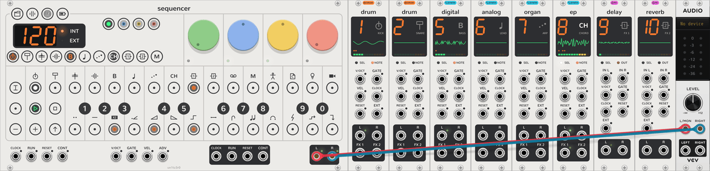
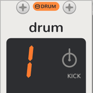
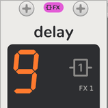

# vcvopxyz

<picture><source media="(prefers-color-scheme: dark)" srcset="docs/assets/guide/voices-dark.png"></picture>

## What is it?

An ode to the [Teenage Engineering OP-Z](https://teenage.engineering/products/op-z), this project is a [VCV Rack](http://vcvrack.com/) plugin that adds a set of modules and expanders which work together to bring the magic and fun of the OP-Z from your pocket into to your (virtual) eurorack modular system.

## What it is not

Rather than try and make a sample-perfect clone of each sound and FX engine, the goal was to build something similar *enough* to be instantly usable by anyone who is familiar with the original. What it lacks in sounding exactly like the hardware, it makes up for by allowing the sequencer tracks to be diverted to 1v/oct pitch and gate/trig outputs so that they can control chains of external modules whose output can then be routed back into the OP-Z's track-fx and mixer. 

#### This project is not affiliated with or endorsed by teenage engineering. OP-Z and OP-XY are their trademarks.

## Intros

These two documents will be helpful for those with no prior experience with the OP-Z or those with some experience who could use a reminder.

- [Beginner's Guide](docs/guide.md): steo-by-step instructions starting with an empty rack to making a simple loop, with screenshots, for those without any experience with the OP-Z.
- [Quickstart](docs/quickstart.md): a cheatsheet running down most of the core features for those with some OP-Z experience who just need a refresher to jog their memory.

To see some examples of music that can be made with this, then check out the example patches in [patches/](patches). 

## Modules

The **Sequencer** module is the master, with the rest of the modules in this plugin being expanders that are meant to be chained to the right of a Sequencer. The modules to its right are its tracks' voices, which are equivalent to the drum kits and synth and effects engines (which can be configured in slots through the OP-Z mobile app when connected to an OP-Z over bluetooth). There may be up to four drum tracks ("Kick", "Snare", "Hats", and "Perc/Misc"), four synth tracks ("Bass", "Lead", "Arp", and "Chords"), and two send effect tracks, plus a master track which does not bind to an expander but instead transposes the selected synth tracks in the song's detected scale. The expanders are assigned to the compatible tracks of the sequencer in the order they appear, showing the track number, symbol and name on their status screens. They also show when their track is selected for editing in the sequencer, and when there is note activity, showing the voice allocation and a pre-fader track vu meter at the bottom of the screen.

Each track engine/expander has inputs for triggering notes on the track externally, and for modulating it's engine specific parameters (the green and blue knobs on the track's first parameter page). The track engines also have stereo audio output in case you want to bypass the Sequencer's built-in mixer, and route individual tracks out to somewhere else. There are also the two effects sends, in case those should be useful, which will disable sending the track's audio to the Sequencer's send effect tracks. Note that the whole thing works just fine without patching any of the inputs or outputs on the engine modules, so long as they are part of a chain that starts with a Sequencer, they'll play through the sequencer's mixer and outputs if left unpatched.

The Sequencer has V/OCT, GATE and velocity inputs for recording notes, clock and transport inputs and outputs, and clocks itself when
no clock is patched, at a tempo set in its tempo mode as on the OP-Z. The tracks reach other modules through the
breakouts, not through cables from the Sequencer. New to it? Start with [your first sound](docs/guide.md).

| | Module | |
| --- | --- | --- |
| <picture><source media="(prefers-color-scheme: dark)" srcset="docs/assets/modules/Sequencer-label-dark.png"></picture> | [Sequencer](docs/sequencer.md) | The OP-Z's front panel: tempo, transport, eight tracks of 16 steps with micro timing, a master track that transposes them in the key it detects, an arpeggiator on the arp track, recording, [step components](docs/step-components.md), a mixer, 16 patterns per project with chains, and ten project slots that import and export the OP-Z's project files. |
| <picture><source media="(prefers-color-scheme: dark)" srcset="docs/assets/modules/Drum-label-dark.png"></picture> | [Drum](docs/drum-tracks.md) | The four drum tracks: 24 sounds a kit, synthesized or loaded from OP-1 and OP-Z kits, AIFF and WAV, with the drum note styles. |
| <picture><source media="(prefers-color-scheme: dark)" srcset="docs/assets/modules/Digital-label-dark.png"></picture> | [Digital](docs/synth-tracks.md#the-engines) | A sine driven past full scale so it wraps like an overflowing integer, with phase feedback. |
| <picture><source media="(prefers-color-scheme: dark)" srcset="docs/assets/modules/Analog-label-dark.png"></picture> | [Analog](docs/synth-tracks.md#the-engines) | Saw, sub and noise through an enveloped low-pass. |
| <picture><source media="(prefers-color-scheme: dark)" srcset="docs/assets/modules/Cluster-label-dark.png"></picture> | [Cluster](docs/synth-tracks.md#the-engines) | Seven detuned saws per note. |
| <picture><source media="(prefers-color-scheme: dark)" srcset="docs/assets/modules/Organ-label-dark.png"></picture> | [Organ](docs/synth-tracks.md#the-engines) | Drawbar FM organ in eight algorithms. |
| <picture><source media="(prefers-color-scheme: dark)" srcset="docs/assets/modules/Bow-label-dark.png"></picture> | [Bow](docs/synth-tracks.md#the-engines) | A bowed string waveguide, with a second string for chorus. |
| <picture><source media="(prefers-color-scheme: dark)" srcset="docs/assets/modules/Electric-label-dark.png"></picture> | [Electric](docs/synth-tracks.md#the-engines) | Two sines modulating each other, at any ratio from 0.5 to 4. |
| <picture><source media="(prefers-color-scheme: dark)" srcset="docs/assets/modules/Saw-label-dark.png"></picture> | [Saw](docs/synth-tracks.md#the-engines) | Two saws through an enveloped resonant low-pass. |
| <picture><source media="(prefers-color-scheme: dark)" srcset="docs/assets/modules/Shade-label-dark.png"></picture> | [Shade](docs/synth-tracks.md#the-engines) | A soft FM piano with detune and drive. |
| <picture><source media="(prefers-color-scheme: dark)" srcset="docs/assets/modules/Uranus-label-dark.png"></picture> | [Uranus](docs/synth-tracks.md#the-engines) | A clean sine bass with harmonics and feedback. |
| <picture><source media="(prefers-color-scheme: dark)" srcset="docs/assets/modules/Volt-label-dark.png"></picture> | [Volt](docs/synth-tracks.md#the-engines) | Saw, pulse and sub, with a width sweep and ring modulation. |
| <picture><source media="(prefers-color-scheme: dark)" srcset="docs/assets/modules/EP-label-dark.png"></picture> | [EP](docs/synth-tracks.md#the-engines) | FM electric piano in eight algorithms, from tines to a toy. |
| <picture><source media="(prefers-color-scheme: dark)" srcset="docs/assets/modules/Breakout-label-dark.png"></picture> | [Synth Breakout](docs/breakout.md) | A synth track that sends its notes, envelope, LFO and dials out as CV and takes its voice back in. |
| <picture><source media="(prefers-color-scheme: dark)" srcset="docs/assets/modules/DrumBreakout-label-dark.png"></picture> | [Drum Breakout](docs/breakout.md#drum-breakout) | A drum track that sends its triggers, sounds, velocity, envelope, LFO and dials out as CV and takes its sound back in. |
| <picture><source media="(prefers-color-scheme: dark)" srcset="docs/assets/modules/FxBreakout-label-dark.png"></picture> | [Send FX Breakout](docs/breakout.md#send-fx-breakout) | An FX track that sends its send, notes, time, LFO and dials out and takes an outside effect back in. |
| <picture><source media="(prefers-color-scheme: dark)" srcset="docs/assets/modules/Delay-label-dark.png"></picture> | [Delay, Reverb, Rymd, Chorus, Crush, Dist](docs/fx-tracks.md) | The OP-Z's send effects, on FX tracks 9 and 10: every engine's FX 1 and FX 2 sends reach them over the bus. |
| <picture><source media="(prefers-color-scheme: dark)" srcset="docs/assets/modules/Screen-label-dark.png"></picture> | [Screen](docs/screen.md) | Place this extender to the right of a drum or synth engine to see a waveform scope/envelope shape, voice allocation, and all of it's knob parameters pages at once. **Also allows editing drum kits** when placed next to a drum voice (click the "Kit" button in the top right corner). |

## Holding keys

Much of the OP-Z's features are accessed by holding a modifier key to temporarily switch the behavior of the other keys, or, in other words, key combinations. Since you can't click on more than one thing at a time (at least, not without a second mouse plugged in), we needed a workaround, so keys that can be held on the real OP-Z can be *latched* here, instead.

- **TRACK**, **REC** and the index keys switch on and off with a click
- a step or **SHIFT**, which also
do something on a click, latch with a long press or a Ctrl+click (⌘+click on a Mac)
- Either behavior can be turned off in the context menu.

The [quickstart](docs/quickstart.md) has complete descriptions of the recognized combinations and their equivalents on the real OP-Z.

## Further Reading

- [Your first sound](docs/guide.md): a walk from an empty rack to a beat, with screenshots.
- [Quickstart](docs/quickstart.md): the face, clicks and holds, modes and colours.
- [The manual](docs/README.md): every module, page and key.
- Installing: [Linux](INSTALL.linux.md), [macOS](INSTALL.macos.md) (Intel and Apple silicon),
  [Windows](INSTALL.windows.md).
- [Development](docs/development.md): building, releasing, the source tree and the panel generator.
- [DESIGN.md](DESIGN.md): how it fits together. [TODO.md](TODO.md): what's next.

## License

MIT, see [LICENSE](LICENSE). The Nunito font in `res-src/fonts` (SIL Open Font License) is used only to generate
panel artwork and isn't shipped with the plugin.
