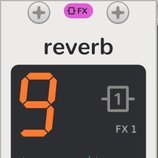
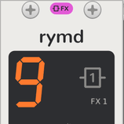
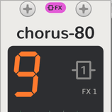
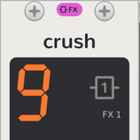
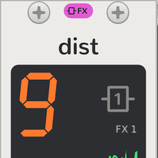

# vcvopxyz manual

<picture><source media="(prefers-color-scheme: dark)" srcset="assets/guide/voices-dark.png"></picture>

## Start here

- [Your first sound](guide.md): from an empty rack to a bassline, a beat and an echo, with the idea everything else
  rests on: the modules to the Sequencer's right are its tracks' voices.
- [Quickstart](quickstart.md): the face, clicks and holds, the modes and the colours on one page, and the OP-Z's
  combos side by side with the clicks here.

## Modules

| | Module | Plays | What it is |
| --- | --- | --- | --- |
| <picture><source media="(prefers-color-scheme: dark)" srcset="assets/modules/Sequencer-label-dark.png"></picture> | [Sequencer](sequencer.md) | Every track | The OP-Z's front panel and the master of the modules to its right: tempo, transport, eight tracks of 16 steps, [step components](step-components.md), parameter locks, recording, the mixer, the master track, 16 patterns with chains, and project slots. |
| <picture><source media="(prefers-color-scheme: dark)" srcset="assets/modules/Drum-label-dark.png"></picture> | [Drum](drum-tracks.md) | Tracks 1 to 4 | A drum track: a 24-sound kit, built in or loaded from OP-1 and OP-Z kits, AIFF and WAV, with the drum note styles. |
| <picture><source media="(prefers-color-scheme: dark)" srcset="assets/modules/Digital-label-dark.png"></picture> | [Digital](synth-tracks.md#the-engines) | Tracks 5 to 8 | A sine driven past full scale so it wraps like an overflowing integer, with phase feedback. |
| <picture><source media="(prefers-color-scheme: dark)" srcset="assets/modules/Analog-label-dark.png"></picture> | [Analog](synth-tracks.md#the-engines) | Tracks 5 to 8 | Saw, sub and noise through an enveloped low-pass. |
| <picture><source media="(prefers-color-scheme: dark)" srcset="assets/modules/Cluster-label-dark.png"></picture> | [Cluster](synth-tracks.md#the-engines) | Tracks 5 to 8 | Seven detuned saws per note. |
| <picture><source media="(prefers-color-scheme: dark)" srcset="assets/modules/Organ-label-dark.png"></picture> | [Organ](synth-tracks.md#the-engines) | Tracks 5 to 8 | Drawbar FM organ in eight algorithms. |
| <picture><source media="(prefers-color-scheme: dark)" srcset="assets/modules/Bow-label-dark.png"></picture> | [Bow](synth-tracks.md#the-engines) | Tracks 5 to 8 | A bowed string waveguide, with a second string for chorus. |
| <picture><source media="(prefers-color-scheme: dark)" srcset="assets/modules/Electric-label-dark.png"></picture> | [Electric](synth-tracks.md#the-engines) | Tracks 5 to 8 | Two sines modulating each other, at any ratio from 0.5 to 4. |
| <picture><source media="(prefers-color-scheme: dark)" srcset="assets/modules/Saw-label-dark.png"></picture> | [Saw](synth-tracks.md#the-engines) | Tracks 5 to 8 | Two saws through an enveloped resonant low-pass. |
| <picture><source media="(prefers-color-scheme: dark)" srcset="assets/modules/Shade-label-dark.png"></picture> | [Shade](synth-tracks.md#the-engines) | Tracks 5 to 8 | A soft FM piano with detune and drive. |
| <picture><source media="(prefers-color-scheme: dark)" srcset="assets/modules/Uranus-label-dark.png"></picture> | [Uranus](synth-tracks.md#the-engines) | Tracks 5 to 8 | A clean sine bass with harmonics and feedback. |
| <picture><source media="(prefers-color-scheme: dark)" srcset="assets/modules/Volt-label-dark.png"></picture> | [Volt](synth-tracks.md#the-engines) | Tracks 5 to 8 | Saw, pulse and sub, with a width sweep and ring modulation. |
| <picture><source media="(prefers-color-scheme: dark)" srcset="assets/modules/EP-label-dark.png"></picture> | [EP](synth-tracks.md#the-engines) | Tracks 5 to 8 | FM electric piano in eight algorithms, from tines to a toy. |
| <picture><source media="(prefers-color-scheme: dark)" srcset="assets/modules/Delay-label-dark.png"></picture> | [Delay](fx-tracks.md#delay) | FX 1 or 2 | A digital delay, its time set by notes in tempo. |
| <picture><source media="(prefers-color-scheme: dark)" srcset="assets/modules/Reverb-label-dark.png"></picture> | [Reverb](fx-tracks.md#reverb) | FX 1 or 2 | A plate, its predelay set by notes. |
| <picture><source media="(prefers-color-scheme: dark)" srcset="assets/modules/Rymd-label-dark.png"></picture> | [Rymd](fx-tracks.md#rymd) | FX 1 or 2 | The OP-Z's older reverb, a room. |
| <picture><source media="(prefers-color-scheme: dark)" srcset="assets/modules/Chorus-label-dark.png"></picture> | [Chorus-80](fx-tracks.md#chorus) | FX 1 or 2 | A bucket-brigade stereo chorus. |
| <picture><source media="(prefers-color-scheme: dark)" srcset="assets/modules/Crush-label-dark.png"></picture> | [Crush](fx-tracks.md#crush) | FX 1 or 2 | A bitcrusher with a low-pass after it. |
| <picture><source media="(prefers-color-scheme: dark)" srcset="assets/modules/Dist-label-dark.png"></picture> | [Dist](fx-tracks.md#dist) | FX 1 or 2 | An oversampled overdrive with a tone control. |
| <picture><source media="(prefers-color-scheme: dark)" srcset="assets/modules/Breakout-label-dark.png"></picture> | [Synth Breakout](breakout.md) | Tracks 5 to 8 | A synth track that sends its notes, envelope, LFO and dials out as CV and takes its voice back in. |
| <picture><source media="(prefers-color-scheme: dark)" srcset="assets/modules/DrumBreakout-label-dark.png"></picture> | [Drum Breakout](breakout.md#drum-breakout) | Tracks 1 to 4 | A drum track that sends its triggers, sounds, velocity, envelope, LFO and dials out and takes its sound back in. |
| <picture><source media="(prefers-color-scheme: dark)" srcset="assets/modules/FxBreakout-label-dark.png"></picture> | [Send FX Breakout](breakout.md#send-fx-breakout) | FX 1 or 2 | An FX track that sends its send, notes, time, LFO and dials out and takes an outside effect back in. |
| <picture><source media="(prefers-color-scheme: dark)" srcset="assets/modules/Screen-label-dark.png"></picture> | [Screen](screen.md) | Nothing | The OP-Z's phone app beside any of them: every page at once, every dial a touch arc, and a Drum's kit editor. |

The pages by kind: [Sequencer](sequencer.md), [step components](step-components.md), [synth tracks](synth-tracks.md),
[drum tracks](drum-tracks.md), [FX tracks](fx-tracks.md), [breakouts](breakout.md) and the [Screen](screen.md).

## Getting it running

- Installing: [Linux](../INSTALL.linux.md), [macOS](../INSTALL.macos.md) (Intel and Apple silicon),
  [Windows](../INSTALL.windows.md).
- [Development](development.md): building, releasing, the source tree, panels, the manual's pictures, and adding a
  module.

## Behind it

- [DESIGN.md](../DESIGN.md): how the modules fit together, and the choices made where the OP-Z guide is silent or
  where this plugin differs from it.
- [TODO.md](../TODO.md): what's next, and the loose ends.
