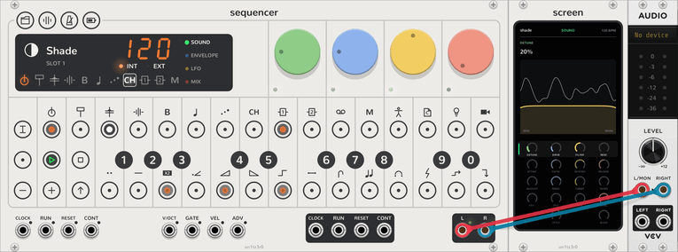
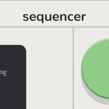
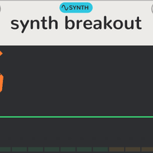
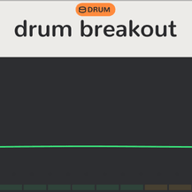
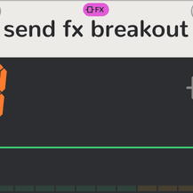
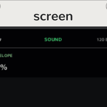

# vcvopxyz manual

<picture><source media="(prefers-color-scheme: dark)" srcset="assets/guide/band-dark.png"></picture>

## Where to start

Find yourself in the left column, and read the pages in order.

| You are | Read |
| --- | --- |
| New to the OP-Z and to VCV Rack | Install ([Linux](../INSTALL.linux.md), [macOS](../INSTALL.macos.md), [Windows](../INSTALL.windows.md)), [How it works](how-it-works.md), [Your first sound](guide.md), [Breakouts](breakout.md) |
| A VCV user, new to the OP-Z | [How it works](how-it-works.md), [Your first sound](guide.md), [Quickstart](quickstart.md), [Breakouts](breakout.md) |
| An OP-Z owner | [Quickstart](quickstart.md) and its [table for OP-Z owners](quickstart.md#for-op-z-owners), [How it works](how-it-works.md), [Breakouts](breakout.md) |

[How it works](how-it-works.md) has a [glossary](how-it-works.md#glossary) of every term.

## Modules

| | Module | Plays | What it is |
| --- | --- | --- | --- |
| <picture><source media="(prefers-color-scheme: dark)" srcset="assets/modules/Sequencer-label-dark.png"></picture> | [Sequencer](sequencer.md) | Every track | The OP-Z: its face, its tracks and every sound. Steps, [step components](step-components.md), recording, the mixer, patterns and projects. |
| <picture><source media="(prefers-color-scheme: dark)" srcset="assets/modules/Breakout-label-dark.png"></picture> | [Synth Breakout](breakout.md) | Tracks 5 to 8 | Takes a synth track's sound out, or sends its notes and CVs out and takes your voice in. |
| <picture><source media="(prefers-color-scheme: dark)" srcset="assets/modules/DrumBreakout-label-dark.png"></picture> | [Drum Breakout](breakout.md#drum-breakout) | Tracks 1 to 4 | Takes a drum track's sound out, or sends its triggers and CVs out and takes your drums in. |
| <picture><source media="(prefers-color-scheme: dark)" srcset="assets/modules/FxBreakout-label-dark.png"></picture> | [Send FX Breakout](breakout.md#send-fx-breakout) | FX 1 or 2 | Takes an FX track's effect out, or sends its send and CVs out and takes your effect in. |
| <picture><source media="(prefers-color-scheme: dark)" srcset="assets/modules/Screen-label-dark.png"></picture> | [Screen](screen.md) | Nothing | Shows the selected track's pages and dials, like the OP-Z's phone app, and edits a drum track's kit. |

## Plugs

A track's sound is its **plug**: a kit, an engine or an effect. Each track has ten plug slots. Latch **TRACK** and
click a black key to choose one. The Sequencer's context menu, **Plug slots**, fills them.

| | Plug | Tracks | |
| --- | --- | --- | --- |
| <picture><source media="(prefers-color-scheme: dark)" srcset="assets/plugs/Drum-dark.png"></picture> | [Kits](kits.md) | Tracks 1 to 4 | 24 sounds a kit: the OP-Z's own, sampled, the built-in ones, or loaded from OP-1 and OP-Z kits, AIFF and WAV. |
| <picture><source media="(prefers-color-scheme: dark)" srcset="assets/plugs/Digital-dark.png"></picture> | [Digital](synth-tracks.md#the-engines) | Tracks 5 to 8 | A sine driven past full scale so it wraps like an overflowing integer, with phase feedback. |
| <picture><source media="(prefers-color-scheme: dark)" srcset="assets/plugs/Analog-dark.png"></picture> | [Analog](synth-tracks.md#the-engines) | Tracks 5 to 8 | Saw, sub and noise through an enveloped low-pass. |
| <picture><source media="(prefers-color-scheme: dark)" srcset="assets/plugs/Cluster-dark.png"></picture> | [Cluster](synth-tracks.md#the-engines) | Tracks 5 to 8 | Seven detuned saws per note. |
| <picture><source media="(prefers-color-scheme: dark)" srcset="assets/plugs/Organ-dark.png"></picture> | [Organ](synth-tracks.md#the-engines) | Tracks 5 to 8 | Drawbar FM organ in eight algorithms. |
| <picture><source media="(prefers-color-scheme: dark)" srcset="assets/plugs/Bow-dark.png"></picture> | [Bow](synth-tracks.md#the-engines) | Tracks 5 to 8 | A bowed string waveguide, with a second string for chorus. |
| <picture><source media="(prefers-color-scheme: dark)" srcset="assets/plugs/Electric-dark.png"></picture> | [Electric](synth-tracks.md#the-engines) | Tracks 5 to 8 | Two sines modulating each other, at any ratio from 0.5 to 4. |
| <picture><source media="(prefers-color-scheme: dark)" srcset="assets/plugs/Saw-dark.png"></picture> | [Saw](synth-tracks.md#the-engines) | Tracks 5 to 8 | Two saws through an enveloped resonant low-pass. |
| <picture><source media="(prefers-color-scheme: dark)" srcset="assets/plugs/Shade-dark.png"></picture> | [Shade](synth-tracks.md#the-engines) | Tracks 5 to 8 | A soft FM piano with detune and drive. |
| <picture><source media="(prefers-color-scheme: dark)" srcset="assets/plugs/Uranus-dark.png"></picture> | [Uranus](synth-tracks.md#the-engines) | Tracks 5 to 8 | A clean sine bass with harmonics and feedback. |
| <picture><source media="(prefers-color-scheme: dark)" srcset="assets/plugs/Volt-dark.png"></picture> | [Volt](synth-tracks.md#the-engines) | Tracks 5 to 8 | Saw, pulse and sub, with a width sweep and ring modulation. |
| <picture><source media="(prefers-color-scheme: dark)" srcset="assets/plugs/EP-dark.png"></picture> | [EP](synth-tracks.md#the-engines) | Tracks 5 to 8 | FM electric piano in eight algorithms, from tines to a toy. |
| <picture><source media="(prefers-color-scheme: dark)" srcset="assets/plugs/Delay-dark.png"></picture> | [Delay](fx-tracks.md#delay) | FX 1 or 2 | A digital delay, its time set by notes in tempo. |
| <picture><source media="(prefers-color-scheme: dark)" srcset="assets/plugs/Reverb-dark.png"></picture> | [Reverb](fx-tracks.md#reverb) | FX 1 or 2 | A plate, its predelay set by notes. |
| <picture><source media="(prefers-color-scheme: dark)" srcset="assets/plugs/Rymd-dark.png"></picture> | [Rymd](fx-tracks.md#rymd) | FX 1 or 2 | The OP-Z's older reverb, a room. |
| <picture><source media="(prefers-color-scheme: dark)" srcset="assets/plugs/Chorus-dark.png"></picture> | [Chorus-80](fx-tracks.md#chorus) | FX 1 or 2 | A bucket-brigade stereo chorus. |
| <picture><source media="(prefers-color-scheme: dark)" srcset="assets/plugs/Crush-dark.png"></picture> | [Crush](fx-tracks.md#crush) | FX 1 or 2 | A bitcrusher with a low-pass after it. |
| <picture><source media="(prefers-color-scheme: dark)" srcset="assets/plugs/Dist-dark.png"></picture> | [Dist](fx-tracks.md#dist) | FX 1 or 2 | An oversampled overdrive with a tone control. |

## Every page

- Start: [How it works](how-it-works.md), [Your first sound](guide.md), [Quickstart](quickstart.md).
- The Sequencer: [Sequencer](sequencer.md), [step components](step-components.md).
- The plugs: [synth tracks](synth-tracks.md), [drum tracks](drum-tracks.md), [kits](kits.md),
  [FX tracks](fx-tracks.md).
- The other modules: [breakouts](breakout.md), [Screen](screen.md).
- Installing: [Linux](../INSTALL.linux.md), [macOS](../INSTALL.macos.md) (Intel and Apple silicon),
  [Windows](../INSTALL.windows.md).
- Contributing: [Development](development.md), [how the manual is written](STYLE.md),
  [DESIGN.md](../DESIGN.md) and [TODO.md](../TODO.md).
