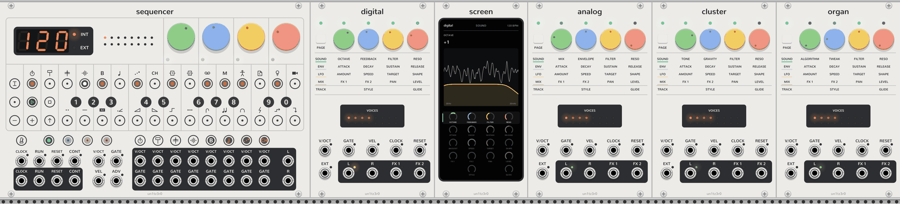

# vcvopxyz manual

<picture>
  <source media="(prefers-color-scheme: dark)" srcset="assets/rack-dark.png">
  
</picture>

## Modules

| Page | What it covers |
| --- | --- |
| [Sequencer](sequencer.md) | The OP-Z's front panel and the master of the modules to its right: tempo, transport, eight tracks of 16 steps, recording. |
| [Step components](step-components.md) | The Sequencer's 14 per-step modifiers: pulses, ratchets, ramps, glides, sweeps, jumps and sparks. |
| [Synth tracks](synth-tracks.md) | What every synth engine shares (pages, note styles, LFO, jacks), then Digital, Analog, Cluster and Organ. |
| [Breakout](breakout.md) | A synth track whose voice is made of other modules. |
| [Screen](screen.md) | The OP-Z's phone app, as an expander. |

## Getting it running

- Installing: [Linux](../INSTALL.linux.md), [macOS](../INSTALL.macos.md) (Intel and Apple silicon),
  [Windows](../INSTALL.windows.md).
- [Development](development.md): building, releasing, the source tree, panels, and adding a module.

## Behind it

- [DESIGN.md](../DESIGN.md): how the modules fit together, and the choices made where the OP-Z guide is silent.
- [TODO.md](../TODO.md): what's next, and what's still waiting on an answer.

## A first patch

1. Add a **Sequencer**, then a **Digital** directly to its right. No cables: Digital plays track 5 (bass).
2. Patch the Sequencer's **L** and **R** to an audio interface or mixer.
3. Click the bass track's key under the face, play the round keys to hear it, and click steps to paste the last
   notes played into them.
4. Click **PLAY**. Add Analog, Cluster or Organ to the right of Digital for tracks 6, 7 and 8, and a Screen beside
   any engine to see its pages.
