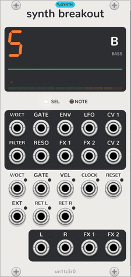
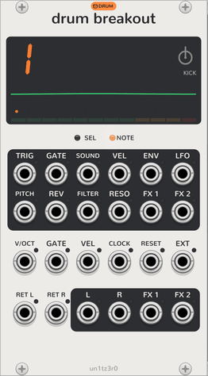
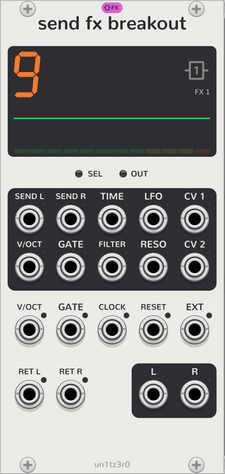

# Breakouts

<picture><source media="(prefers-color-scheme: dark)" srcset="assets/guide/breakout-dark.png"></picture>

A breakout gives one of the [Sequencer](sequencer.md)'s tracks jacks, so that other modules can use it. A breakout
makes no sound itself. Put it in the Sequencer's [row](how-it-works.md#the-row). There is one breakout for each kind
of track:

| | Breakout | Takes | Width |
| --- | --- | --- | --- |
| <picture><source media="(prefers-color-scheme: dark)" srcset="assets/modules/Breakout-label-dark.png"></picture> | [Synth Breakout](#synth-breakout) | One of tracks 5 to 8 | 12 HP |
| <picture><source media="(prefers-color-scheme: dark)" srcset="assets/modules/DrumBreakout-label-dark.png"></picture> | [Drum Breakout](#drum-breakout) | One of tracks 1 to 4 | 14 HP |
| <picture><source media="(prefers-color-scheme: dark)" srcset="assets/modules/FxBreakout-label-dark.png"></picture> | [Send FX Breakout](#send-fx-breakout) | FX 1 or FX 2 | 12 HP |

[Your first patch](patching.md) uses a Synth Breakout step by step.

## Two ways out

The jacks that you patch decide what a breakout does.

- **Audio out:** patch **L** and **R**, or **L** alone for mono. The track's sound goes to these jacks, not to the
  Sequencer's mix. Use this for your own effects, mixer or recorder.
- **A sound from outside:** patch **RET L**, and **RET R** for stereo. The track's plug stops, and the sound at these
  jacks replaces it. Your modules make this sound from the breakout's note outputs.

The return goes through the track as the plug's sound does: its envelope, filter, level, pan and FX sends, and the
mixer. The display shows **Breakout** in place of the plug. Remove the cables from **RET L** and **RET R**, and the
plug plays again.

The note outputs are **V/OCT** and **GATE** on a Synth Breakout, and **TRIG** and **GATE** on a Drum Breakout. A
Send FX Breakout has **SEND L** and **SEND R**. These outputs work with or without a return. With no return, the plug
plays, and your modules can play the same notes with it.

You can use the two ways together. The return then goes out of **L** and **R**, not to the mix.

## Common to the three breakouts

### The track

The context menu's **Track** chooses the track. **Auto**, the default, takes the first track of its kind that no
breakout to its left has. Thus two Synth Breakouts take tracks 5 (bass) and 6 (lead). A track that you choose by number
is the breakout's own, unless a breakout to its left has it already.

While a breakout has a track, the track's key on the Sequencer's display shows a small jack.

### The panel

- **The screen** shows the track's number as a big digit, beside the track's icon. The icon lights white while the
  Sequencer has the track selected. A dash shows that the breakout has no track.
- Under the number are a scope of the track's sound, a dot for each voice, and a level meter. The meter goes green,
  then yellow, then red as the sound reaches the soft limit.
- **SEL** lights while the Sequencer has the track selected. **NOTE** (**OUT** on a Send FX Breakout) lights while
  the track plays.
- Each jack has a light that shows its level. It turns red above 10 V.

A breakout has no dials. The Sequencer's dials change the track, and a [Screen](screen.md) shows them all. Parameter
locks, step components, presets and patterns work on the track as on any other.

### Each output takes one stage

While a return is patched, some outputs do a job that the track then stops doing itself.

- **ENV** patched: the track does not envelope the return.
- **FILTER** or **RESO** patched: the track does not filter the return.
- **LFO** patched: the LFO moves nothing inside the track.

With no return, the plug plays as usual. These outputs then only give a copy of the envelope, a dial or the LFO.

The **FX 1** and **FX 2** audio outputs (synth and drum) always take the track's send. It goes to the jack, not to the
FX track. The level and the pan always apply. **RET R** takes the signal of **RET L** while nothing is patched to it.

### Inputs

- **V/OCT**, **GATE** and **VEL:** with **GATE** patched, these polyphonic inputs play the track in place of its steps
  and keys.
- **CLOCK:** sets the LFO's synced speeds, at 4 pulses for each beat.
- **RESET:** starts the LFO again.
- **EXT:** the External LFO shape follows it, ±5 V. On a track with no breakout, that shape does not move.

## Synth Breakout

<picture><source media="(prefers-color-scheme: dark)" srcset="assets/modules/Breakout-large-dark.png"></picture>

A Synth Breakout gives a [synth track](synth-tracks.md) jacks. Its slug is `Breakout`, its name before version 2.0.21,
so that old patches find it.

| Output | Gives |
| --- | --- |
| **V/OCT**, **GATE**, **ENV** | One channel for each voice, or one in mono and legato. **V/OCT** includes the glide and the LFO's pitch. |
| **LFO** | The LFO after its amount, ±5 V. |
| **CV 1**, **CV 2** | The sound page's two engine dials, 0 to 10 V, with the LFO. |
| **FILTER**, **RESO**, **FX 1**, **FX 2** | The dials of those names, 0 to 10 V, with the LFO. |
| **L**, **R** | The track's sound, in place of the mix. |

The track envelopes a polyphonic return one channel for each voice. It envelopes a mono return by the loudest voice.

## Drum Breakout

<picture><source media="(prefers-color-scheme: dark)" srcset="assets/modules/DrumBreakout-large-dark.png"></picture>

A Drum Breakout gives a [drum track](drum-tracks.md) jacks, so that other modules can make its drums. The note styles
and keys work as with a kit.

| Output | Gives |
| --- | --- |
| **TRIG** | A 1 ms trigger as each note starts. One channel for each note. |
| **GATE** | High while each note plays. |
| **SOUND** | Which of the 24 sounds the note's key chooses: 1/12 V for each sound, from 0 V for the first (F3). |
| **VEL** | The note's velocity, 0 to 10 V. |
| **ENV** | The envelope, times the velocity, 0 to 10 V. |
| **PITCH** | The pitch dial as V/OCT, ±1 V, with the LFO's pitch. One channel. |
| **REV** | 10 V while reverse is on. One channel. |
| **LFO**, **FILTER**, **RESO**, **FX 1**, **FX 2** | As on a Synth Breakout. |

Each note of a step has its own channel. The **mono** note style puts every note on the first channel. In retrig and
mono, the envelope stays open at the sustain level, so the outside sound ends itself. In gate and loop, the envelope
releases with the note.

### Drums from outside

1. Patch **TRIG** to a drum module's trigger input, or **GATE** to its gate input. The kit still plays.
2. Patch the drum module's output to **RET L**. The kit stops, and the track's steps, components and locks play the
   drum module.
3. For a sampler that chooses its sample by V/OCT, patch **SOUND** to that input. Each key now plays the next sample.
4. Patch **VEL** to an accent or velocity input, and **PITCH** to the tuning input.

## Send FX Breakout

<picture><source media="(prefers-color-scheme: dark)" srcset="assets/modules/FxBreakout-large-dark.png"></picture>

A Send FX Breakout gives an [FX track](fx-tracks.md) jacks, so that other modules can make its effect.

| Output | Gives |
| --- | --- |
| **SEND L**, **SEND R** | What the tracks send the FX track, ±5 V, after the LFO's send target. |
| **TIME** | The time that the keys set, as on the Delay, at 1 V for each second, after the LFO's time target. |
| **V/OCT**, **GATE** | The track's notes, one channel each. |
| **LFO** | The LFO, ±5 V. |
| **CV 1**, **CV 2**, **FILTER**, **RESO** | The dials, 0 to 10 V. |
| **L**, **R** | The track's own effect, in place of the mix. |

**RET L** and **RET R** replace the track's own effect. They return through the track's filter, unless **FILTER** or
**RESO** is patched. They then go into the mix at the track's level. With **GATE** patched, the **V/OCT** and
**GATE** inputs set the time in place of the track's notes.

### An effect from outside

1. Patch **SEND L** and **SEND R** to a delay or reverb. The track's own effect still plays.
2. Patch its outputs to **RET L** and **RET R**. The track's own effect stops.
3. Raise a track's **FX 1** or **FX 2** send. The effect returns to the mix, as the built-in effects do.
4. Patch **TIME** to the effect's time input, scaled to suit. The track's keys and steps now set the time in tempo.
5. Patch **CV 1** and **CV 2** to two of its controls. The Sequencer's dials, a Screen and locks now change them.
