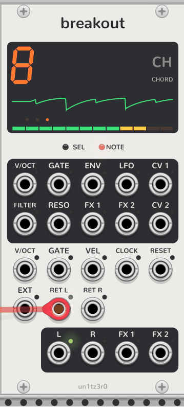
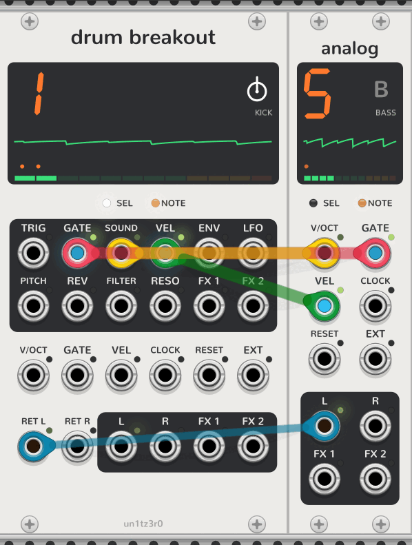

# Breakout and Drum Breakout

<picture>
  <source media="(prefers-color-scheme: dark)" srcset="assets/breakout-dark.png">
  
</picture>

A [synth track](synth-tracks.md) whose voice is made of other modules. It is 12 HP and has everything an engine has,
plus a dark box of outputs at the top that send the track out, and **RET L** and **RET R** to take the sound back in. It takes
its track from a Sequencer to its left like any engine.

- **Out:** **V/OCT**, **GATE** and **ENV** are polyphonic, a channel per voice (one in mono and legato), with the
  glide and the LFO's pitch in V/OCT. **LFO** is the LFO after its amount, ±5V. **CV 1** and **CV 2** are the sound
  page's dials, and **FILTER**, **RESO**, **FX 1** and **FX 2** the dials of those names, all 0 to 10V, with the LFO.
- **Return:** whatever goes out, the track stops doing itself. With **ENV** patched the return isn't enveloped; with
  **FILTER** or **RESO** patched it isn't filtered; with an **FX** amount patched, that **FX** output carries the
  full signal for an outside VCA; with **LFO** patched, the LFO moves nothing inside. Level and pan always apply.
- **Envelope:** a polyphonic return is enveloped channel by channel, one voice each; a mono one by the loudest
  voice. **RET R** is normalled to **RET L**.

## A voice from outside

1. Patch **V/OCT** to a VCO's V/OCT, and the VCO's output to **RET L**. The track's envelope, filter and mix now
   shape the VCO.
2. Patch **FILTER** and **RESO** to an outside filter's cutoff and resonance CV, and put that filter between the VCO
   and **RET L**. The inside filter switches off.
3. Patch **ENV** to an outside VCA's CV and put it in the chain too. The inside envelope switches off, and the
   track is now only level and pan around your own voice.

## Drum Breakout

<picture>
  <source media="(prefers-color-scheme: dark)" srcset="assets/drum-breakout-dark.png">
  
</picture>

A [drum track](drum-tracks.md) whose sounds are made of other modules, as Breakout is for a synth track. It is 14 HP
and takes one of tracks 1 to 4 like a Drum, with the same dials, note styles and keys. Its return works exactly as
Breakout's does: whatever goes out, the track stops doing itself.

- **Out, a channel per note:** **TRIG** is a 1 ms trigger as each note starts, and **GATE** is high while it's held.
  **SOUND** is which of the 24 sounds its key picks, 1/12V a sound from 0V for the first (F3), the way a V/OCT
  input steps through samples. **VEL** is the velocity and **ENV** the envelope, times the velocity, 0 to 10V. Each
  of the notes a step plays keeps its own channel; **mono** puts them all on the first.
- **Out, one channel:** **PITCH** is the pitch dial as V/OCT, ±1V, with the LFO's pitch target added. **REV** is
  10V while reverse is on. **LFO**, **FILTER**, **RESO**, **FX 1** and **FX 2** are as on Breakout.
- **Envelope:** retrig and mono leave it open at the sustain level (all the way, by default), for the sound outside
  to end itself; gate and loop release it with the note.

### Drums from outside

1. Patch **TRIG** to a drum module's trigger input, or **GATE** to a gate input, and its output to **RET L**. The track's level, pan, filter and
   FX sends now carry it, and its steps, components and parameter locks play it.
2. For a sampler that picks its sample by V/OCT, patch **SOUND** to that input: each key plays the next sample.
3. Patch **VEL** to an accent or velocity input, and **PITCH** to its tuning, so the Sequencer's pitch dial and LFO
   reach it.
