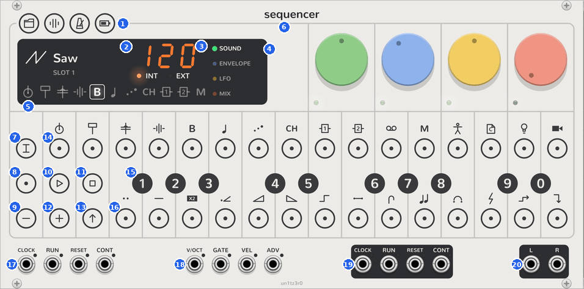

# Controls

This page names each part of the Sequencer's face, and lists the gestures, the modes and the colours. Each row links
to the page that tells more. The [quickstart](quickstart.md) is a short tour of the same controls.

<picture><source media="(prefers-color-scheme: dark)" srcset="assets/keys/face-numbered-dark.png"></picture>

## The parts

| | Part | What it does | More |
| --- | --- | --- | --- |
| 1 | **PROJECT**, **MIXER**, **TEMPO**, **SCREEN** | The index keys. The first three latch a mode. SCREEN shows the battery while you hold it. | [Modes](#modes) |
| 2 | The plug readout | Shows the selected track's plug, with its icon, its plug slot and its preset. | [Track](track.md#plugs) |
| 3 | The tempo readout | Shows the tempo. **INT** lights for the Sequencer's own clock, and **EXT** for a clock at the **CLOCK** input. | [Tempo](tempo.md) |
| 4 | The pages | Sound, envelope, LFO and mix. Click one to give the dials that page. | [Track](track.md#pages) |
| 5 | The track keys | One key for each track: 1 to 8, FX 1, FX 2, then the master track. Click one to select its track. | [Track](track.md#select-a-track) |
| 6 | The dials | Green, blue, yellow and red. They change the selected track's sound, on the page shown. | [Track](track.md#pages) |
| 7 | **TRACK** | Latches track mode: plugs, presets and the track's settings. | [Track](track.md#track-mode) |
| 8 | **REC** | Latches recording. In track mode, it makes a random sound. | [Steps](steps.md#record) |
| 9 | **−** | Moves the keyboard down an octave. It also has other jobs in some modes. | [Steps](steps.md#play-the-keys) |
| 10 | **PLAY** | Starts the patterns from step 1. In project mode, it starts and ends a chain. | [Sequencer](sequencer.md#transport) |
| 11 | **STOP** | Stops. Hold it for a second to clear. | [Steps](steps.md#clear) |
| 12 | **+** | Moves the keyboard up an octave. It also has other jobs in some modes. | [Steps](steps.md#play-the-keys) |
| 13 | **SHIFT** | A click changes the page. A long press latches it. | [Clicks, latches and holds](#clicks-latches-and-holds) |
| 14 | The steps | The selected track's 16 steps. In some modes, they choose a track, a pattern or a mute. | [Steps](steps.md) |
| 15 | The black keys | Ten keys, numbered 1 to 0. They play notes, and choose values such as a plug slot. | [Steps](steps.md#play-the-keys) |
| 16 | The white keys | Fourteen keys. They play notes, and choose step components and presets. | [Step components](step-components.md) |
| 17 | **CLOCK**, **RUN**, **RESET**, **CONT** in | The transport inputs. | [Sequencer](sequencer.md#jacks) |
| 18 | **V/OCT**, **GATE**, **VEL**, **ADV** in | Notes to play and record, and a trigger that moves the steps. | [Sequencer](sequencer.md#jacks) |
| 19 | **CLOCK**, **RUN**, **RESET**, **CONT** out | The transport outputs. | [Sequencer](sequencer.md#jacks) |
| 20 | **L** and **R** | The mix of every track. | [Mixer](mixer.md) |

Hover over a key, dial or jack to see its tooltip. The tooltip gives its name and its job now.

## Clicks, latches and holds

On the OP-Z, you hold one key and press another. A mouse clicks one key at a time. Thus a key that you hold on the
OP-Z **latches** here: it stays on after you release the mouse button.

| Gesture | Keys | Result |
| --- | --- | --- |
| Click | Every key | Presses the key. |
| Click to latch, click to release | **TRACK**, **REC**, **PROJECT**, **MIXER**, **TEMPO** | Latches a mode. A mode switches the other modes off. REC stays as it is. |
| Long press (0.4 s), or Ctrl+click (⌘+click on a Mac) | A step, **SHIFT** | Latches the key. A plain click on these keys does a different job. |
| Long press, or Ctrl+click | A white key in track mode, a black or white key in project mode | Stores a preset, a project or a chain. |
| Hold the mouse button down | **SCREEN**, and **STOP** for a second | Works only while you hold it. |
| Double-click | A dial | Removes a step's parameter lock, or resets the dial. |
| Right-click | A step | Opens its menu: velocity, micro timing, length and locks. |

The Sequencer's context menu has **Long-press toggles hold** and **Ctrl-click toggles hold**. Clear one to stop
that gesture from latching keys.

## Modes

**TRACK**, **PROJECT**, **MIXER** and **TEMPO** are one mode at a time. **SHIFT**, a latched step and **REC** work
alone or with a mode. With no mode, the steps show the selected track's pattern and the keys play it.

| Mode | Lit | The steps | The keys | The dials |
| --- | --- | --- | --- | --- |
| None | | The pattern. Click an empty step to paste the last notes, or a lit step to clear it. | Play the track. | The track's sound, on the page shown. |
| [Track](track.md#track-mode) | <picture><source media="(prefers-color-scheme: dark)" srcset="assets/keys/track-track-dark.png"></picture> | Select a track. | Black: plug slots. White: presets. | Note length, note style, quantize, portamento. |
| [Track](track.md#step-count-and-step-length) and **SHIFT** | | Set the step count. | Black: step length. | |
| [Project](project.md) | <picture><source media="(prefers-color-scheme: dark)" srcset="assets/keys/project-project-dark.png"></picture> | Play a pattern. | Black: project slots. White: saved chains. | |
| [Mixer](mixer.md) | <picture><source media="(prefers-color-scheme: dark)" srcset="assets/keys/mixer-mixer-dark.png"></picture> | Mute a track. With **SHIFT**, mute only its sound. | Black: mute groups. | Drum level, synth level, punch, master level. |
| [Tempo](tempo.md) | <picture><source media="(prefers-color-scheme: dark)" srcset="assets/keys/metronome-tempo-dark.png"></picture> | | Black: type a tempo. White: tap a tempo. | Tempo, swing, metronome sound, metronome level. |
| [**SHIFT** latched](step-components.md) | <picture><source media="(prefers-color-scheme: dark)" srcset="assets/keys/shift-shift-dark.png"></picture> | Choose steps for step components. | White: a component. Black: its value. | |
| [A step latched](steps.md#latch-a-step) | <picture><source media="(prefers-color-scheme: dark)" srcset="assets/keys/step0-held-dark.png"></picture> | Click a later step to set the note length. | Add and remove the step's notes. | The step's parameter locks. |
| [**REC**](steps.md#record) | <picture><source media="(prefers-color-scheme: dark)" srcset="assets/keys/rec-rec-dark.png"></picture> | Stopped: the step to record into. | Notes to record. | Playing: turns to record as locks. |

## Colours

The keys keep the OP-Z's colours. On a step:

| Colour | Meaning |
| --- | --- |
| Orange | The step has notes. A dim orange step is past the step count, so the track does not play it. |
| White | The playhead. In track mode, the selected track. In project mode, the pattern that plays. |
| Red | The playhead while you record. A sound mute in mixer mode. A clear, as it fills. |
| Blue | How long the latched step's notes last. On the black keys in track mode with **SHIFT**, the step length. |
| Green | A step with step components. The rest of a chain. The battery. |
| Blinking | A latched step, or a step that you chose for step components. |

The track keys on the display have their own colours:

- A white outline shows the selected track.
- Orange shows how loud the track plays now.
- Cyan flashes at each note.
- A small jack shows that a [breakout](breakout.md) has the track.

The page names light in their colours, and the small lights under the dials follow. A dial's light turns white while
a latched step locks it.
