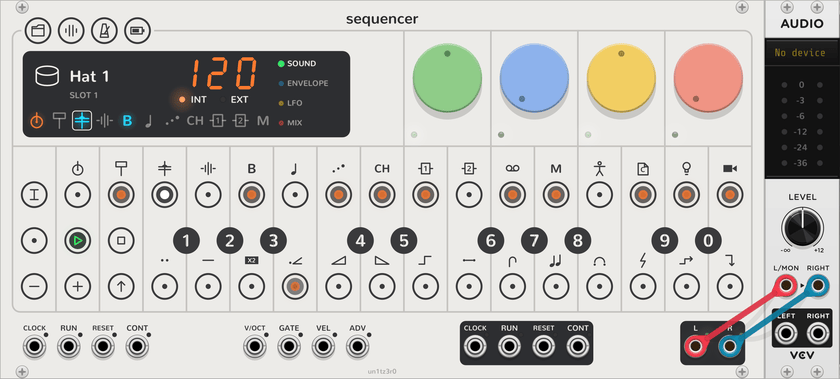

# Drum tracks

<picture><source media="(prefers-color-scheme: dark)" srcset="assets/guide/drums-dark.png"></picture>

Tracks 1 (kick), 2 (snare), 3 (perc) and 4 (sample) are the drum tracks. Each plays a **kit** of 24 sounds, its
[plug](track.md#plugs). A drum track works as a [synth track](synth-tracks.md) does, with the same LFO, presets and
parameter locks. This page gives only the differences. [Kits](kits.md) tells where kits come from. To play a drum
track on other modules, use a [Drum Breakout](breakout.md#drum-breakout).

## Keys and plug slots

- **Keys:** F3 to E5, the keys at their home octave, play the 24 sounds in turn. The octaves above and below play
  them again. A key's tooltip names its sound.
- **Plug slots:** a new Sequencer gives each drum track the OP-Z kits sampled for it, then its built-in kit. The kick
  track has Kick 1 to 4, the snare track Snare 1 to 4, and the perc track Hat 1 to 5. The sample track has only its
  built-in kit.
- **A new kit** plays from the next note. It keeps the track's dials as they are.

## Pages

| Page | Green | Blue | Yellow | Red |
| --- | --- | --- | --- | --- |
| Sound | **Pitch**: ±12 semitones, for every sound | **Reverse**: off on the left half, on on the right half | **Filter** | **Reso** |
| Envelope | **Attack** | **Decay** | **Sustain** | **Release** |
| LFO | **Amount** | **Speed** | **Target** | **Shape** |
| Mix | **FX 1** | **FX 2** | **Pan** | **Level** |
| Track mode | Note length | **Style** | Quantize | |

- The envelope starts at full sustain and a release of 40 ms.
- The LFO targets are pitch, reverse, filter, resonance, attack, pitch (up to two octaves each way), pan and volume.
- Drum tracks have no glide.

## Note styles

| Style | Each sound |
| --- | --- |
| **Retrig** | Plays to its end, and its tail rings under the next sound. |
| **Mono** | Stops the last sound with a 3 ms fade. One sound plays at a time. |
| **Gate** | Stops with its note: the envelope releases when the note ends. The note length sets how much plays. |
| **Loop** | Repeats while its note plays, then plays to its end as the envelope releases. |

In retrig, as many sounds ring at once as the track has voices, and at least two. Past that, the oldest stops.

In retrig and mono, the release never starts, because each sound plays to its end. Use the attack, decay and sustain
to shape it. A kit file's sounds can be set to gate or loop. They then play that way in every note style.
