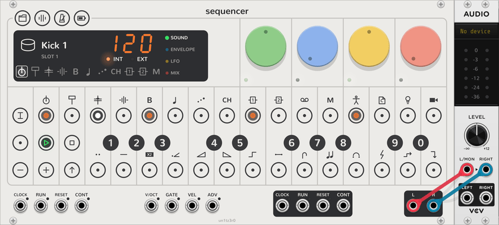

# Drum tracks

<picture><source media="(prefers-color-scheme: dark)" srcset="assets/guide/drum-dark.png"></picture>

Tracks 1 to 4, kick, snare, perc and sample, are the OP-Z's drum tracks. Each plays a **kit** of 24 sounds, one per
key, picked from its ten slots with **TRACK** and a black key, as a synth track picks an engine. They are the same
tracks as the [synth tracks](synth-tracks.md), with the same pages, LFO, presets and parameter locks; this page covers
only where they differ. The kits themselves, the OP-Z's, the built-in ones and your own, are on [their own
page](kits.md). To play a drum track on other modules, use a [Drum Breakout](breakout.md#drum-breakout).

## Keys and slots

- **Keys:** F3 to E5, the Sequencer's keys at their home octave, play the 24 sounds in turn, and the octaves either
  side play them again. A key's tooltip names its sound.
- **Slots:** a new Sequencer gives each drum track the OP-Z kits sampled for it, then its built-in kit: Kick 1 to 4
  on the kick track, Snare 1 to 4 on the snare, Hat 1 to 5 on the perc, and the built-in kit alone on the sample
  track. The context menu's **Plug slots** puts another kit in any slot, or loads one from a file.
- **Switching:** a new kit plays from the next note, and leaves the track's dials as they are.

## Pages

| Page | Dials |
| --- | --- |
| Sound (green) | **Pitch** (±12 semitones, every sound), **Reverse** (off to the left, on to the right), **Filter**, **Reso** |
| Envelope (blue) | **Attack**, **Decay**, **Sustain**, **Release**, starting at full sustain and a 40 ms release |
| LFO (yellow) | As a synth track's, with these targets: pitch, reverse, filter, resonance, attack, pitch (±2 octaves), pan, volume |
| Mix (red) | As a synth track's |
| Track (white) | **Style** (retrig, mono, gate, loop) on the second dial; drums have no portamento |

## Note styles

- **Retrig** plays each sound to its end, and its tail rings on under the next. As many sounds ring at once as the
  track has channels, and at least two, as on the OP-Z; past that, the oldest is cut off.
- **Mono** plays one sound at a time, cutting the last one off with a 3 ms fade.
- **Gate** stops each sound with its note: the envelope releases when the note ends, so the step's note length sets
  how much plays.
- **Loop** repeats each sound while its note is held, then plays it out to its end as the envelope releases.

In retrig and mono the envelope's release never starts, since a sound plays to its end: attack, decay and sustain
shape it. The Sequencer gives each drum track two channels to begin with, so two sounds on one step play together. A
kit file's own slices can set gate or loop, and play that way whatever the note style.
