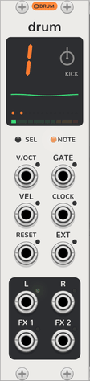

# Drum tracks

<picture><source media="(prefers-color-scheme: dark)" srcset="assets/modules/Drum-large-dark.png"></picture>

**Drum** is the OP-Z's drum track: a kit of 24 sounds, one per key. The first Drum to the right of a
[Sequencer](sequencer.md) plays track 1 (kick), the next track 2 (snare), then 3 (perc) and 4 (sample), whatever
synth engines sit between them. It is the same track as a [synth track](synth-tracks.md), with the same status screen,
pages, LFO and jacks; this page covers only where it differs. To play a drum track on other modules instead, use a
[Drum Breakout](breakout.md#drum-breakout).

## Kits

- **Keys:** F3 to E5, the Sequencer's keys at their home octave, play the 24 sounds in turn, and the octaves either
  side play them again. A key's tooltip on the Sequencer names its sound.
- **OP-Z kits:** the context menu's **OP-Z kit** plays one of the OP-Z's own kits, sampled from the device: four
  kick kits, four snare kits and five hat kits so far, for tracks 1 to 3. A patch keeps only the kit's name, not its
  sound. A few sounds are missing or cut short in these first samples (pad 16 of the snare and hat kits, five pads
  of Hat 5), and play nothing or end early until they're sampled again.
- **Built in:** each track starts on a kit of its own, synthesized when the first Drum is added. The context menu's
  **Built-in kit** plays another track's instead.

| Track | Sounds |
| --- | --- |
| Kick | 808s from long and deep to tight, 909s, rumble, hardcore, distorted, gabber, acoustic, soft, thud, felt, click, blip, sub, zap |
| Snare | 808, 909, tight, fat, crack, lo-fi, deep and noise snares, rims and a sidestick, 808, 909, tight and big claps, snap, brushes, slap, piccolo, swell, electro, trash |
| Perc | Closed, pedal and open hats, crash, ride, china, four toms, congas, bongo, cowbell, clave, woodblock, shaker, tambourine, triangle |
| Sample | Zaps, laser, drop, blips on C, E, G and C, FM bell, glass, pluck and gong, 808 notes on C, D# and G, sub drop, noise burst, swoosh, static, thunder, glitch, robot, chirp, hit |

- **Loading:** the context menu's **Load a kit file…** takes an OP-1 or OP-Z kit (an AIFF with the kit's slices in
  it), or any other AIFF or WAV, cut into 24 equal slices. **Load a folder of sounds…** takes up to 24 AIFF and WAV
  files, one per key in order of their names, resampled to 44.1 kHz. Stereo files are mixed to mono. A file's sample
  rate must be between 1 and 384 kHz, and samples that aren't numbers play as silence.
- **Saving:** a loaded kit saves with the patch, in its storage folder, so the patch plays it on any computer.
  Built-in and OP-Z kits are made or read again on loading. A Drum pasted with Ctrl+V plays the built-in kit, since only a patch or
  Ctrl+D (duplicate) carries the kit's sound.
- **Kit settings:** a kit file's own slices keep their tuning, volume, direction and play mode: a slice set to gate
  or loop plays that way whatever the note style.
- **Editing:** a [Screen](screen.md#kit-editor) beside a Drum edits its kit's slices: their ends, tuning, level,
  play mode and direction. Editing a built-in or OP-Z kit makes a copy of it that saves with the patch, as a loaded kit does.
- **Saving as a kit file:** the context menu's **Save as a kit file…** writes the kit playing, built in, OP-Z or edited, as
  an OP-1 and OP-Z kit: a 16-bit AIFF at 44.1 kHz with the slices in it. A kit file holds 12 seconds, so a longer kit
  is cut short there. These files load back here unchanged, but haven't been tried on an OP-Z yet.

## Pages

| Page | Dials |
| --- | --- |
| Sound (green) | **Pitch** (±12 semitones, every sound), **Reverse** (off to the left, on to the right), **Filter**, **Reso** |
| Envelope (blue) | **Attack**, **Decay**, **Sustain**, **Release**, starting at full sustain and a 40 ms release |
| LFO (yellow) | As a synth track's, with these targets: pitch, reverse, filter, resonance, attack, pitch (±2 octaves), pan, volume |
| Mix (red) | As a synth track's |
| Track (white) | **Style** (retrig, mono, gate, loop) on the second dial; drums have no portamento |

## Note styles

- **Retrig** plays each sound to its end, and its tail rings on under the next. As many sounds ring at once as the
  track has channels, and at least two, as on the OP-Z; past that, the oldest is cut off.
- **Mono** plays one sound at a time, cutting the last one off with a 3 ms fade.
- **Gate** stops each sound with its note: the envelope releases when the note ends, so the step's note length sets
  how much plays.
- **Loop** repeats each sound while its note is held, then plays it out to its end as the envelope releases.

In retrig and mono the envelope's release never starts, since a sound plays to its end: attack, decay and sustain
shape it. The Sequencer gives each drum track two channels to begin with, so two sounds on one step play together.
