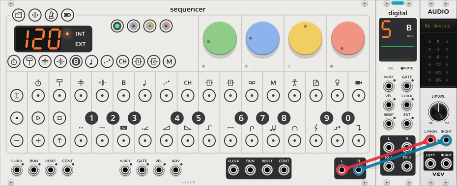

# Your first sound

A walk from an empty rack to a bassline, a beat and an echo, in about ten minutes. It assumes you know how to add
modules and patch cables in VCV Rack, but nothing about the OP-Z. For the keys and gestures on their own, see the
[quickstart](quickstart.md).

## The idea: tracks and their voices

The **Sequencer** is the OP-Z's face: the keys, the steps, the dials, the transport. It sequences the OP-Z's
tracks, but it makes no sound of its own. Each module you place to its right is the **voice** of one of its tracks:
it takes the track's notes and the dials' turns over the bus that runs along the row, plays them, and sends its sound
back into the Sequencer's **L** and **R**. No cables between them.

| Tracks | Named | Voiced by, in the order they sit in the row |
| --- | --- | --- |
| 1 to 4 | kick, snare, perc, sample | a **Drum** each, or a **Drum Breakout** |
| 5 to 8 | bass, lead, arp, chord | a synth engine each (Digital, Analog, Cluster, Organ, Bow, Electric, Saw, Shade, Uranus, Volt, EP), or a **Synth Breakout** |
| 9 and 10 | FX 1, FX 2 | a send effect each (Delay, Reverb, Rymd, Chorus, Crush, Dist), or a **Send FX Breakout** |
| 12 | master | nothing: it transposes the other tracks |

So the first Drum in the row plays the kick, the second the snare, and so on; the first synth engine plays the bass,
the next the lead. Kinds can mix in any order: a Drum, then Digital, then another Drum is kick, bass, snare. Each
module's tag between its top screws says which kind it is, and its screen shows which track it took. A track with no
module voicing it still plays its pattern, silently, so you can add one later.

If you know the OP-Z, this is its plugs: where the hardware picks a track's engine from a list, here you place the
engine as a module. The breakouts go further and hand a track to any VCV module: see [Breakouts](breakout.md).

## 1. The Sequencer and an audio output

<picture><source media="(prefers-color-scheme: dark)" srcset="assets/guide/audio-dark.png"></picture>

Add a **Sequencer** from the module browser (search for vcvopxyz), and VCV's **Audio-2** (or any audio output) to
its right. Patch the Sequencer's **L** and **R**, bottom right, to the audio module's inputs, and pick
your sound card in the audio module's menu.

Nothing sounds yet: no track has a voice. Keep the audio module at the end of the row, since a module from another
plugin ends the bus: anything after it isn't reached.

## 2. A voice for the bass track

<picture><source media="(prefers-color-scheme: dark)" srcset="assets/guide/digital-dark.png"></picture>

Add **Digital** directly to the right of the Sequencer, between it and the audio module. Its screen shows **5**, **B** and **BASS**: it's the first
synth engine, so it plays track 5, the bass. Its **SEL** LED lights while the Sequencer has its track selected.

Click the bass track's key, the **B** under the Sequencer's display: <picture><source media="(prefers-color-scheme: dark)" srcset="assets/keys/select4-playing-dark.png"></picture>.
The track keys there are a row of shortcuts, one per track; the one selected lights white. Now play the round keys:
the black keys numbered 1 to 0 and the white keys under them are a keyboard, F3 to E5, and you hear Digital. Click
**−** and **+** to move the keyboard an octave.

## 3. A bassline

<picture><source media="(prefers-color-scheme: dark)" srcset="assets/guide/bass-dark.png"></picture>

The 16 keys along the top are the selected track's steps. Play a note, then click an empty step: the step takes the
last notes played (a chord, if you played several together) and lights orange. Click a lit step to clear it. Play
another note and click more steps, then click **PLAY** <picture><source media="(prefers-color-scheme: dark)" srcset="assets/keys/play-playing-dark.png"></picture>. A white light, the
playhead, runs along the steps.

To change a step's note, pick it up: long-press it, or Ctrl+click it (⌘+click on a Mac). It blinks while it's held;
play a key to add that note to it, or to take it off if it's there. Click the step again to put it down. That
long press stands in for the OP-Z's held key, here and everywhere; the [quickstart](quickstart.md#clicks-and-holds)
lists them all.

## 4. Turn the dials

The four dials are Digital's while the bass track is selected: turn the green one and you're turning Digital's first
sound dial, with its own tooltip and undo. They have four pages each, sound, envelope, LFO and mix, in green, blue,
yellow and red: click **SHIFT** or one of the four page keys beside the display to turn the page. The page keys and
the dials' small LEDs show the page you're on. The [synth tracks page](synth-tracks.md#pages) lists every dial.

## 5. A beat

<picture><source media="(prefers-color-scheme: dark)" srcset="assets/guide/drum-dark.png"></picture>

Add a **Drum** between the Sequencer and Digital, or anywhere before the audio module. It's the first Drum, so it
plays track 1, the kick; Digital keeps the bass. Click the kick track's key, the first under the display, and play the
keys: a Drum has 24 sounds, one per key. Play the first white key, then click steps 1, 5, 9 and 13 for four on the
floor.

Add three more Drums for the snare, perc and sample tracks, and three more synth engines for the lead, arp and chord.

## 6. An echo

<picture><source media="(prefers-color-scheme: dark)" srcset="assets/guide/delay-dark.png"></picture>

Add a **Delay** anywhere in the row, before the audio module. It's the first send effect, so it plays FX 1. Select
the bass track again and click the red page key: the green dial is now the bass track's **FX 1** send. Turn it up
for echoes.

The Delay has its own track, FX 1, with its own key under the display. Select it, and the dials are the Delay's;
play a key on it to set the echo's time, longer for higher keys.

## 7. The whole band

<picture><source media="(prefers-color-scheme: dark)" srcset="assets/guide/voices-dark.png"></picture>

That's the shape of every vcvopxyz patch: one Sequencer, and to its right a voice for each track you want to hear.
A **Screen** beside any of them shows that track's four pages at once, with every dial as an arc you can drag.

## 8. Keep it

Your work saves with the patch. To keep a song in one of the Sequencer's ten project slots, click **PROJECT**
<picture><source media="(prefers-color-scheme: dark)" srcset="assets/keys/project-project-dark.png"></picture> and long-press a black key: that slot now holds every track's steps, the
tempo, the mixer and every engine's dials. Click another black key to start a new song in another slot; the one you
left saves itself first. Click **PROJECT** again to leave project mode.

## Next

- [Quickstart](quickstart.md): every gesture and mode on one page.
- [The Sequencer](sequencer.md): steps, [parameter locks](sequencer.md#steps), recording, the mixer, patterns and
  chains, and the master track.
- [Step components](step-components.md): ratchets, ramps, sweeps, jumps and sparks on any step.
- [Breakouts](breakout.md): a track's notes and dials out to other modules, and their sound back in.
