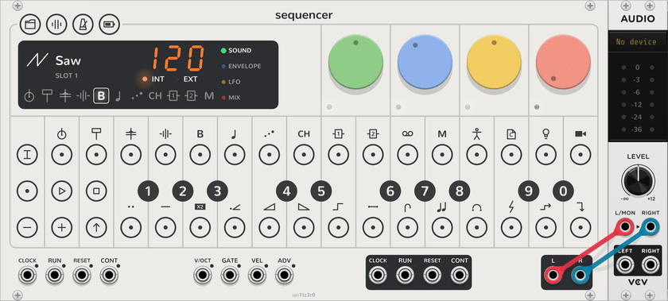
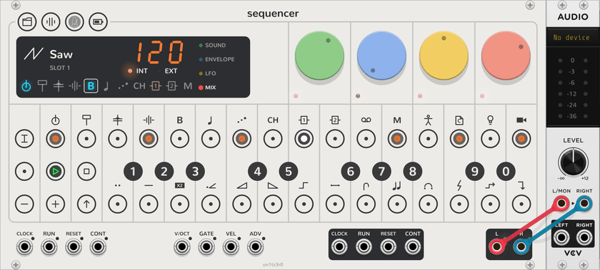

# Your first sound

A walk from an empty rack to a bassline, a beat, an echo and a voice of your own, in about ten minutes. It assumes
you know how to add modules and patch cables in VCV Rack, but nothing about the OP-Z. For the keys and gestures on
their own, see the [quickstart](quickstart.md).

## The idea: one instrument, and its tracks

The **Sequencer** is the whole OP-Z: the keys, the steps, the dials and the transport, and every sound too. It plays
the OP-Z's tracks, each with its own sound, and mixes them into its **L** and **R**.

| Tracks | Named | Plays |
| --- | --- | --- |
| 1 to 4 | kick, snare, perc, sample | a drum kit of 24 sounds |
| 5 to 8 | bass, lead, arp, chord | a synth engine: Saw, Volt, Digital, Organ and eight more |
| 9 and 10 | FX 1, FX 2 | a send effect: Delay, Reverb and four more |
| 12 | master | nothing: it transposes the other tracks |

Each track has ten **slots**, each holding a sound, called a **plug**: an engine on a synth track, a kit on a drum
track, an effect on an FX track. A new Sequencer has them filled already, so it plays as soon as it's patched, and
you switch a track's sound with two clicks.

The other modules only reach out of it. A **breakout** placed to its right hands one track to other modules: its
notes out as CV, and their sound back in. A **Screen** shows the selected track's every dial. Neither needs a cable to
the Sequencer.

If you know the OP-Z, this is the hardware as you know it: the plugs, the presets and the combos are where you'd look
for them, with a display beside the dials standing in for the phone app.

## 1. The Sequencer and an audio output

<picture><source media="(prefers-color-scheme: dark)" srcset="assets/guide/audio-dark.png"></picture>

Add a **Sequencer** from the module browser (search for vcvopxyz), and VCV's **Audio-2** (or any audio output).
Patch the Sequencer's **L** and **R**, bottom right, to the audio module's inputs, and pick your sound card in the
audio module's menu.

## 2. Play the bass

The display beside the dials shows the track selected, the bass to begin with: its plug, **Saw**, with its icon and
**SLOT 1**, the tempo, and along the bottom a key per track. The bass track's key,
<picture><source media="(prefers-color-scheme: dark)" srcset="assets/keys/select4-playing-dark.png"></picture>, is outlined.

Play the round keys: the black keys numbered 1 to 0 and the white keys under them are a keyboard, F3 to E5, and you
hear the bass. Click **−** and **+** to move the keyboard an octave. Click another track's key on the display and the
keys play that track instead; come back to the bass for now.

## 3. A bassline

<picture><source media="(prefers-color-scheme: dark)" srcset="assets/guide/bass-dark.png"></picture>

The 16 keys along the top are the selected track's steps. Play a note, then click an empty step: the step takes the
last notes played (a chord, if you played several together) and lights orange. Click a lit step to clear it. Play
another note and click more steps, then click **PLAY** <picture><source media="(prefers-color-scheme: dark)" srcset="assets/keys/play-playing-dark.png"></picture>. A white light, the
playhead, runs along the steps, and the bass track's key on the display glows orange as it plays.

To change a step's note, pick it up: long-press it, or Ctrl+click it (⌘+click on a Mac). It blinks while it's held;
play a key to add that note to it, or to take it off if it's there. Click the step again to put it down. That long
press stands in for the OP-Z's held key, here and everywhere; the [quickstart](quickstart.md#clicks-and-holds) lists
them all.

## 4. Turn the dials

The four dials turn the selected track's sound, with their own tooltips and undo. They have four pages each, sound,
envelope, LFO and mix, in green, blue, yellow and red: click a page's name down the display's right, or **SHIFT**, to
turn the page. The page lit and the dials' small LEDs show the page you're on.
<picture><source media="(prefers-color-scheme: dark)" srcset="assets/keys/page1-page-dark.png"></picture> The [synth tracks page](synth-tracks.md#pages) lists every dial.

## 5. Another sound

<picture><source media="(prefers-color-scheme: dark)" srcset="assets/guide/slots-dark.png"></picture>

Click **TRACK** <picture><source media="(prefers-color-scheme: dark)" srcset="assets/keys/track-track-dark.png"></picture> to switch track mode on. The black keys are now the bass track's ten
slots, lit white, the one playing brightest. Click **4**: the bass plays **Digital**, and the display says so. Try the
others while the bassline plays; the pattern carries on with each.

Still in track mode, the white keys are the plug's 14 **presets**: click one to load it, or long-press it (or
Ctrl+click it) to store the track's dials there for any patch to load. **REC** rolls new dice on the sound, envelope
and LFO pages. Each is one step of Rack's undo, so a sound you lose is a Ctrl+Z away. Click **TRACK** again to leave
track mode.

The slots themselves are filled from the Sequencer's context menu, **Plug slots**: any engine in any slot, in the
order you like.

## 6. A beat

<picture><source media="(prefers-color-scheme: dark)" srcset="assets/guide/drum-dark.png"></picture>

Click the kick track's key, the first on the display. Its plug is a kit: 24 sounds, one per key, the first OP-Z kick
kit to begin with. Play the first white key, then click steps 1, 5, 9 and 13 for four on the floor. The snare, perc
and sample tracks beside it each have kits of their own, and in track mode their black keys pick another kit, as the
bass's picked another engine.

## 7. An echo

<picture><source media="(prefers-color-scheme: dark)" srcset="assets/guide/delay-dark.png"></picture>

FX 1, track 9, is a **Delay**. Select the bass track again and click **MIX** on the display: the green dial is now the
bass track's **FX 1** send. Turn it up for echoes.

The Delay has its own key on the display, <picture><source media="(prefers-color-scheme: dark)" srcset="assets/keys/fx_select0-off-dark.png"></picture>. Select it, and the dials are the
Delay's; play a key on it to set the echo's time, longer for higher keys. FX 2 is a **Reverb**, on the blue dial of
each track's mix page.

## 8. A voice of your own

<picture><source media="(prefers-color-scheme: dark)" srcset="assets/guide/breakout-dark.png"></picture>

Add a **Synth Breakout** to the right of the Sequencer. Its screen shows **5**: it took the first synth track, the
bass. Now add any oscillator, VCV's **VCO** say, patch the breakout's **V/OCT** to the VCO's **V/OCT**, and the VCO's
output to the breakout's **RET L**.

The bass is now the VCO, still shaped by the track's envelope, filter and mix, still played by its steps and parameter
locks, and still sent to the Delay. The display shows **Breakout** in place of the plug, and the bass track's key shows
a small jack in its corner. Pull the **V/OCT** cable and the track's own plug comes back.

Patch the breakout's **L** and **R** instead and the bass keeps its plug, but its sound leaves there on its own, for
your own effects. [Breakouts](breakout.md) has the rest, and a Drum Breakout and a Send FX Breakout for the other
kinds of track.

## 9. The whole band

<picture><source media="(prefers-color-scheme: dark)" srcset="assets/guide/band-dark.png"></picture>

That's the shape of every vcvopxyz patch: one Sequencer, with breakouts beside it for the tracks you want to take
further. A **Screen** anywhere along the row shows the selected track's four pages at once, with every dial as an arc
you can drag, and a drum track's kit to edit.

## 10. Keep it

Your work saves with the patch. To keep a song in one of the Sequencer's ten project slots, click **PROJECT**
<picture><source media="(prefers-color-scheme: dark)" srcset="assets/keys/project-project-dark.png"></picture> and long-press a black key: that slot now holds every track's steps, the
plugs playing and their dials, the tempo and the mixer. Click another black key to start a new song in another
slot; the one you left saves itself first. Click **PROJECT** again to leave project mode.

## Next

- [Quickstart](quickstart.md): every gesture and mode on one page.
- [The Sequencer](sequencer.md): steps, [parameter locks](sequencer.md#steps), recording, the mixer, presets,
  patterns and chains, and the master track.
- [Step components](step-components.md): ratchets, ramps, sweeps, jumps and sparks on any step.
- The plugs: [synth engines](synth-tracks.md), [drum kits](drum-tracks.md) and [send effects](fx-tracks.md).
- [Breakouts](breakout.md): a track's notes and dials out to other modules, and their sound back in.
