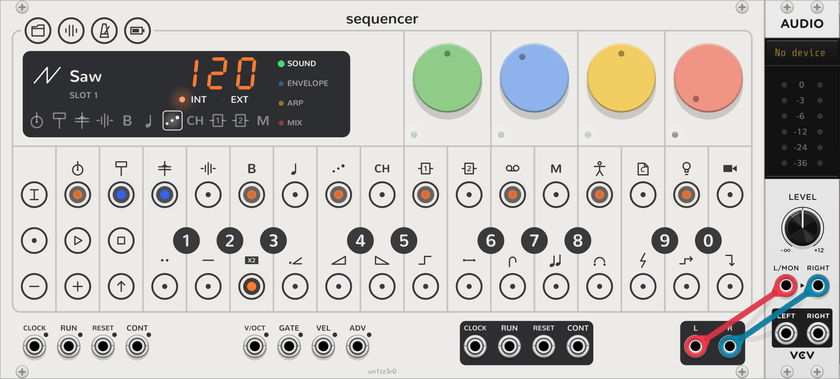
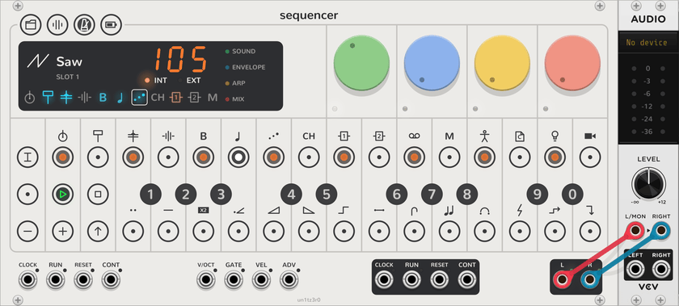
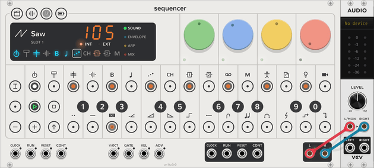

# Your first song

This tutorial starts with an empty rack and ends with a song of six tracks. They are a kick, a snare, a hi-hat part, a
bassline, a lead and an arp. It takes about 20 minutes. You need only the **Sequencer** and an audio module.

Before you start:

- If VCV Rack is new to you, read [Rack in two minutes](rack-basics.md).
- [How it works](how-it-works.md) explains the words that this page uses, such as track, plug and step.

When you finish, compare your work with [first-song.vcv](../patches/first-song.vcv), which holds the same song.

## 1. Hear the Sequencer

<picture><source media="(prefers-color-scheme: dark)" srcset="assets/guide/audio-dark.png"></picture>

1. Add a **Sequencer**. In the module browser, type "Sequencer" and choose the one by un1tz3r0.
2. Add an **Audio-2** to its right, and choose your sound card on its display.
3. Patch the Sequencer's **L** to the Audio-2's **L/MON**, and **R** to **RIGHT**. They are at the bottom right of the
   Sequencer.
4. Click white key 1, at the bottom left of the keyboard.

You hear a bass note. The display beside the dials shows the selected track: track 5 (bass), which plays the plug
**Saw** from plug slot 1.

## 2. Learn the keyboard

<picture><source media="(prefers-color-scheme: dark)" srcset="assets/diagrams/keys-dark.svg"></picture>

The black keys and white keys are a keyboard of two octaves. This manual calls each key by its row and number, as in
the picture. The black keys have their numbers printed on the panel. Count the white keys from the left.

1. Click **−**, at the bottom of the left column.

The **−** key lights, and every key now plays an octave lower: white key 1 plays F2. The bassline below uses this
octave.

## 3. Write the bassline

<picture><source media="(prefers-color-scheme: dark)" srcset="assets/guide/bass-dark.png"></picture>

The 16 keys along the top are the steps of the selected track. To put a note on steps, play the note, then click
each step that gets it. A step with notes lights orange. To clear a step, click it again.

1. Enter the bassline, one row of this table at a time.

   | Play | Then click steps |
   | --- | --- |
   | White key 3 (A2) | 1 and 5 |
   | Black key 6 (F♯3) | 3 |
   | White key 10 (A3) | 7 and 15 |
   | Black key 4 (C♯3) | 9 |
   | Black key 9 (C♯4) | 11 |
   | Black key 1 (F♯2) | 13 |

2. Click **PLAY**, in the second column.

The bassline plays, and a white light, the playhead, moves along the steps. The bass track's key on the display
glows each time it plays a note.

## 4. Choose another sound

<picture><source media="(prefers-color-scheme: dark)" srcset="assets/guide/slots-dark.png"></picture>

A track's sound is its [plug](how-it-works.md#glossary). Each track has ten plug slots on the black keys.

1. Click **TRACK**, at the top of the left column. TRACK lights, and the black keys show the plug slots. The slot that
   plays is brightest.
2. Click black key 4. The display shows **Digital**, and the bassline plays with that sound.
3. Click the other black keys to hear each plug. Then click black key 1 to return to **Saw**.

While TRACK is on, the white keys are the plug's presets. Click one to load it. To keep your own sound, long-press a
white key, or Ctrl+click it (⌘+click on a Mac). This stores the dials in that preset.

4. Click **TRACK** again to switch track mode off.

Every change in this tutorial is one step of Rack's undo. Press Ctrl+Z if you lose a sound that you liked.

## 5. Turn the dials

The four dials change the selected track's sound. Each dial has four jobs, one on each **page**: sound (green),
envelope (blue), LFO (yellow) and mix (red). The page names are down the right side of the display.

1. Turn the green dial. On the sound page, it changes the engine's first sound control.
2. Click **ENVELOPE** on the display, or click **SHIFT**. The page changes, and the dials' small lights turn blue.
3. Turn the red dial. On the envelope page it is the release, so the notes now ring on.

Hover over a dial to see its name and value. [Synth tracks](synth-tracks.md#pages) lists every dial.

## 6. Add the drums

<picture><source media="(prefers-color-scheme: dark)" srcset="assets/guide/drums-dark.png"></picture>

The drum tracks play a [kit](how-it-works.md#glossary): 24 sounds, one on each key.

1. Click **+**, in the second column, to return the keyboard to its home octave. The **−** key goes dark.
2. Click the first key on the display, track 1 (kick). The steps now show the kick track, which has no notes yet.
3. Enter the kick from the table below.
4. Select track 2 (snare) and enter the snare. Then select track 3 (perc) and enter the hi-hats.

| Track | Play | Then click steps |
| --- | --- | --- |
| 1 (kick) | Black key 6 | 1, 9, 11 and 14 |
| 2 (snare) | White key 3 | 5 and 13 |
| 3 (perc) | White key 4 | 3, 7, 11 and 15 |
| 3 (perc) | Black key 9 | 5, 8 and 12 |
| 3 (perc) | White key 12 | 2 and 14 |
| 3 (perc) | White key 5 | 9 |
| 3 (perc) | Black key 4 | 16 |

Each drum track has its own kits in its plug slots, as the bass has engines. Use **TRACK** and the black keys to try
them.

## 7. Add the lead

1. Click **−** to move the keyboard down an octave again.
2. Select track 6 (lead), the sixth key on the display.
3. Enter the lead.

| Play | Then click steps |
| --- | --- |
| Black key 4 (C♯3) | 2 |
| Black key 5 (D♯3) | 3 |
| White key 7 (E3) | 5 |
| White key 11 (B3) | 7 |
| Black key 9 (C♯4) | 8 |
| Black key 6 (F♯3) | 10 |
| Black key 7 (G♯3) | 11 |
| White key 10 (A3) | 13 |
| Black key 0 (D♯4) | 15 |
| White key 14 (E4) | 16 |

## 8. Add the arp, with long notes

<picture><source media="(prefers-color-scheme: dark)" srcset="assets/guide/length-dark.png"></picture>

1. Click **+** to return to the home octave.
2. Select track 7 (arp).
3. Enter the arp.

| Play | Then click steps |
| --- | --- |
| White key 3 (A3) | 1 |
| White key 4 (B3) | 3 |
| Black key 5 (D♯4) | 5 and 13 |
| White key 7 (E4) | 7 |
| Black key 6 (F♯4) | 9 |
| White key 10 (A4) | 11 |
| Black key 4 (C♯4) | 15 |

Track 7 has an arpeggiator, and it is on. While a note lasts, the arp plays it again on every sixteenth. A longer
note gives more repeats. To set one note's length, you **latch** its step. A latched step stays on after you release
the mouse button, as a held key does on the OP-Z.

4. Long-press step 1, or Ctrl+click it (⌘+click on a Mac). The step blinks.
5. Click step 3. Blue lights show that the note now lasts to the end of step 3.
6. Click step 1 again to release it.
7. Do the same for the steps in this table.

| Latch step | Then click step |
| --- | --- |
| 3 | 5 |
| 5 | 7 |
| 9 | 11 |
| 11 | 13 |
| 13 | 15 |
| 15 | 16 |

Each of these notes now plays three times, or twice on step 15.

## 9. Add an echo

<picture><source media="(prefers-color-scheme: dark)" srcset="assets/guide/delay-dark.png"></picture>

Tracks 9 and 10 are send effects. Track 9 (FX 1) plays a **Delay**, and track 10 (FX 2) plays a **Reverb**.

1. Select track 7 (arp) if it is not selected.
2. Click **MIX** on the display. The dials' lights turn red.
3. Turn the green dial to about half. It is the arp track's **FX 1** send.

You hear echoes of the arp. The blue dial on the mix page is the **FX 2** send, to the reverb.

## 10. Set the tempo

<picture><source media="(prefers-color-scheme: dark)" srcset="assets/guide/tempo-dark.png"></picture>

The song sounds best at 105 beats a minute. The tempo starts at 120.

1. Click **TEMPO**, the third of the four small keys at the top left of the face.
2. Click black keys 1, 0 and 5, in that order. The display shows **105**.
3. Click **TEMPO** again to switch tempo mode off.

## 11. Keep the song

<picture><source media="(prefers-color-scheme: dark)" srcset="assets/guide/song-dark.png"></picture>

Rack saves the song with the patch: press Ctrl+S. The Sequencer can also keep ten songs in its **project slots**.

1. Click **PROJECT**, the first of the four small keys at the top left of the face.
2. Long-press black key 1, or Ctrl+click it. The song is now in project slot 1.
3. Click **PROJECT** again to switch project mode off.

To start a new song, click **PROJECT** and click an empty project slot. The Sequencer saves the current song to its
own slot first.

## Next

- [Your first patch](patching.md): play the bassline on other modules, with the breakouts.
- [Quickstart](quickstart.md): every key and mode on one page.
- [Steps](steps.md) and [Project](project.md): parameter locks, recording, patterns and chains.
