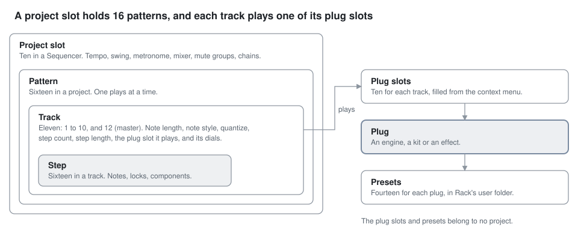
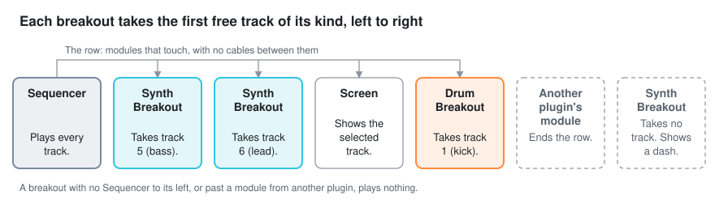
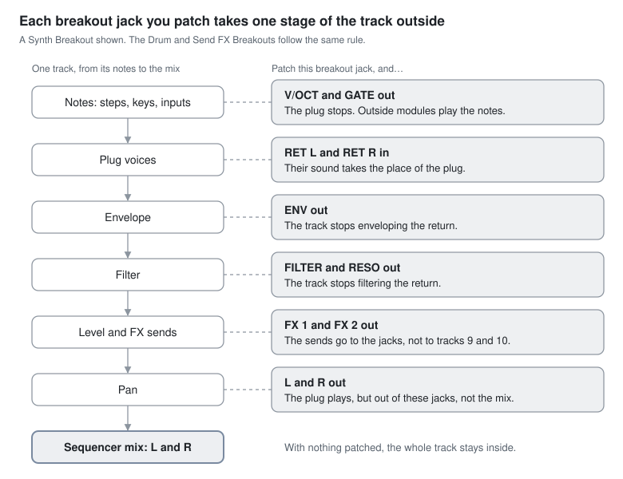

# How it works

The **Sequencer** makes every sound. The other modules give one of its tracks jacks, or show a track on a screen.
This page explains that model. The [guide](guide.md) shows it step by step.

<picture><source media="(prefers-color-scheme: dark)" srcset="assets/guide/band-dark.png"></picture>

## One box

The Sequencer is the whole OP-Z: the keys, the steps, the dials, the transport, and every sound. Patch its **L** and
**R** outputs to an audio module, and you can make a complete song. The modules of this plugin need no cables between
them.

## Tracks

The Sequencer plays 11 of the OP-Z's 16 tracks. Each track has its own pattern of steps and its own sound.

| Tracks | Names | Each plays |
| --- | --- | --- |
| 1 to 4 | kick, snare, perc, sample | a kit of 24 drum sounds |
| 5 to 8 | bass, lead, arp, chord | a synth engine |
| 9 and 10 | FX 1, FX 2 | a send effect, which every other track can send to |
| 12 | master | no sound. Its notes transpose the synth tracks in the song's key. |

You select a track with its key on the display. The keys, the steps and the dials then work on that track.

## Plugs, plug slots and presets

A track's sound is its [plug](#glossary). A synth track plays an **engine**, a drum track plays a **kit**, and an FX
track plays an **effect**.

- Each track has ten **plug slots**. A new Sequencer fills them for you. The context menu's **Plug slots** changes
  them.
- To change a track's plug, latch **TRACK** and click a black key. Each black key is one plug slot.
- Each plug has 14 **presets**. With **TRACK** latched, the white keys load and store them.

## Steps, patterns and projects

<picture><source media="(prefers-color-scheme: dark)" srcset="assets/diagrams/holds-dark.svg"></picture>

- A **step** holds up to four notes, with their timing, length and [parameter locks](#glossary).
- A **track** has 16 steps, and its own step count, step length and note style.
- A **pattern** holds every track. A project has 16 patterns, and a **chain** plays them in turn.
- A **project slot** holds a song: its 16 patterns, chains, tempo and mixer. The Sequencer has ten project slots.

The plug slots and presets are outside the projects. A project only remembers which plug slot each track plays, and
the dials.

## The row

<picture><source media="(prefers-color-scheme: dark)" srcset="assets/diagrams/row-dark.svg"></picture>

The other modules of this plugin work only in the Sequencer's **row**. The row is the modules to the Sequencer's right
that touch it and touch each other.

- A module from another plugin ends the row. A gap between modules also ends it.
- A **breakout** takes one track of its kind: a synth track, a drum track or an FX track. **Auto**, the default, takes
  the first track of its kind that no breakout to its left has. The context menu's **Track** sets a track by number.
- A **Screen** shows the selected track's pages and dials. It passes the row on to the modules to its right.

The track's key on the Sequencer's display shows a small jack while a breakout has the track.

## Breakouts: two ways out

<picture><source media="(prefers-color-scheme: dark)" srcset="assets/diagrams/track-dark.svg"></picture>

A breakout makes no sound itself. The jacks that you patch on it decide what it does.

1. **Patch its audio outputs, L and R.** The track's plug plays, but its sound goes to these jacks, not to the mix.
   Use this for your own effects, mixer or recorder.
2. **Patch its note outputs.** The plug stops. Your modules play the notes, and their sound returns at **RET L** and
   **RET R**. The track's envelope, filter, level, pan and FX sends then shape that sound.

Each other output that you patch takes one more stage outside the track. For example, with **ENV** patched, the track
does not envelope the return. If the audio outputs and the note outputs are both patched, the audio outputs win.
Remove the cables and the plug plays again. [Breakouts](breakout.md) lists every jack.

## What saves where

| What | Saved in | Shared by |
| --- | --- | --- |
| The Sequencer: its patterns, project slots, plug slots and dials | The patch | That patch only |
| A kit loaded from a file | The patch's storage folder | That patch only |
| Presets | `vcvopxyz/presets/` in Rack's user folder | Every patch on the computer |
| All ten project slots, as one file | A file that you choose | Any patch that loads it |
| The project slots, as OP-Z project files | A projects folder that you choose | Any patch, and an OP-Z |

## Glossary

| Term | Meaning |
| --- | --- |
| **arp** | The arpeggiator. It replaces the LFO page on track 7 (arp). |
| **black keys** | The keys numbered 1 to 0. They play notes, and they also choose a value, such as a plug slot. |
| **breakout** | A module that gives one track jacks. There are three: Synth Breakout, Drum Breakout and Send FX Breakout. |
| **chain** | A list of patterns that play in turn. |
| **dial** | One of the four coloured controls: green, blue, yellow and red. |
| **effect** | The plug of an FX track, such as Delay or Reverb. |
| **engine** | The plug of a synth track, such as Saw or Digital. |
| **index keys** | PROJECT, MIXER, TEMPO and SCREEN, on the top edge of the face. |
| **kit** | The plug of a drum track: 24 sounds, one for each key. |
| **latch** | A key that stays on after you release the mouse button. It stands in for a key that you hold on the OP-Z. |
| **master track** | Track 12. Its notes transpose the synth tracks in the song's key. |
| **page** | One of the dials' four sets of jobs: sound, envelope, LFO and mix. |
| **parameter lock** | A dial's value saved on one step. The track uses it while that step plays. |
| **pattern** | One set of steps for every track. A project has 16. |
| **plug** | The sound that a track plays: an engine, a kit or an effect. |
| **plug slot** | One of a track's ten places for a plug, on the black keys in track mode. |
| **preset** | A plug's saved dials. Each plug has 14, on the white keys in track mode. |
| **project slot** | One of the Sequencer's ten places for a song, on the black keys in project mode. |
| **row** | The modules to the Sequencer's right that touch it and each other, with no module from another plugin between. |
| **step** | One of the 16 keys along the top, and the notes it holds for the selected track. |
| **step component** | A change to how a step plays, such as a ratchet or a ramp. |
| **step count** | How many of its 16 steps a track plays. |
| **step length** | How long each step lasts: a sixteenth note times 1 to 8 or 16, or one pulse at **ADV**. |
| **track mode** | The mode that **TRACK** latches. Its steps select a track, and its keys choose plugs and presets. |
| **voice** | One note that plays now. A track's polyphony is how many voices it plays at once. |
| **white keys** | The 14 keys along the bottom. They play notes, and they also choose a step component or a preset. |
