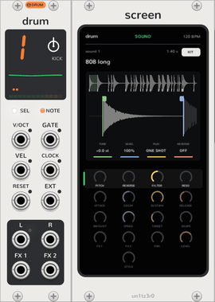

# Kits

<picture><source media="(prefers-color-scheme: dark)" srcset="assets/guide/kit-screen-dark.png"></picture>

A [drum track](drum-tracks.md)'s plug is a kit: 24 sounds, one per key from F3, each a slice of one long sample with
its own tuning, level, direction and play mode. Each drum track has ten slots of them, on the black keys in track
mode, and the context menu's **Plug slots** fills each slot with one of these:

| Kind | Where from | Saved in a patch as |
| --- | --- | --- |
| [OP-Z kits](#op-z-kits) | Sampled from an OP-Z, in the plugin | Their name |
| [Built-in kits](#built-in-kits) | Synthesized with the first Sequencer | Their name |
| [Kit files](#kit-files) | An OP-1 or OP-Z kit, any AIFF or WAV, or a folder of sounds | Their sound, in the patch's storage folder |

Each kit put in a slot, from any of them, is one step of Rack's undo.

## OP-Z kits

The OP-Z's own kits, sampled from the device, one WAV and its slices each in the plugin's `res/kits`:

| Track | Kits |
| --- | --- |
| Kick | Kick 1, Kick 2, Kick 3, Kick 4 |
| Snare | Snare 1, Snare 2, Snare 3, Snare 4 |
| Perc | Hat 1, Hat 2, Hat 3, Hat 4, Hat 5 |

Any of them can go on any drum track. A few sounds are missing or cut short in these first samples (pad 16 of the
snare and hat kits, five pads of Hat 5, and a few that ring into the next), and play nothing or end early until
they're sampled again.

## Built-in kits

Each drum track has a kit of its own, synthesized when the first Sequencer is added, in the slot after its OP-Z
kits:

| Track | Sounds |
| --- | --- |
| Kick | 808s from long and deep to tight, 909s, rumble, hardcore, distorted, gabber, acoustic, soft, thud, felt, click, blip, sub, zap |
| Snare | 808, 909, tight, fat, crack, lo-fi, deep and noise snares, rims and a sidestick, 808, 909, tight and big claps, snap, brushes, slap, piccolo, swell, electro, trash |
| Perc | Closed, pedal and open hats, crash, ride, china, four toms, congas, bongo, cowbell, clave, woodblock, shaker, tambourine, triangle |
| Sample | Zaps, laser, drop, blips on C, E, G and C, FM bell, glass, pluck and gong, 808 notes on C, D# and G, sub drop, noise burst, swoosh, static, thunder, glitch, robot, chirp, hit |

## Kit files

In a slot's menu:

- **Load a kit file…** takes an OP-1 or OP-Z kit (an AIFF with the kit's slices in it), or any other AIFF or WAV, cut
  into 24 equal slices. A kit file's slices keep their tuning, volume, direction and play mode.
- **Load a folder of sounds…** takes up to 24 AIFF and WAV files, one per key in order of their names, resampled to
  44.1 kHz.
- Stereo files are mixed to mono. A file's sample rate must be between 1 and 384 kHz, and samples that aren't numbers
  play as silence.

A loaded kit saves with the patch, in its storage folder, so the patch plays it on any computer. A Sequencer pasted
with Ctrl+V has no storage folder yet, so its loaded kits' slots come up empty; Ctrl+D (duplicate) and a saved patch
carry them.

**Save as a kit file…** writes the slot's kit, whatever kind, as an OP-1 and OP-Z kit: a 16-bit AIFF at 44.1 kHz with
the slices in it. A kit file holds 12 seconds, so a longer kit is cut short there. These files load back here
unchanged, but haven't been tried on an OP-Z yet.

## Editing

A [Screen](screen.md#kit-editor) edits the kit playing on the selected drum track: each slice's ends, tuning, level,
play mode and direction. Editing an OP-Z or built-in kit makes a copy of it in its slot that saves with the patch, as
a loaded kit does.
