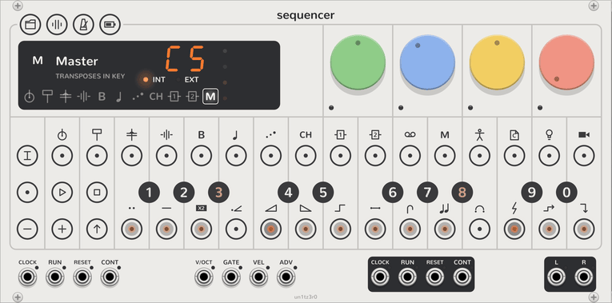

# Master track

<picture><source media="(prefers-color-scheme: dark)" srcset="assets/keys/face-master-dark.png"></picture>

The master track is the OP-Z's track 12. It has no sound. Its notes move other tracks up and down, in the song's key.
Thus you can write a bassline and chords once, and let them follow a chord progression.

To select the master track, click **MASTER**, the last track key on the display. You can also latch **TRACK** and
click step 12. Write its steps and play its keys as on any other track.

## The key

The Sequencer finds the song's key from the notes of tracks 5 (bass), 6 (lead), 7 (arp) and 8 (chord). The bass counts
twice, and the lowest note of each step counts toward the root. With no notes, the key is C major.

While the master track is selected, the display shows the key: the root, then the number of the mode. The modes go
from 1, Ionian (major), to 7, Locrian. For example, `A6` is A minor.

On the keyboard, the notes of the key light. The root lights brighter, and the note that moves the tracks now lights
brightest. Each key's tooltip tells where that note moves the tracks.

## How a note moves the tracks

- **The root:** the root nearest to middle C leaves the tracks where they are. In A minor, that note is A3.
- **A note in the key:** it moves the tracks by degrees of the scale. The tracks stay in the key, and the mode
  changes with the root, as in a chord progression. For example, D4 in A minor moves every note up three degrees, into
  D Dorian.
- **A note outside the key:** it moves the tracks by semitones, so the key changes. For example, C♯4 in A minor moves
  every note up four semitones, into C♯ minor.

If several master notes play at once, the lowest one moves the tracks.

## Note style

In track mode, the blue dial sets the master track's note style:

- **Latch**, the default, keeps each note until the next one. It releases the note when the pattern starts again or
  the Sequencer stops, unless you still hold a key.
- **Free** moves the tracks only while a note plays.

## Which tracks move

At the start, the master track moves the synth tracks, 5 to 8. To change this:

1. Select the master track.
2. Latch **SHIFT**. The track keys on the display light green for the tracks that move.
3. Click a track key to add that track, or to remove it.
4. Release **SHIFT**.

The [tonality component](step-components.md#the-components) changes how one step's notes follow the master track. In
[mixer mode](mixer.md#mutes), step 12 mutes the master track, which stops its moves.
