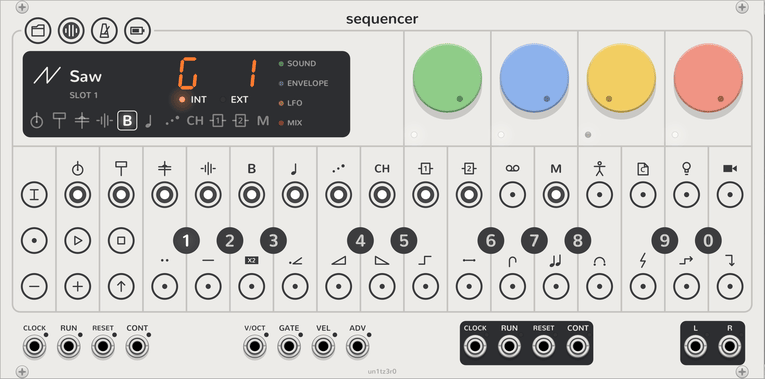

# Mixer

<picture><source media="(prefers-color-scheme: dark)" srcset="assets/keys/face-mixer-dark.png"></picture>

Every track mixes into the Sequencer's **L** and **R** outputs, at its own level and pan. The mixer sets the levels of
the groups of tracks, mutes tracks, and compresses the mix. Click **MIXER** to latch mixer mode. Click it again to
release it.

## Levels

In mixer mode, the dials set the mix:

| Dial | Setting |
| --- | --- |
| Green | **Drum level**: tracks 1 to 4. |
| Blue | **Synth level**: tracks 5 to 8. |
| Yellow | **Punch**: a compressor on **L** and **R**. It makes the mix louder as it compresses. It starts at 0. |
| Red | **Master level**: the level of **L** and **R**, after the punch. |

A track's own level is on its mix page: see [Track](track.md#pages).

## Mutes

In mixer mode, steps 1 to 10 show tracks 1 to 10, and step 12 shows the master track. A track that plays lights
white, and a muted track is dark.

- **Mute:** click the track's step. The track stops its notes, and the last note fades as its release sets.
- **Sound mute:** latch **SHIFT**, then click the step. The step lights red. The track continues to play, but at no level.

A sound mute also stops the track's FX sends, because the sends come after the level. A muted FX track silences its
effect, but its send continues to fill, so the effect's tail returns when you unmute it. A muted master track stops
its [transposing](master.md).

## Mute groups

The black keys are ten **mute groups**. Each mute group holds its own set of mutes. Click a black key to use that
mute group. The display shows its number. Each pattern remembers its mute group, so a [chain](project.md#chains) can
change the mutes from pattern to pattern.
