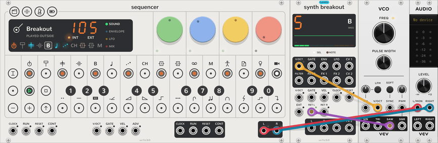
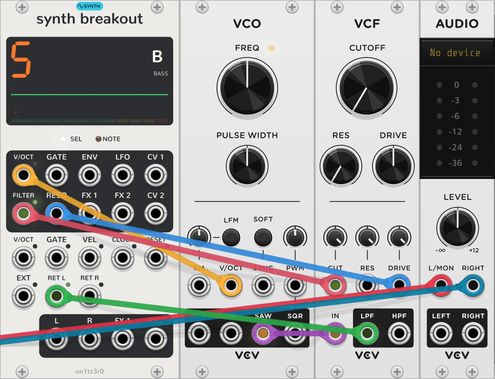
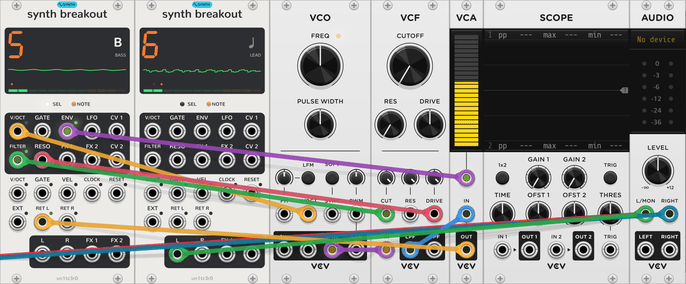
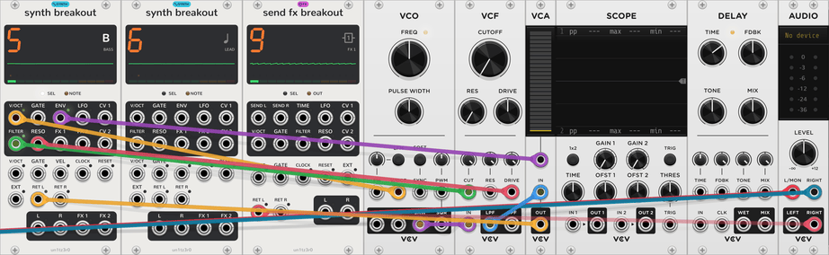

# Your first patch

This tutorial continues [Your first song](guide.md). It replaces the bass track's sound with VCV modules, one stage
at a time, and then puts an outside echo on the arp. It takes about 15 minutes.

You need the song from the first tutorial. If you do not have it, open
[first-song.vcv](../patches/first-song.vcv). You also need these modules from VCV's free Fundamental
plugin: VCO, VCF, VCA, Scope and Delay.

A breakout gives one track jacks. Each jack that you patch takes one stage of the track outside.
[How it works](how-it-works.md#breakouts-two-ways-out) explains this idea.

## 1. Add a breakout

1. Add a **Synth Breakout**. Drop it directly to the right of the Sequencer, so that it touches the Sequencer. Rack
   moves the Audio-2 along. Keep the Audio-2 at the right end of the rack for the rest of this page.

The breakout's screen shows **5**. It took track 5 (bass), the first synth track. On the Sequencer's display, the bass
track's key shows a small jack.

A breakout works only in the Sequencer's [row](how-it-works.md#the-row): it must touch the Sequencer, or touch
another module of this plugin that does.

## 2. Play the bass on a VCO

<picture><source media="(prefers-color-scheme: dark)" srcset="assets/guide/breakout-dark.png"></picture>

1. Add a **VCO** to the right of the breakout.
2. Patch the breakout's **V/OCT** output to the VCO's **V/OCT** input.
3. Patch the VCO's **SAW** output to the breakout's **RET L** input.

The bassline now plays on the VCO. The Sequencer's display shows **Breakout** in place of the plug. The bass
track's envelope, filter, level and FX sends still shape the sound. Turn the Sequencer's dials to hear this.

When you patch **V/OCT**, the track's plug stops. Remove that cable and the plug plays again.

## 3. Use your own filter

<picture><source media="(prefers-color-scheme: dark)" srcset="assets/guide/breakout-filter-dark.png"></picture>

1. Add a **VCF** to the right of the VCO.
2. Patch the VCO's **SAW** to the VCF's **IN**, and the VCF's **LPF** to the breakout's **RET L**.
3. Patch the breakout's **FILTER** output to the VCF's **CUT** input.
4. Patch the breakout's **RESO** output to the VCF's **RES** input.
5. On the VCF, turn the **CUTOFF** dial fully left. Turn the small dials above its **CUT** and **RES** inputs fully
   right.

The track's own filter stops. On the sound page, the Sequencer's **Filter** and **Reso** dials now turn the VCF.

## 4. Use your own envelope

<picture><source media="(prefers-color-scheme: dark)" srcset="assets/guide/breakout-env-dark.png"></picture>

1. Add a **VCA** to the right of the VCF. Use the small VCA with one channel, not VCA-2.
2. Patch the VCF's **LPF** to the VCA's **IN**, and the VCA's **OUT** to the breakout's **RET L**.
3. Patch the breakout's **ENV** output to the VCA's **CV** input.

The track's own envelope stops. The Sequencer's envelope page now shapes the VCA. The track keeps only its level,
pan and FX sends, around a voice that you built.

## 5. Take a track out on its own

1. Add a second **Synth Breakout**, directly to the right of the first. Rack moves the VCO and the modules after it
   along. The new breakout's screen shows **6**: it took track 6 (lead).
2. Add a **Scope** to the right of the VCA.
3. Patch the second breakout's **L** output to the Scope's **X** input.

<picture><source media="(prefers-color-scheme: dark)" srcset="assets/guide/breakout-out-dark.png"></picture>

The lead goes silent in the Sequencer's mix, and the Scope shows its sound. Its plug still plays, but the sound now
leaves at the breakout's **L** and **R**. Use these outputs for your own effects, a mixer or a recorder.

4. Remove the cable from **L**. The lead returns to the mix.

## 6. Use your own echo

<picture><source media="(prefers-color-scheme: dark)" srcset="assets/guide/send-dark.png"></picture>

1. Add a **Send FX Breakout** directly to the right of the second Synth Breakout. Its screen shows **9**: it took
   track 9 (FX 1), the first send track.
2. Add a **Delay** to the right of the Scope.
3. Patch the breakout's **SEND L** to the Delay's **IN**, and the Delay's **WET** to the breakout's **RET L**.

The arp's echo now comes from the outside Delay. Turn the Delay's dials to change it. The arp's **FX 1** send, on its
mix page, still sets how much of the arp goes to the echo.

## 7. See every dial

1. Add a **Screen** directly to the right of the last breakout.

The Screen shows the selected track's four pages at once. Drag a dial's arc on the Screen to turn it. The Screen
passes the row on, so a breakout to its right still works.

## Next

- [Breakouts](breakout.md): every jack of the three breakouts.
- [Quickstart](quickstart.md): every key and mode on one page.
- [The Screen](screen.md), and its kit editor for the drum tracks.
