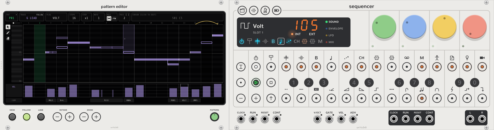

# Pattern Editor

The Pattern Editor shows a [pattern](project.md#patterns) of the [Sequencer](sequencer.md) on a large screen, and
edits it with the mouse and the computer keyboard. Put it to the Sequencer's left. It can also be to the left of a
[Remotes](remotes.md) or a [Song Editor](song-editor.md) that touches the Sequencer. It makes no sound.

To change its width, drag its left edge. Its right edge stays against the Sequencer. It is 24 to 64 HP wide, and
32 HP when you add it.

## The two views

Click **VIEW** to change between the views. **VIEW** lights in the overview.

- **Track view** shows the notes of one track on a roll. The steps go from left to right, and the pitches go from
  low to high. A drum track's rows are the 24 sounds of its kit. Below the roll are the lane and the components.
- **The overview** shows the 16 steps of each of the 11 tracks. Each dot is a note. A brighter dot is a note with a
  higher velocity. A white corner shows step components. A blue dot shows parameter locks.

In both views, steps past the track's step count are grey and have lines across them. You cannot edit them. The
step that plays has a green background.

The boxes at the top show the pattern, the track, its plug, and the track's step count, step length and note length.
In track view, **ROLL** has two switches for the [played roll](#see-what-the-components-play), and **PASS** shows the
pass. **CURSOR** shows the step and the note at the cursor.

## Edit with the mouse

The palette at the top left of the roll has three tools. Click a tool, or press its key while the screen has the
keyboard. Hold the pointer on a tool to see what it does.

| Tool | Key | Result |
| --- | --- | --- |
| **Pointer** | P | Selects notes and moves them. |
| **Pen** | D | Adds notes. Hold D to use the Pen until you release D. |
| **Eraser** | E | Deletes each note that you click or drag across. |

A click is a press that moves less than 3 pixels before you release it. A drag moves more. A press alone does
nothing.

With the Pointer:

| Action | Result |
| --- | --- |
| Click a note | Selects it. Hold Shift to add it to the selection, or to remove it. |
| Click an empty cell | Clears the selection and moves the cursor. |
| Drag a note | Moves the selection one step or one semitone at a time. Hold Shift to move it one tick at a time. |
| Ctrl+drag a note | Copies the selection to where you release it. |
| Drag the end of a note | Changes the length of each selected note, one step at a time. Hold Shift for one tick at a time. Drag past the last step for drones. |
| Drag on an empty cell | Selects the notes in the box. Hold Shift to add them to the selection. |
| Double-click an empty cell | Adds a note. |
| Double-click a note | Deletes it. |

With the Pen, click an empty cell to add a note, or drag from it to add a note and set its length. On a note, the Pen
does what the Pointer does.

A white outline shows a selected note. When the pointer is on a note, a thin outline shows the note, and a white bar
shows the end that sets its length. **CURSOR** shows how many notes you selected.

A move or a copy is all or nothing. If one note cannot go to its new place, no note moves. A step has at most four
notes. A note can start up to 23 ticks before its step and 24 ticks after it. A tick is 1/24 of a step.

The lane:

| Action | Result |
| --- | --- |
| Drag across the lane | Sets the velocity, or the lock, of each step that you cross. |
| Drag up or down from a step with a selected note | Moves the velocity of every selected note by the same amount. Hold Ctrl to give them all the velocity at the pointer. |
| Ctrl+click a lock in the lane | Removes the lock. |

In the overview, click a step to go to that track and step in track view. Click a track's name to choose the track.

Each drag or click is one step of the undo history. Use Rack's **Undo** (Ctrl+Z) to undo it.

### The step menu

Right-click a step, in the roll, the lane, the component row or the overview, to open its menu. If the step has a
selected note, the clears and the components change each step that has a selected note. A component belongs to a
step, so it changes all of the notes on that step.

- **Copy step** and **Paste step** copy all of the step that you clicked: its notes, components and locks.
- **Clear notes**, **Clear locks** and **Clear components** clear one part of the steps.
- Below them are the 14 [step components](step-components.md). Click a component to add it with its first value, or
  to remove it. Hold the pointer on it to choose **Off** or one of its ten values. The menu names each value by what
  it does, for example **3: 3 slots**. A spark also has the passes that it fires on.
- A check mark shows that each of the steps has the component or the value. A dash shows that only some have it. The
  value shows at the right, or **mixed** when the steps have different values.

### Change what the mouse does

Right-click the panel, out of the screen, and use **Mouse gestures**:

| Item | Choices (the first is the default) |
| --- | --- |
| Click on an empty cell | Clears the selection, or adds a note |
| Drag on an empty cell | Box-selects, or draws notes in each cell that you cross |
| Click on a note | Selects it, or deletes it |
| Double-click on an empty cell | Adds a note, or does nothing |
| Double-click on a note | Deletes it, or does nothing |
| Free timing while dragging | Shift, Ctrl or Alt |

**Tool** in the same menu chooses the tool. Rack uses Alt+drag to move the rack, so Alt works for free timing only
after the drag starts.

## Edit with the keyboard

Click the screen to send the computer keyboard to it. A green line around the screen shows that it has the keyboard.
Press Escape, or click outside the screen, to return the keyboard to Rack. Rack's Ctrl+Z, Ctrl+Shift+Z and Ctrl+S
work while the screen has the keyboard.

When you select notes, the keys that move, change and delete notes act on the selection. With no selection, they act
on the note at the cursor.

| Key | Result |
| --- | --- |
| Arrow keys | Move the cursor one step or one row. In the overview, up and down choose the track. |
| Shift+Left, Shift+Right | Move the notes one step. With Ctrl, one tick. |
| Shift+Up, Shift+Down | Move the notes one semitone. With Ctrl, one octave. |
| Alt+Left, Alt+Right | Make the notes one step shorter or longer. With Ctrl, one tick. |
| Alt+D | Makes the notes drones, or makes drones usual notes again. |
| Ctrl+A | Selects all of the track's notes. |
| Delete or Backspace | Deletes the selected notes. With no selection, clears the step at the cursor: its notes, components and locks. |
| Ctrl+C, Ctrl+V | Copy the selected notes, and paste them with the first note on the cursor's step. The pasted notes become the selection. With no selection, copy and paste the step at the cursor. |
| Escape | Clears the selection. With no selection, returns the keyboard to Rack. |
| Enter or Space | Adds or removes the note at the cursor. In the overview, Enter opens track view. |
| Two digits, 00 to 99 | Set the lane's value at the cursor's step. |
| Tab, Shift+Tab | Choose the next or the previous track. |
| P, D, E | Choose the Pointer, the Pen or the Eraser. |
| V | Changes the view. |
| L, Shift+L | Show the next or the previous lane. |
| U, J | Turn the played roll on or off. Put its steps in written order or in play order. |
| [ and ] | Show the pass before or the next pass. |
| - and = | Zoom the steps out or in. |
| Page Up, Page Down | Move the roll one octave. |

When the screen has the keyboard, the mouse wheel moves the roll one semitone. Hold Ctrl to zoom the steps. Hold
Shift to move along the steps when they are zoomed in.

## See what the components play

The roll shows what the [step components](steps.md) play. This is the played roll. Click the left **ROLL** switch, or
press U, to turn it off or on. With it off, the roll shows only the written notes on a grid of 16 equal steps.

On the played roll:

| What you see | What it means |
| --- | --- |
| A wide step | Pulse and pulse hold make a step as wide as the slots that it plays. A dotted line divides the slots. |
| A solid note | A written note that plays as it is written. |
| A hollow note | A written note that does not play as it is written. A ramp or random moves it, the velocity component mutes it, or a trigger spark stops it on this pass. |
| A dashed note | A note that a component adds: a pulse, a ratchet, or the next note of a ramp. A dotted line connects it to its written note. Click it to select the written note. |
| A band with **?** | Random: the note can be at any pitch in the band. |
| A yellow arc | Jump: the step that the playhead goes to after this step. |
| A slanted line | Portamento: the glide into the note. |
| A dark step | The playhead does not go to this step on this pass, because of a jump. |
| A dashed bar in the velocity lane | The velocity that plays when the velocity component changes it. A **×** shows a muted note. |

Ramps, sparks and jumps can play differently on each pass. A pass is as many slots as the track's step count. When
they do, **PASS** shows which pass the roll shows. Click **PASS** or press ] to show the next pass. Shift+click it or
press [ to show the pass before. When **FOLLOW** is lit, **PASS** follows the playhead.

The right **ROLL** switch, or J, puts the steps in the order that the playhead plays them on the pass. A step can then
show more than one time, and a yellow line shows a jump. The roll uses the scale of the master track for ramps.

Zoom the steps with the slider above the keys, the **ZOOM** keys, Ctrl and the mouse wheel, or the - and = keys. When
the steps are zoomed in, drag the bar below the roll to move along them.

## The lane

The lane below the roll shows the velocity of each note. Click **LANE**, or press L, to show the
[parameter locks](steps.md#parameter-locks) of one dial in its place. Each click shows the next dial of the 16 on the
four pages. The name of the dial shows at the left of the lane. **LANE** lights in the color of that dial.
A step with no lock on that dial shows a short line.

## Controls

| Control | What it does |
| --- | --- |
| **VIEW** | Changes between track view and the overview. |
| **FOLLOW** | When it is lit, the screen shows the track that the Sequencer selects. A track that you choose on the screen is then also selected on the Sequencer. The played roll also shows the pass that plays. |
| **LANE** | Shows velocity, or the locks of the next dial. |
| **OCTAVE -** and **+** | Move the roll one octave down or up. A drum track's roll does not move. |
| **ZOOM -** and **+** | Zoom the steps out or in. |
| **PATTERN** wheel | Shows a different pattern of the 16. Drag it up or down, or scroll on it. |

The screen shows the pattern that plays, and follows a change of pattern. After you turn **PATTERN** to a different
pattern, the screen stays on it. **PAT** at the top is green when the screen shows the pattern that plays. Turn
**PATTERN** back to that pattern to follow it again.

You can edit a pattern that does not play. It plays your changes when the Sequencer starts it.

## Not yet

You cannot edit the track's settings (step count, step length, note length) here yet. Use the Sequencer's
[track settings](track.md#step-count-and-step-length) for that.
