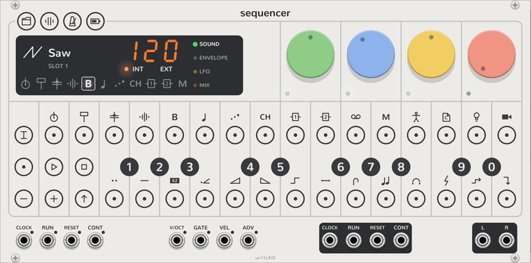

# Quickstart

This page is a short tour of the Sequencer's face. Each task takes one or two clicks. [Controls](controls.md) has the
same facts in tables, and [Your first song](guide.md) uses them to make music.

> **If you own an OP-Z.** The face, its icons and its colours are the hardware's. These things are different:
>
> - A key that you hold on the OP-Z latches here. The next section tells how.
> - The display beside the dials shows what the OP-Z app shows: the plug, the tempo and the pages.
> - Each track has ten plug slots on the black keys, and each plug has 14 presets on the white keys.
> - TRACK, SHIFT and a black key set the step length. TRACK, SHIFT and a step set the step count.
> - The breakouts give a track jacks, so that other VCV modules can play its notes or change its sound.
>
> [For OP-Z owners](op-z-owners.md) gives each OP-Z combination and the clicks that do the same thing here.

<picture><source media="(prefers-color-scheme: dark)" srcset="assets/keys/face-off-dark.png"></picture>

## Latch a key

On the OP-Z, you hold one key and press a second key. A mouse can click only one key at a time. Thus a key that you
hold on the OP-Z **latches** here: it stays on after you release the mouse button.

- **TRACK**, **REC**, **PROJECT**, **MIXER** and **TEMPO**: click to latch, and click again to release.
- A step and **SHIFT**: long-press for 0.4 seconds, or Ctrl+click (⌘+click on a Mac). A plain click on these keys
  does a different job.
- **SCREEN** and **STOP**: hold the mouse button down. They work only while you hold them, as on the OP-Z.

A latched key blinks or lights white. To stop long presses or Ctrl+clicks from latching keys, use the Sequencer's
context menu: **Long-press toggles hold** and **Ctrl-click toggles hold**.

## Play

1. Click a white or black key to play the selected track. The keys are two octaves, from F3 to E5.
2. Click **−** or **+** to move the keyboard down or up an octave.
3. Click **PLAY** to start the pattern, and **STOP** to stop it.

## Select a track

1. Click a track's key along the bottom of the display. Tracks 1 to 4 are drums, 5 to 8 are synths, and 9 and 10
   are send effects. The last key is the master track.

The steps, the keys and the dials now work on that track.

## Write a pattern

1. Play a note on the keys.
2. Click a step. The step lights orange, and plays that note.
3. Click a lit step to clear it.

To make a note longer, latch its step and click a later step. To change a step's notes, latch it and play keys.

## Change the sound

1. Turn a dial. The four dials change the selected track's sound.
2. Click **SHIFT**, or a page name on the display, to change the page. The pages are sound (green), envelope (blue),
   LFO (yellow) and mix (red).
3. Double-click a dial to reset it.

Hover over a dial to see its name and value.

## Choose a plug

1. Click **TRACK**. It lights.
2. Click a black key. The track plays the plug in that plug slot, and the display shows its name.
3. Click a white key to load one of the plug's presets. To store the dials in a preset, long-press the white key.
4. Click **REC** to make a random sound. Press Ctrl+Z to undo it.
5. Click **TRACK** to release it.

To put a different plug in a plug slot, right-click the Sequencer and open **Plug slots**.

## Set the step count and the step length

1. Click **TRACK**, then latch **SHIFT**.
2. Click a step. The track now plays from step 1 to that step.
3. Click a black key to set the step length: 1 to 8 sixteenths, or 16. Black key 0 moves one step for each trigger
   at the **ADV** input.
4. Release **SHIFT** and **TRACK**.

## Lock a dial on one step

1. Latch a step.
2. Turn a dial. The step now plays with that value. The dial's small light turns white.
3. Release the step.

To remove the lock, latch the step and double-click the dial.

## Record

1. Click **REC**, then click **PLAY**.
2. Play keys. The Sequencer records the notes onto the steps.
3. Turn a dial while you record. The Sequencer records the turn as a lock on each step that it passes.
4. Click **REC** to stop recording.

## Add step components

1. Latch **SHIFT**, then click one or more steps. They blink.
2. Click a white key to choose a component, then a black key to choose its value.
3. Release **SHIFT**.

Each white key has the icon of its component above it. [Step components](step-components.md) tells what each one
does.

## Set the tempo

1. Click **TEMPO**.
2. Type three digits on the black keys, such as 1, 2 and 0 for 120. Or click a white key on each beat to tap a tempo.
   The tempo can be 40 to 200.
3. Click **TEMPO** again.

A patched **CLOCK** input sets the tempo instead. The display then shows **EXT**.

## Mute a track

1. Click **MIXER**.
2. Click a step to mute the track that it selects. The track stops its notes, and the last note rings on.
3. To cut the track's sound at once, latch **SHIFT** first. The step lights red.
4. Click **MIXER** again.

## Choose a pattern

1. Click **PROJECT**.
2. Click a step to play one of the 16 patterns.
3. To chain patterns, click **PLAY**, click the steps in the order to play them, and click **PLAY** again.
4. Click **PROJECT** again.

## Save and load a project

1. Click **PROJECT**.
2. Long-press a black key to save the song in that project slot. Click a black key to load a project.
3. Click **PROJECT** again.

## Clear

- To clear a track, click **TRACK** and hold **STOP** for a second. The steps fill red. Release early to keep them.
- To clear a pattern, click **PROJECT** and hold **STOP** for a second.
- To clear a step's locks, latch the step and hold **STOP**.

Every change on the face is one step of Rack's undo, so Ctrl+Z returns it.

## Next

- [Controls](controls.md): every key, mode and colour, in tables.
- [The Sequencer](sequencer.md): its chapters, which tell about each control in full.
- [Your first patch](patching.md): the breakouts, and the Sequencer with other VCV modules.
