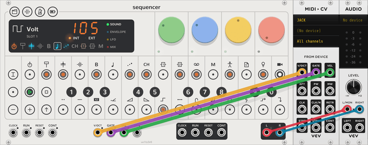
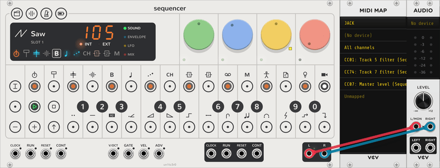
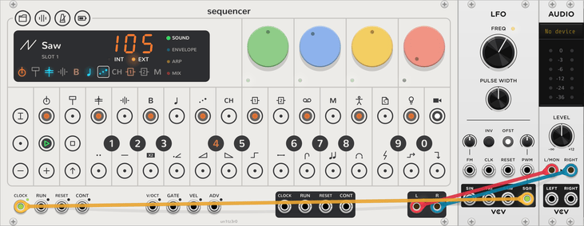
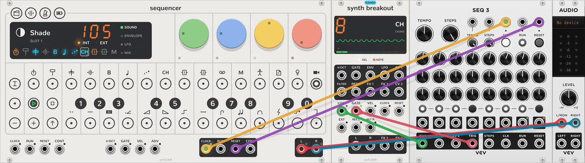
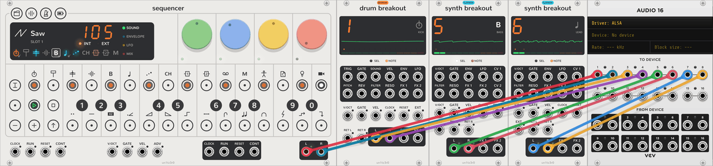
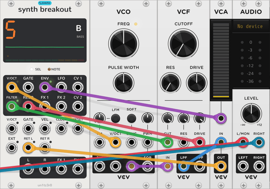
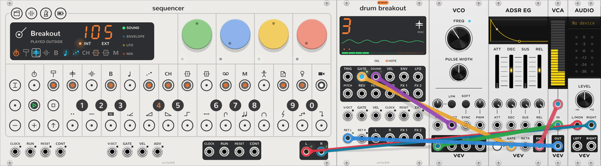
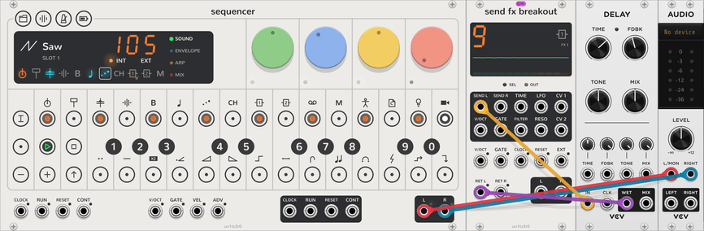
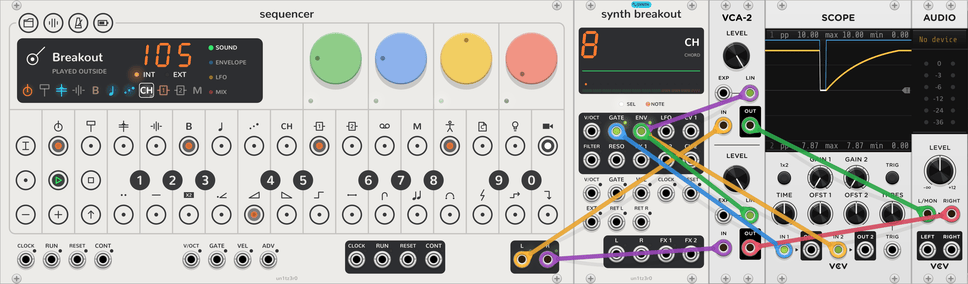
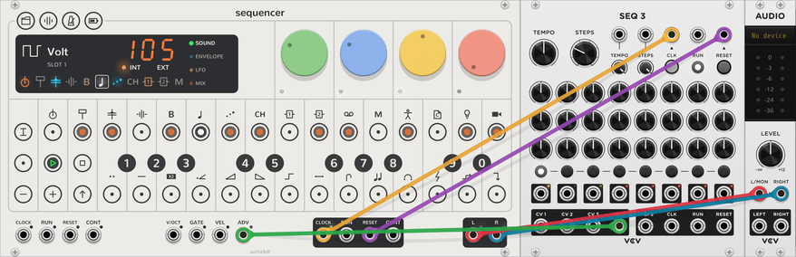

# Patch recipes

Each recipe reaches one goal in a few steps. Each one has a demo patch in [patches/](../patches). The demo patch plays
the song from [Your first song](guide.md), with the recipe's modules in it. Open it with **File > Open**, and click
**PLAY**.

The recipes use modules from VCV's free Core and Fundamental plugins. You can use other modules that do the same jobs.
[Rack in two minutes](rack-basics.md) tells how to add a module and patch a cable.

| Goal | Demo patch |
| --- | --- |
| [Play from a MIDI keyboard](#play-from-a-midi-keyboard) | [midi-keyboard.vcv](../patches/midi-keyboard.vcv) |
| [Turn the dials from a MIDI controller](#turn-the-dials-from-a-midi-controller) | [midi-map.vcv](../patches/midi-map.vcv) |
| [Follow another clock](#follow-another-clock) | [follow-clock.vcv](../patches/follow-clock.vcv) |
| [Lead other modules](#lead-other-modules) | [lead-clock.vcv](../patches/lead-clock.vcv) |
| [Record each track alone](#record-each-track-alone) | [stems.vcv](../patches/stems.vcv) |
| [Play a track with your own voice](#play-a-track-with-your-own-voice) | [own-voice.vcv](../patches/own-voice.vcv) |
| [Play drum modules from a drum track](#play-drum-modules-from-a-drum-track) | [drum-modules.vcv](../patches/drum-modules.vcv) |
| [Put an outside effect on an FX track](#put-an-outside-effect-on-an-fx-track) | [outside-effect.vcv](../patches/outside-effect.vcv) |
| [Move other modules from a track](#move-other-modules-from-a-track) | [pump.vcv](../patches/pump.vcv) |
| [Step a track from triggers](#step-a-track-from-triggers) | [advance.vcv](../patches/advance.vcv) |
| [Move projects to and from an OP-Z](#move-projects-to-and-from-an-op-z) | None |

## Play from a MIDI keyboard

<picture><source media="(prefers-color-scheme: dark)" srcset="assets/recipes/midi-keyboard-dark.png"></picture>

Play the selected [track](how-it-works.md#tracks) from a MIDI keyboard, and record what you play.

1. Add a **MIDI to CV** module. On its display, choose your MIDI driver and your keyboard.
2. Right-click MIDI to CV, and set **Polyphony channels** to 3 or more, for chords.
3. Patch its **V/OCT**, **GATE** and **VEL** outputs to the Sequencer's **V/OCT**, **GATE** and **VEL** inputs.
4. Click a track key to select a track.

The keyboard plays the selected track, as the Sequencer's keys do. Select another track, and the keyboard plays that
track. To record, latch **REC**: see [Record](steps.md#record). If a note does not stop, click **STOP** while the
Sequencer is stopped.

## Turn the dials from a MIDI controller

<picture><source media="(prefers-color-scheme: dark)" srcset="assets/recipes/midi-map-dark.png"></picture>

Turn a dial's job from a control on a MIDI controller, such as a fader or a rotary control.

1. Add a **MIDI Map** module. On its display, choose your MIDI driver and your controller.
2. On the Sequencer, select the track, and click the page that has the job.
3. On MIDI Map, click **Unmapped**. The row shows **Mapping...**.
4. Click the Sequencer's dial.
5. Move a control on your controller.

The row now names the job, for example **Track 5 filter**. The control moves that job of that track, also when
you select another track or page. A small square shows beside the dial while it shows a mapped job.

The demo patch maps three MIDI controls. CC 1, the mod wheel, moves track 5's filter. CC 74 moves track 7's filter,
and CC 7 moves the master level.

## Follow another clock

<picture><source media="(prefers-color-scheme: dark)" srcset="assets/recipes/follow-clock-dark.png"></picture>

Let another module, a DAW or a MIDI device set the tempo.

1. Patch the clock to the Sequencer's **CLOCK** input.
2. Right-click the Sequencer, and set **Clock pulses per beat** to the clock's rate.
3. Click **PLAY**.

**EXT** lights, and the tempo readout shows the clock's tempo. The Sequencer starts at the next pulse. Read
[Tempo](tempo.md#an-outside-clock) for the details.

| Clock | Patch | Clock pulses per beat |
| --- | --- | --- |
| An LFO or a clock module | Its pulse output to **CLOCK** | Its pulses for each beat. The demo's LFO runs at 7 Hz, which is 4 pulses a beat at 105 BPM. |
| A DAW or a MIDI device, through **MIDI to CV** | **CLK** to **CLOCK**, and **STRT** to **RESET** | 24, the MIDI clock's rate. |

When the MIDI clock starts, **STRT** returns the Sequencer to step 1. When the clock stops, the Sequencer waits at
its place.

## Lead other modules

<picture><source media="(prefers-color-scheme: dark)" srcset="assets/recipes/lead-clock-dark.png"></picture>

Make other sequencers and clocked modules follow the Sequencer.

1. Patch the Sequencer's **CLOCK** output to the other module's clock input.
2. Patch the Sequencer's **RESET** output to the other module's reset input.
3. Right-click the Sequencer, and set **Clock pulses per beat** to the rate that the other module needs.

The other module steps in time with the Sequencer, and starts from its first step when you click **PLAY**.

- **CLOCK** gives pulses only while the Sequencer plays.
- **RUN** is high while the Sequencer plays. Patch it to a module that runs while its run input is high. Do not patch
  it to SEQ 3, because each pulse at the run input of SEQ 3 starts or stops it.
- **CONT** gives a pulse when the Sequencer continues from where it stopped.

In the demo patch, SEQ 3 steps each sixteenth. Its **CV 1** and **TRIG** go to the **V/OCT** and **GATE** inputs of a
Synth Breakout that has track 8 (chord). Track 8's plug plays SEQ 3's melody, in the mix.

## Record each track alone

<picture><source media="(prefers-color-scheme: dark)" srcset="assets/recipes/stems-dark.png"></picture>

Record each track on its own channels, for example to mix them in a DAW.

1. Add a breakout for each track that you want alone, directly to the right of the Sequencer. See
   [Breakouts](breakout.md).
2. Patch each breakout's **L** and **R** to your recorder, or to an **Audio-16** for your DAW.
3. Patch the Sequencer's **L** and **R** to two more channels.

Each breakout's track now plays at its own jacks, and leaves the mix. The Sequencer's **L** and **R** have the
other tracks. The demo patch takes track 1 (kick), track 5 (bass) and track 6 (lead) out alone.

- A track's FX sends still go to the FX tracks, in the mix. To record a track's sends alone too, patch the breakout's
  **FX 1** and **FX 2** outputs. The sends then go there in place of the FX tracks.
- Many recorders have a gate input that records while it is high. Patch the Sequencer's **RUN** output to it. Each
  recorder then records while the Sequencer plays.

## Play a track with your own voice

<picture><source media="(prefers-color-scheme: dark)" srcset="assets/guide/breakout-env-dark.png"></picture>

Play a synth track with a VCO, a VCF and a VCA in place of its plug. [Your first patch](patching.md) builds this patch
one step at a time.

1. Add a **Synth Breakout** directly to the right of the Sequencer. It takes track 5 (bass).
2. Patch its **V/OCT** output to a VCO, and the VCO to the breakout's **RET L**.
3. Optional: patch **FILTER** and **RESO** to a VCF, and **ENV** to a VCA. The track then stops doing those jobs
   itself.

The track's steps play your VCO, and the sound returns through the track into the mix. To use a stereo voice, patch
**RET R** too.

## Play drum modules from a drum track

<picture><source media="(prefers-color-scheme: dark)" srcset="assets/recipes/drum-modules-dark.png"></picture>

Play drum modules, or any other sound, from a drum track's steps.

1. Add a **Drum Breakout** directly to the right of the Sequencer. Right-click it, and choose the track.
2. Patch its **TRIG** output to the drum module's trigger input, or **GATE** to an envelope's gate input.
3. Patch the drum module's output to the breakout's **RET L**.
4. Optional: patch **SOUND** to the module's pitch input. Each key then plays a different pitch.
5. Optional: patch **VEL** to an accent or level input.

The track's steps, step components and locks now play your module. In the demo patch, track 3 (perc) plays a VCO
through an ADSR and a VCA. **SOUND** sets the VCO's pitch, so each key of the perc pattern sounds a different note.

The **retrig** and **mono** note styles keep the track's envelope open, so your module must end each sound itself.
See [Drum Breakout](breakout.md#drum-breakout).

## Put an outside effect on an FX track

<picture><source media="(prefers-color-scheme: dark)" srcset="assets/recipes/outside-effect-dark.png"></picture>

Use a delay, reverb or other effect module as an FX track's effect.

1. Add a **Send FX Breakout** directly to the right of the Sequencer. It takes track 9 (FX 1).
2. Patch its **SEND L** to the effect's input. For a stereo effect, patch **SEND R** too.
3. Patch the effect's wet output to the breakout's **RET L**. For a stereo effect, patch its right output to **RET R**.
4. On a track's mix page, raise **FX 1**.

That track's send now goes through your effect, and returns into the mix. In the demo patch, track 7 (arp) sends to
a Fundamental Delay at a dotted eighth. See [Send FX Breakout](breakout.md#send-fx-breakout) for the **TIME** output
and the dial outputs.

## Move other modules from a track

<picture><source media="(prefers-color-scheme: dark)" srcset="assets/recipes/pump-dark.png"></picture>

Use a track's steps as a source of envelopes and CVs for other modules. A breakout gives its **ENV**, **LFO** and
dial outputs only while it has the track's notes, so patch a note output first.

1. Add a **Synth Breakout** directly to the right of the Sequencer. Right-click it, and choose **Track 8, chord**.
2. Patch its **GATE** output to any input, for example a Scope. The track's plug is now silent.
3. Patch **ENV**, **LFO**, **CV 1** or **CV 2** to the modules that you want to move.
4. Write notes on track 8. Each note starts the envelope.

The modules now move with track 8's steps. The demo patch makes the whole mix pump on each beat:

- Track 8 has a note on each beat, four steps long, with a slow attack and a full sustain.
- The Sequencer's **L** and **R** go through a **VCA-2**, and **ENV** sets its level.

**CV 1** and **CV 2** give the sound page's first two dials, so a [parameter lock](steps.md#parameter-locks) on a step
gives that step its own voltage. The **LFO** output gives the track's LFO.

## Step a track from triggers

<picture><source media="(prefers-color-scheme: dark)" srcset="assets/recipes/advance-dark.png"></picture>

Move one track a step for each trigger, out of time with the other tracks.

1. Select the track.
2. Latch **TRACK**, then latch **SHIFT**.
3. Click black key 0, **Per ADV trigger**. Release **SHIFT** and **TRACK**.
4. Patch triggers to the Sequencer's **ADV** input.

The track moves one step for each trigger. The other tracks keep the tempo. **PLAY** starts the track from step 1, as
it does the others.

In the demo patch, the Sequencer's **CLOCK** drives a SEQ 3 with three steps and only its first gate on. The **TRIG**
of SEQ 3 then gives a trigger each three sixteenths. Track 6 (lead) plays at that rate, against the four beats of the
bar. The **gate step** [jump](step-components.md#notes) sends the same trigger from a track's own step.

## Move projects to and from an OP-Z

Move a [project slot](project.md#project-slots) to an OP-Z, or bring one from it. An OP-Z keeps its projects as
`project01.opz` to `project10.opz` in the `projects` folder of its disk mode. See teenage engineering's
[disk mode guide](https://teenage.engineering/guides/op-z/disk-mode) for how to open it.

To send your projects to an OP-Z:

1. Right-click the Sequencer. Open **Projects**, and click **Export the slots to a projects folder…**. Choose a folder.
2. Make a copy of the OP-Z's own `projects` folder.
3. Copy the new `.opz` files into the OP-Z's `projects` folder.

To bring projects from an OP-Z:

1. Copy the OP-Z's `projects` folder to your computer.
2. Right-click the Sequencer. Open **Projects**, and click **Import a projects folder…**. Choose that folder.

To read one file into the current project slot, click **Import a project into slot N…** in its place.

A project file holds the patterns, the chains and each track's plug. The file's format comes from the OP-Z
community's work, not from teenage engineering, so some track settings are a best guess. The export is not yet
tested on a real OP-Z. The drum kits stay on the
OP-Z, and the Sequencer keeps its own. See [Project](project.md#project-files).

## Next

- [Troubleshooting](troubleshooting.md), when something does not work.
- [Breakouts](breakout.md): every jack of the three breakouts.
- [Controls](controls.md): every key, mode and colour.
