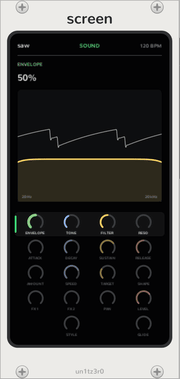

# Screen

<picture><source media="(prefers-color-scheme: dark)" srcset="assets/guide/screen-dark.png"></picture>

The Screen does the job of the OP-Z's phone app. The OP-Z has no screen, because you carry one already. Put the Screen
in a Sequencer's [row](how-it-works.md#the-row), and it shows the track that the Sequencer has selected. It makes no
sound and has no jacks.

## What it shows

- **The top line:** the track's plug, the page that the dials are on, and the tempo.
- **The value:** the dial that you turned last, in its colour, with its value.
- **The picture:** a picture of the page, as in the table below.
- **The dials:** every dial of every page, as an arc in its colour. The page that the dials are on lights.

| Page | Picture |
| --- | --- |
| Sound | A scope of the track's sound, with the filter's curve over it. On an FX track, also the time. |
| Envelope | The envelope, with each stage in its dial's colour, and a dot on it for each voice that plays. |
| LFO | One cycle of the shape, as deep as the amount, with the speed, the target and a dot at the phase now. |
| Arp | Sixteen beats of the arp over a chord: each note as high as the pattern puts it, and as big as its accent. |
| Mix | The two sends, the pan, the output meters and the level. |
| Track mode | The note style, and the glide as a slide between two notes. |

Outside a Sequencer's row, or with the master track selected, the Screen tells you where it must go.

## Turn a dial

1. Click a dial's arc. The Screen selects the dial and shows its page. The track mode row also latches the Sequencer's
   **TRACK**.
2. Drag up or down anywhere on the Screen to turn the dial. Hold Ctrl for fine steps.

Each drag is one step of Rack's undo.

<picture><source media="(prefers-color-scheme: dark)" srcset="assets/guide/arp-screen-dark.png"></picture>

## Kit editor

<picture><source media="(prefers-color-scheme: dark)" srcset="assets/guide/kit-screen-dark.png"></picture>

With a drum track selected, a **KIT** button shows beside the dial's value. Click it to show the track's
[kit](kits.md) in place of the page's picture. Click it again to return.

- **The top strip** is the whole kit, with a mark where each slice starts. The slice that the editor shows is shaded.
  Click a slice in the strip to show it. When you play a key, the editor also shows its slice.
- **The slice** is below the strip. Drag near its green start or its blue end to move it. Hold Ctrl for fine steps.
- **TUNE** and **LEVEL:** drag up or down. Tune goes over four octaves, and level goes up to 400%.
- **PLAY:** click to change the play mode: one shot, gate or loop.
- **REVERSE:** click to play the slice backward, or forward again.

The slice's name and length show in place of the dial's value. Each drag or click is one step of Rack's undo. The
dials below work as before.

An edit to an OP-Z kit or a built-in kit makes a copy of it in its plug slot. The copy saves with the patch, as a kit
from a file does.

## The row

A Screen passes the row on, so a breakout to its right still gets its track. Two Screens show the same track.
