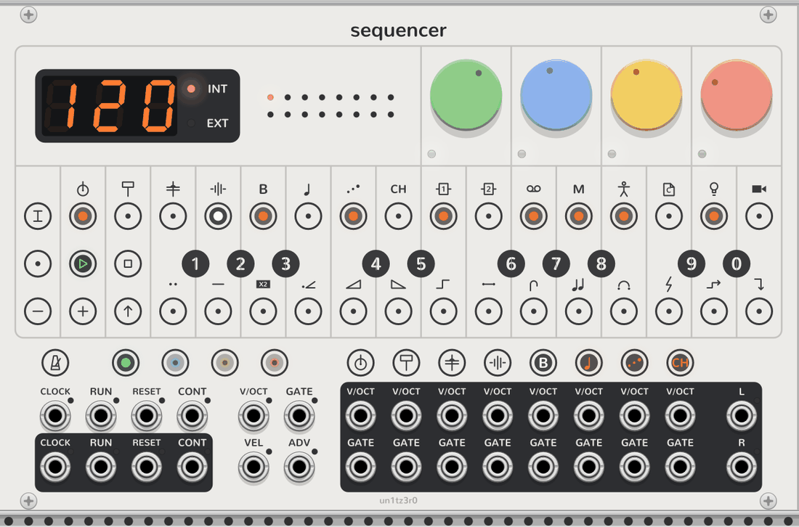

# Sequencer

<picture>
  <source media="(prefers-color-scheme: dark)" srcset="assets/sequencer-dark.png">
  
</picture>

The OP-Z's front panel, and the master of the OP-Z modules to its right. It keeps the tempo and the transport and
sequences the OP-Z's first eight tracks: kick, snare, perc and sample, then bass, lead, arp and chord. Each track has
16 steps of up to four notes, with micro timing, note lengths, step count and step length.

## The chain

Place engines to its right, Screens beside them if you like, and they need no cables. The first synth engine plays
track 5 (bass), the next track 6, and so on; drum engines will take tracks 1 to 4 the same way. Each track has poly
**V/OCT** and **GATE** outputs. While a track's GATE is unpatched, its notes, velocity and the tempo go to its engine
over the bus instead. Engines with their own outputs unpatched are mixed into **L** and **R**. A module from another
plugin ends the chain.

## The face

The face copies the OP-Z's, icons and all, scaled up to fill the panel above the jacks: four dials over 17 columns
of round keys. **TRACK**, **REC** and **−**, **PLAY** and **+**, **STOP** and **SHIFT** on the left, the 16 steps along
the top under the track icons, the black keys numbered 1 to 0 on the column lines, and the white keys along the
bottom under the step component icons. Each key has an RGB LED that lights up its symbol. The tempo display and the
selected track's channel dots sit where the OP-Z's speaker is. Under the face, a row of keys: **TEMPO**, the four
pages, and a key per track over its jacks.

## Tracks and dials

- **Selecting a track:** click its key over its jacks (white while selected, orange while it plays), or switch
  **TRACK** on and click one of steps 1 to 8. The keys, steps, dials and recording all work on the selected track.
- **Dials:** they are the selected track's engine's dials, so turning one turns that parameter on the engine, with
  its own tooltip, undo and MIDI mapping. Click **SHIFT**, or one of the four page keys, to change the page; the
  page keys and the dials' LEDs show it in its colour.

## Steps

- **Pasting and clearing:** click an empty step to paste the last notes played (a chord, if they were down
  together), or a lit step to clear it. Steps past the step count glow dimly and don't play. Right-click a step to
  set its notes' velocity, micro timing and length.
- **Holding a step:** Rack can't hold one button while clicking another, so a long press or a Ctrl+click (⌘+click
  on a Mac) picks a step up, and it blinks until clicked again. Either can be switched off in the context menu. While
  a step is held, the keys add and remove its notes, clicking another step makes its notes last to the end of that
  one (blue LEDs show how far; the same click again restores the default length), and **−** and **+** nudge it a
  tick, 1/24 of a step. Picking a step up while stopped plays it, and copies it for pasting.
- **Step components:** with **SHIFT** latched, steps take components that bend how they play. See
  [Step components](step-components.md).

## Modes

- **Track mode:** click **TRACK** to switch it on, and again to switch it off. Steps 1 to 8 select a track. The dials
  set its **note length** (1/64 to a bar with the dotted values between, then drone), the engine's **note style**,
  **quantize** (pulls micro timing towards the grid as it plays) and the engine's **portamento**. The black keys set
  the step length in blue (1 to 8 for ×1 to ×8, 9 for ×16, 0 for one step per trigger on **ADV**), and **−** and
  **+** shift the pattern a step. With SHIFT latched too, the steps set the step count. **STOP** lets go of the
  notes, and held for a second clears the track.
- **Tempo mode:** click **TEMPO** to switch it on. The dials set the **tempo** (40 to 200 BPM) and **swing** (50%,
  straight, to 75%, which delays every second sixteenth). Type a tempo on the black keys, three digits as on the
  OP-Z, or tap one on the white keys. Its LED flashes on the beat.
- **SHIFT:** a click turns the page. A long press or a Ctrl+click latches it, for track mode's step count and the
  step components.

## Recording

Click **REC** to switch it on. While playing, notes from the keys and inputs go into the nearest step with their
micro timing and length. Hold notes on the inputs and click **−** to erase them from the steps they pass instead,
until they're released. While stopped, REC records a step at a time: each note or chord goes into the blinking step,
which moves on when they're released. Click a step to move it there.

## Transport and clock

- **Transport:** **PLAY** starts every track from the first step, or again from it while playing. **STOP** stops,
  and when stopped already, lets go of every note, the live ones too. Pattern edits can be undone like any other
  change.
- **Transport jacks:** **RUN** plays from the start while high and stops when it falls. **CONT** carries on from
  where it stopped. **RESET** starts over while playing. The outputs of the same names follow the sequencer: RUN is
  high while playing, and RESET and CONT pulse as it starts and carries on.
- **Clock:** the display shows the tempo, with **INT** lit. A patched **CLOCK**, at 4 pulses per beat unless you
  change it in the context menu, takes over and lights **EXT**, and the display shows dashes until it has timed two
  pulses. PLAY then waits for the next pulse, and the sequencer follows the pulses as they speed up, slow down or
  stop. The **CLOCK** output pulses while it plays.

## Notes in

- **Keys and inputs:** the keys, F3 to E5 as on the OP-Z, play the selected track while they're down, and so do notes
  on the poly **V/OCT**, **GATE** and **VEL** inputs (from MIDI-CV, say), which follow their V/OCT while held. **−**
  and **+** move the keyboard an octave.
- **Polyphony:** as the OP-Z's, one channel for every track but the lead (3) and chords (4). Change the selected
  track's in the context menu. A new note takes the channel silent longest, or failing that the one playing longest,
  and its gate drops for a sample so the engine retriggers.
