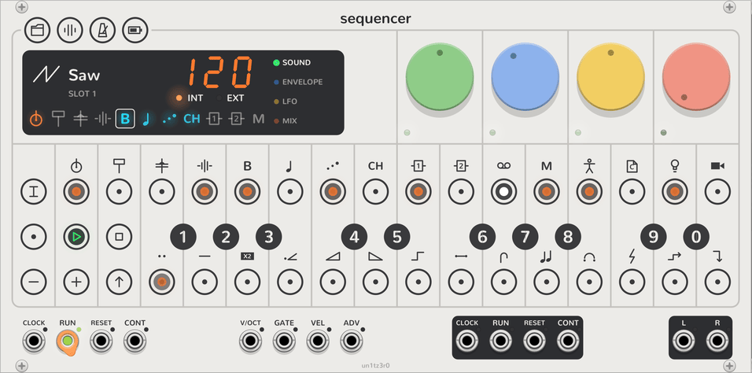
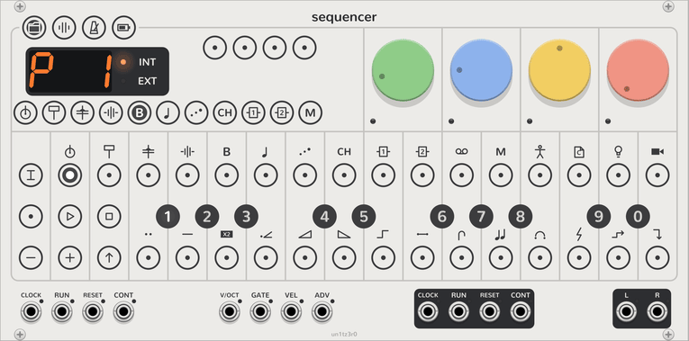

# Sequencer

<picture><source media="(prefers-color-scheme: dark)" srcset="assets/modules/Sequencer-large-dark.png"></picture>

The OP-Z, face and sounds. It keeps the tempo and the transport and plays the OP-Z's first eight tracks: kick, snare,
perc and sample, then bass, lead, arp and chord, the two [FX tracks](fx-tracks.md), 9 and 10, that the others send
to, and the [master track](#master-track) that transposes them in key. Each track plays a [plug](#plugs) from its ten
slots, and has 16 steps of up to four notes, with micro timing, note lengths, step count and step length. A project
has 16 [patterns](#patterns-and-chains) of them all, chained to play in turn, and ten project slots save it all.

New to it? Start with [your first song](guide.md) and the [quickstart](quickstart.md).

## Plugs

A track's sound is its **plug**: a synth engine on tracks 5 to 8 ([synth tracks](synth-tracks.md)), a kit of 24
sounds on tracks 1 to 4 ([drum tracks](drum-tracks.md)), and a send effect on the FX tracks
([FX tracks](fx-tracks.md)). Each track has ten slots of them, on the black keys in [track mode](#modes): click one
and the track plays that plug from its next note, its sound dials where the plug starts them (a kit leaves them as
they are), while the last one rings out. The display shows the plug playing, its icon, its slot and the preset loaded.

A new Sequencer fills the slots for you: the OP-Z's own engines first on each synth track, as the hardware starts
them, then the rest; Delay, Reverb, Rymd, Chorus-80, Crush and Dist on both FX tracks, FX 1 playing the Delay and FX 2
the Reverb; and on each drum track the OP-Z kits sampled for it, then its built-in kit. Change them in the context
menu's **Plug slots**: a submenu for each track, and one for each slot, with every plug of the track's kind, or for a
drum track, the [kits](kits.md) and the files to load into the slot. Each change there is one step of Rack's undo.

A patch from before 2.1.0, when each track's engine was a module beside the Sequencer, opens with every track playing
the plug its module was, with that module's dials and settings, and a Drum module's kit from a file back in a slot.
Rack still lists the old modules as missing; save the patch again in this version and it no longer needs them.

Every track mixes into **L** and **R** at its level and pan, through the mixer's levels and punch. Modules placed to
the right reach the tracks over a bus along the row, with no cables:

- A [breakout](breakout.md) hands one track to other modules: with its audio outputs patched, the track's sound leaves
  there instead of the mix; with its note outputs patched, outside modules play the track's notes, and their sound comes
  back in through the track. The track's key on the display shows a small jack in its corner while a breakout has it.
- A [Screen](screen.md) shows the selected track: every page of dials at once, and a drum track's kit to edit.

A module from another plugin ends the bus: anything after it isn't reached.

## The face

The face copies the OP-Z's, icons and all, scaled up to fill the panel above the jacks: four dials over 17 columns
of round keys. **TRACK**, **REC** and **−**, **PLAY** and **+**, **STOP** and **SHIFT** on the left, the 16 steps along
the top under the track icons, the black keys numbered 1 to 0 on the column lines, and the white keys along the
bottom under the step component icons. Each key has an RGB LED that lights up its symbol. The OP-Z's four index keys,
**PROJECT**, **MIXER**, **TEMPO** and **SCREEN**, sit on the face's top edge in its corner, as they sit on top of the
hardware. Where the OP-Z's speaker is, beside the dials, is the display the hardware has no room for, standing in for
the phone app: the selected track's plug with its icon, slot and preset, the tempo with **INT** and **EXT**, the four
pages down the right, and along the bottom a key per track: the eight tracks, the two FX tracks, then **MASTER**. A
track's key glows orange with its loudest voice, flashes cyan at each note, is outlined while selected, and shows a
jack while a breakout has the track; its name is in its tooltip. Under the face, one
row of jacks: the transport's inputs, the notes to record, then the transport's outputs and the mix.

## Tracks and dials

- <picture><source media="(prefers-color-scheme: dark)" srcset="assets/keys/select4-playing-dark.png"></picture> **Selecting a track:** click its key on the display, or switch
  **TRACK** on and click one of steps 1 to 8, 9 or 10 for an FX track, or 12 for the master track. The keys, steps, dials and recording all work on the selected track.
- <picture><source media="(prefers-color-scheme: dark)" srcset="assets/keys/page1-page-dark.png"></picture> **Dials:** they are the selected track's, so turning one turns that parameter of its sound, named as its plug
  names it in the tooltip, with its own undo and MIDI mapping. Click **SHIFT**, or one of the four pages on the display, to change the page;
  the display and the dials' LEDs show it in its colour. In track, tempo and mixer mode they set those modes' own
  values instead.

## Steps

- <picture><source media="(prefers-color-scheme: dark)" srcset="assets/keys/step4-stopped-dark.png"></picture> **Pasting and clearing:** click an empty step to paste the last notes played (a chord, if they were down
  together), or a lit step to clear it. Steps past the step count glow dimly and don't play. Right-click a step to
  set its notes' velocity, micro timing and length.
- <picture><source media="(prefers-color-scheme: dark)" srcset="assets/keys/step0-held-dark.png"></picture> **Holding a step:** Rack can't hold one button while clicking another, so a long press or a Ctrl+click (⌘+click
  on a Mac) picks a step up, and it blinks until clicked again. Either can be switched off in the context menu. While
  a step is held, the keys add and remove its notes, clicking another step makes its notes last to the end of that
  one (blue LEDs show how far; the same click again restores the default length), and **−** and **+** nudge it a
  tick, 1/24 of a step. Picking a step up copies it for pasting, and while stopped plays it too.
- <picture><source media="(prefers-color-scheme: dark)" srcset="assets/keys/dial0-held-dark.png"></picture> **Parameter locks:** while a step is held, the dials are that step's. Turn one to lock its parameter on the step,
  and its LED turns white; double-click it to let go of the lock. A lock holds the track's dial where you set it
  for as long as the step is under the playhead, then lets it go back to where the dial is, so the knob itself
  never moves. Any dial on any of the four pages can be locked, and a held step plays with its locks while stopped,
  so you can hear them. A step's tooltip counts its locks, and its context menu clears them. With a step held, hold
  **STOP** until every step lights red to clear its locks (playback carries on); let go sooner to keep them.
- <picture><source media="(prefers-color-scheme: dark)" srcset="assets/keys/shift-shift-dark.png"></picture> **Step components:** with **SHIFT** latched, steps take components that bend how they play. See
  [Step components](step-components.md).

## Modes

<picture><source media="(prefers-color-scheme: dark)" srcset="assets/keys/face-track-dark.png"></picture>

- <picture><source media="(prefers-color-scheme: dark)" srcset="assets/keys/track-track-dark.png"></picture> **Track mode:** click **TRACK** to switch it on, and again to switch it off. Steps 1 to 8 select a track, steps 9
  and 10 the FX tracks, and step 12 the master track. The dials
  set its **note length** (1/64 to a bar with the dotted values between, then drone), the **note style**,
  **quantize** (pulls micro timing towards the grid as it plays) and **portamento**. The black keys pick
  the track's plug from its ten slots, lit white (bright for the one playing), and **−** and **+** shift the
  pattern a step. With SHIFT latched too, the steps set the step count and the black keys the step length in blue
  (1 to 8 for ×1 to ×8, 9 for ×16, 0 for one step per trigger on **ADV**); the master track has no plugs, so its
  black keys always set the step length. The slots are filled from the Sequencer's context menu, **Plug slots**. The
  white keys are the plug's 14 [presets](#presets), and **REC** randomizes the track's sound. **STOP** lets go of the
  notes, and held for a second clears the track.
- <picture><source media="(prefers-color-scheme: dark)" srcset="assets/keys/shift-shift-dark.png"></picture> **SHIFT:** a click turns the page. A long press or a Ctrl+click latches it, for track mode's step count, the
  step components and the mixer's sound mutes.

The index keys stand in for the OP-Z's held keys the same way: click one to switch its mode on, again to switch it
off. Switching one on switches the others, and track mode, off.

- <picture><source media="(prefers-color-scheme: dark)" srcset="assets/keys/metronome-tempo-dark.png"></picture> **Tempo:** the dials set the **tempo** (40 to 200 BPM), **swing** (50%, straight, to 75%, which delays every
  second sixteenth), the **metronome sound** (click, wood, beep, cowbell, hat or blip, higher on each bar's first beat) and the
  **metronome level** (off fully left; it plays into **L** and **R** while the sequencer plays). Type a tempo on the
  black keys, three digits as on the OP-Z, tap one on the white keys, or nudge it a BPM with **−** and **+**. The
  key's LED flashes on the beat.
- <picture><source media="(prefers-color-scheme: dark)" srcset="assets/keys/mixer-mixer-dark.png"></picture> **Mixer:** the dials set the **drum level** (tracks 1 to 4), the **synth level** (tracks 5 to 8), **punch** (a
  compressor on **L** and **R** that gets louder as it squashes) and the **master level** of **L** and **R**. Steps
  1 to 10 light for the tracks that play, and step 12 while the master track moves them; click one to mute its
  track, which stops its gates (a muted FX track silences its effect, and a muted master track stops transposing). With SHIFT latched, a
  click mutes only its sound, and the step lights red. The black keys pick one of ten mute groups, each its own set
  of mutes, and the display shows which.
- <picture><source media="(prefers-color-scheme: dark)" srcset="assets/keys/project-project-dark.png"></picture> **Project:** the steps are the project's 16 [patterns](#patterns-and-chains), and the white keys its saved
  chains. The black keys are ten project slots, lit dimly for the ones in use and brightly for the one
  playing. Click one to load it; the project left is saved to its own slot first, as on the OP-Z, unless
  **Save the project on switching** is off in the context menu's **Projects**. A long press or a Ctrl+click saves
  the project to that slot instead. An empty slot loads as a new, blank project. Holding **STOP** for a second clears
  every track of the pattern playing; with SHIFT latched, the whole project, every pattern and chain. The display
  shows the project's number.
- <picture><source media="(prefers-color-scheme: dark)" srcset="assets/keys/screen-off-dark.png"></picture> **Screen:** hold it to see the battery, on the display and on the steps in green. There is no battery, so it runs
  down slowly while playing and charges while stopped.

## Master track

<picture><source media="(prefers-color-scheme: dark)" srcset="assets/keys/master-master-dark.png"></picture> The OP-Z's track 12. It has no plug: its notes move the tracks it transposes, in key, so a bassline and chords
written once can follow a chord progression. Select it with **MASTER** or step 12 in track mode, and sequence it like
any other track, or play it on the keys.

- **The key:** the Sequencer works out the key and mode from the notes of the bass, lead, arp and chord tracks,
  counting the bass twice and each step's lowest note towards the root, and the display shows it while the master
  track is selected: the root and the mode's number, 1 for Ionian (major) to 7 for Locrian, so `A6` is A minor. With
  no notes yet it's C major. The master track's keys light the key's notes, its root brighter and the note moving
  the tracks brighter still, and each key's tooltip says where it moves them.
- **Moving:** the note nearest middle C that is the key's root (A3 in A minor, say) leaves the tracks where they
  are. Other notes in the key move them by degrees of the scale, so the tracks stay in the key and its mode changes
  with the root, as in a chord progression: D4 in A minor moves every note up three degrees, into D Dorian. A note
  outside the key moves them by semitones instead, changing key: C♯4 moves them up four semitones, into C♯ minor.
- **Note style** (the blue dial in track mode): **latch**, the default, holds each new note until the next, and lets
  go when the pattern starts over or the sequencer stops, unless a key is still held. **Free** moves the tracks only
  while a note plays. Of several notes at once, the lowest moves them.
- **Which tracks:** the synth tracks, to start with. With the master track selected and SHIFT latched, the track
  keys beside the dials light green for the tracks it moves; click one to add or remove it.
- **The tonality component:** on a step of a track it moves, it changes how that step's notes follow the master
  track. See [Step components](step-components.md).

## Presets

Each plug keeps 14 presets, on the white keys in track mode, the same in every patch. Click one to load it into the
selected track; a long press or a Ctrl+click stores the track's dials there. A preset holds the sound, envelope, LFO
and mix pages, the note style and portamento, but not the arp's dials, which belong to the pattern. The key of the
preset loaded lights brightly and the stored ones dimly. Preset 1 starts as the plug's defaults. Presets are saved
in Rack's user folder, under `vcvopxyz/presets/`, as soon as they're stored.

**REC** in track mode randomizes the sound, envelope and LFO pages, leaving the mix page as it is. A load, a
store, a randomize and a plug picked are each one step of Rack's undo.

## Patterns and chains

<picture><source media="(prefers-color-scheme: dark)" srcset="assets/keys/face-project-dark.png"></picture>

A project has 16 patterns, each a full set of tracks: every track's steps, step components, parameter locks, step
count and length, note length, quantize and polyphony, the slot each track plays and its dials, and the mute group. In
project mode the steps pick them: white for the pattern playing, green for the rest of its chain, and dim for the
others with notes in them.

- **Switching:** click a step to play its pattern. While playing it comes in at once, and every track carries on
  from the step it's on, as on the OP-Z. Its tracks take the plugs and dials the pattern saved; a pattern never played
  keeps them as they are, so a new one starts from the sound of the last.
- **Chains:** click **PLAY** in project mode, and it blinks: the steps now build a chain, the first pattern playing
  at once and the rest after it, up to 32, repeats allowed. The display counts them. Click **PLAY** again to finish.
  A chain plays each pattern to its end, then the next, round and round. A pattern's end is that of its longest
  track (step count times step length, of the tracks that step in time), and every track starts the next pattern
  from its first step together. **PLAY**, outside project mode, starts the chain from its first pattern.
- **Saved chains:** the 14 white keys keep a chain each, lit dimly when one is saved there and brightly for the one
  playing. A long press or a Ctrl+click saves the chain playing to one; a click plays it. Clicking a step makes a
  chain of one pattern again.
- **Copy and paste:** click **SHIFT** in project mode to copy the pattern playing; SHIFT and the steps blink. Each
  step clicked then takes a copy, and **SHIFT** again stops. A paste over the pattern playing is one undo step for
  each track it changes.

A pattern on its own loops each track at its own length, so polymeters drift as before; only a chain brings the
tracks back together at the end of each pattern.

## Projects

A slot keeps everything that makes a song: its 16 patterns, each with every track's steps, settings, plug and dials
(the note style and portamento too), the chain playing and the saved chains, the tempo, swing and metronome, the
mixer's levels and ten mute groups, and the master track with the tracks it moves. Loading one sets the plugs and
dials too, so each track plays the sound it had. The slots save with the patch, and a switch is one step of Rack's
undo, which puts the project left back as it was. Switching patterns isn't an undo step, but each edit in a pattern
is, and undoing it later changes that pattern, whichever is playing.

The context menu's **Projects** moves them in and out of files:

- **Save the slots to a file** and **Load the slots from a file** keep all ten in one JSON file, to carry them from
  one patch to another.
- **Export the slots to a projects folder** writes each slot in use as `project01.opz` to `project10.opz`, the
  files the OP-Z shows in its disk mode's `projects` folder. **Import a projects folder** reads them back into the
  slots of the same numbers, and **Import a project** reads one file into the current slot.

The OP-Z's project files hold more than a slot does: the drum tracks' samples, the module tracks and a 15th saved
chain. All 16 patterns are read and written, with the chain playing and the 14 saved chains. The master track is
written to and read from the file's track 12, and the FX tracks from 9 and 10. An imported file is kept with the
patch, and its export writes the slot over it, so whatever the Sequencer doesn't model goes back unchanged, as do the
file's patterns that the slot never played or changed. Micro timing is written from −12 to +11 ticks, as far as the
OP-Z's files go. The file
format comes from the OP-Z community's reverse engineering, not from teenage engineering, and has not been tried on
a real OP-Z yet, so copy your OP-Z's projects somewhere safe before you put exported files on it.

## Recording

<picture><source media="(prefers-color-scheme: dark)" srcset="assets/keys/rec-rec-dark.png"></picture> Click **REC** to switch it on. While playing, notes from the keys and inputs go into the nearest step with their
micro timing and length. Hold notes on the inputs and click **−** to erase them from the steps they pass instead,
until they're released. While stopped, REC records a step at a time: each note or chord goes into the blinking step,
which moves on when they're released. Click a step to move it there.

Turn a dial while recording and playing to record it as parameter locks: each step the playhead passes while the
dial moves locks it where it is then, and steps it passes while the dial is still keep the locks they had. The dial
itself moves too, for the steps without locks. One turn is one undo step. Hold **STOP** while recording until every
step lights red to clear all the selected track's locks; let go sooner to keep them. Playback stops at the press, as
it always does.

## Transport and clock

- **Transport:** **PLAY** starts every track from the first step, or again from it while playing. **STOP** stops,
  and when stopped already, lets go of every note, the live ones too. Pattern edits can be undone like any other
  change.
- **Transport jacks:** **RUN** plays from the start while high and stops when it falls. **CONT** carries on from
  where it stopped. **RESET** starts over while playing. The outputs of the same names follow the sequencer: RUN is
  high while playing, and RESET and CONT pulse as it starts and carries on.
- **Clock:** the display shows the tempo, with **INT** lit. A patched **CLOCK**, at 4 pulses per beat unless you
  change it in the context menu, takes over and lights **EXT**, and the display shows dashes until it has timed two
  pulses. PLAY then waits for the next pulse, and the sequencer follows the pulses as they speed up, slow down or
  stop. The **CLOCK** output pulses while it plays.

## Notes in

- **Keys and inputs:** the keys, F3 to E5, play the selected track while they're down, and so do notes
  on the poly **V/OCT**, **GATE** and **VEL** inputs (from MIDI-CV, say), which follow their V/OCT while held. **−**
  and **+** move the keyboard an octave.
- **Polyphony:** as the OP-Z's, two channels for each drum track, so a step can hold two sounds, three for the
  lead, four for the chords, and one for bass and arp. Change the selected
  track's in the context menu. With the [arp](synth-tracks.md#arp) on, the arp track holds every note for the arp,
  and its polyphony counts the arp's notes. A new note takes the channel silent longest, or failing that the one playing longest,
  and its gate drops for a sample so the plug retriggers.
