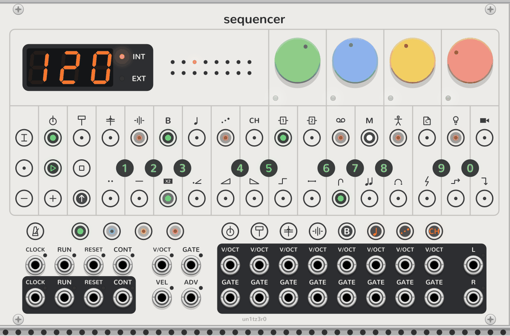

# Step components

<picture>
  <source media="(prefers-color-scheme: dark)" srcset="assets/step-components-dark.png">
  
</picture>

Step components are the OP-Z's per-step modifiers. Each step can carry any number of them, each with a value, and
they change how the step plays rather than what notes it holds.

## Editing

1. Latch **SHIFT** with a long press or a Ctrl+click (⌘+click on a Mac).
2. Click steps to pick them. Picked steps blink green; steps that already have components glow green.
3. Click a white key to put the component above it on every picked step, at a value that does something. Clicking
   it again takes it off.
4. Click a black key to set the component's value, lit green. Clicking a spark's value again cycles which passes it
   fires on (below).
5. Click **SHIFT** to stop editing. **STOP** clears every component on the track.

Tooltips name each key's component or value, and a step's tooltip lists its components. Components are saved with
the patch and can be undone like any other edit.

## The components

| Component | Keys 1 to 9, 0 |
| --- | --- |
| Pulse, pulse hold | The step plays, or holds its note, for 1 to 9 slots before the playhead moves on, or a random number. |
| Multiply | ×1 to ×8 ratchets within the step, a broken chord, or quantize (no micro timing). |
| Velocity | −4 to +3 (in sixteenths of the range, 5 is unchanged), mute, random. |
| Ramp up, ramp down, random | Walk C major from the note, one degree per trigger: 2 to 6 notes over 1 octave (1 to 5) or 3 octaves (6 to 0). |
| Portamento | Glide 1 to 8 into the note (up to a beat), direct, random. |
| Sweep | An out-and-back of the engine's filter (up, down), sound (up, down) or pan over a bar; the first four over two bars; random. |
| Jump | To the start, 2/4, 3/4 or 4/4; skip forward or back a step; random; stay; align with where the track would be; gate step (advances the tracks waiting for triggers). |
| Parameter spark, component spark, trigger spark | Fire the step's [parameter locks](sequencer.md#steps), its components, or its notes, on pass N of every N (1 to 8), random, or reset the count. Again: the first of N, all but the Nth, all but the first. |
| Tonality | Saved, but waiting for the Sequencer to have tonality. |

## Notes

- A slot is one turn of a step under the playhead. Pulse and pulse hold give a step several, so they lengthen the
  pattern; jumps move the playhead without changing the step count.
- Ramps and random use C major until the Sequencer has tonality to supply the key.
- Sweeps travel over the bus, so they move the dials of the engine playing the track, not the dials themselves:
  the knobs stay put while the sound moves. A track with no engine has nothing to sweep.
- The gate step jump pairs with step length 0 (one step per trigger on **ADV**): it advances every track waiting
  for triggers, so one track can clock others.
