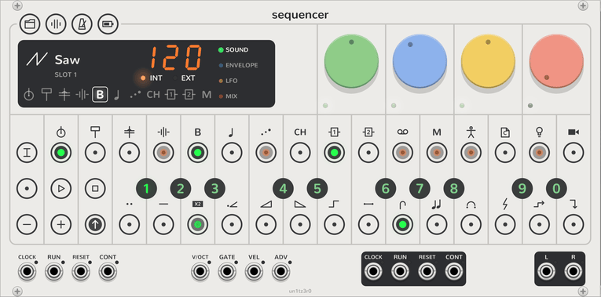

# Step components

<picture><source media="(prefers-color-scheme: dark)" srcset="assets/keys/face-components-dark.png"></picture>

Step components are the OP-Z's per-step modifiers. Each step can carry any number of them, each with a value, and
they change how the step plays rather than what notes it holds.

## Editing

1. Latch **SHIFT** with a long press or a Ctrl+click (⌘+click on a Mac).
2. Click steps to pick them. Picked steps blink green; steps that already have components glow green.
3. Click a white key to put the component above it on every picked step, at a value that does something. Clicking
   it again takes it off.
4. Click a black key to set the component's value, lit green. Clicking a spark's value again cycles which passes it
   fires on (below).
5. Click **SHIFT** to stop editing. **STOP** clears every component on the track.

Tooltips name each key's component or value, and a step's tooltip lists its components. Components are saved with
the patch and can be undone like any other edit.

## The components

| Key | Component | Keys 1 to 9, 0 |
| --- | --- | --- |
| <picture><source media="(prefers-color-scheme: dark)" srcset="assets/keys/key0-off-dark.png"></picture> <picture><source media="(prefers-color-scheme: dark)" srcset="assets/keys/key2-off-dark.png"></picture> | Pulse, pulse hold | The step plays, or holds its note, for 1 to 9 slots before the playhead moves on, or a random number. |
| <picture><source media="(prefers-color-scheme: dark)" srcset="assets/keys/key4-off-dark.png"></picture> | Multiply | ×1 to ×8 ratchets within the step, a broken chord, or quantize (no micro timing). |
| <picture><source media="(prefers-color-scheme: dark)" srcset="assets/keys/key6-off-dark.png"></picture> | Velocity | −4 to +3 (in sixteenths of the range, 5 is unchanged), mute, random. |
| <picture><source media="(prefers-color-scheme: dark)" srcset="assets/keys/key7-off-dark.png"></picture> <picture><source media="(prefers-color-scheme: dark)" srcset="assets/keys/key9-off-dark.png"></picture> <picture><source media="(prefers-color-scheme: dark)" srcset="assets/keys/key11-off-dark.png"></picture> | Ramp up, ramp down, random | Walk the [key](sequencer.md#master-track) from the note, one degree per trigger: 2 to 6 notes over 1 octave (1 to 5) or 3 octaves (6 to 0). |
| <picture><source media="(prefers-color-scheme: dark)" srcset="assets/keys/key12-off-dark.png"></picture> | Portamento | Glide 1 to 8 into the note (up to a beat), direct, random. |
| <picture><source media="(prefers-color-scheme: dark)" srcset="assets/keys/key14-off-dark.png"></picture> | Sweep | An out-and-back of the track's filter (up, down), sound (up, down) or pan over a bar; the first four over two bars; random. |
| <picture><source media="(prefers-color-scheme: dark)" srcset="assets/keys/key16-off-dark.png"></picture> | Tonality | How the step follows the [master track](sequencer.md#master-track): ignore it; follow the root by semitones only; as usual plus an octave, a fifth or a third; a semitone up or down; or snap to the moved key's scale, its triad, or its root and fifth. |
| <picture><source media="(prefers-color-scheme: dark)" srcset="assets/keys/key18-off-dark.png"></picture> | Jump | To the start, 2/4, 3/4 or 4/4; skip forward or back a step; random; stay; align with where the track would be; gate step (advances the tracks waiting for triggers). |
| <picture><source media="(prefers-color-scheme: dark)" srcset="assets/keys/key19-off-dark.png"></picture> <picture><source media="(prefers-color-scheme: dark)" srcset="assets/keys/key21-off-dark.png"></picture> <picture><source media="(prefers-color-scheme: dark)" srcset="assets/keys/key23-off-dark.png"></picture> | Parameter spark, component spark, trigger spark | Fire the step's [parameter locks](sequencer.md#steps), its components, or its notes, on pass N of every N (1 to 8), random, or reset the count. Again: the first of N, all but the Nth, all but the first. |

## Notes

- A slot is one turn of a step under the playhead. Pulse and pulse hold give a step several, so they lengthen the
  pattern; jumps move the playhead without changing the step count.
- Ramps and random walk the key the Sequencer finds in the synth tracks, and then follow the master track.
- The tonality component acts on each note as it starts, so it follows a master note starting at the same moment.
- Sweeps move the sound the track plays with, not the dials themselves: the knobs stay put while the sound moves.
  The master track has no sound to sweep.
- The gate step jump pairs with step length 0 (one step per trigger on **ADV**): it advances every track waiting
  for triggers, so one track can clock others.
