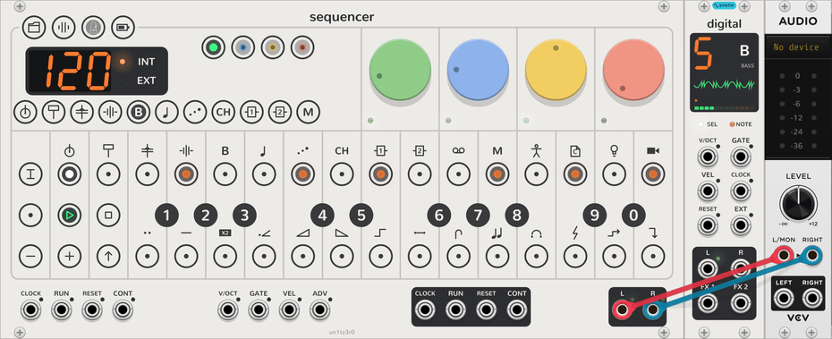
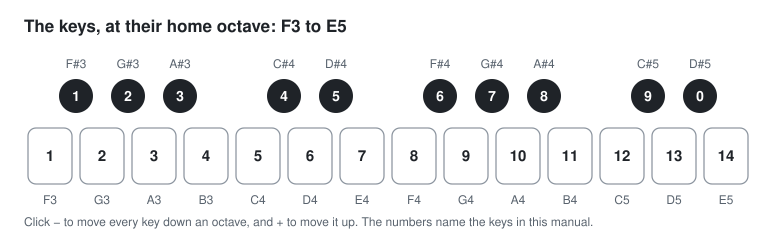

# Steps

<picture><source media="(prefers-color-scheme: dark)" srcset="assets/guide/bass-dark.png"></picture>

The 16 keys along the top are the steps of the selected track. A step holds up to four notes. Each note has a
velocity, a micro timing and a length. A step can also hold [parameter locks](#parameter-locks) and
[step components](step-components.md). This page tells how to write, change, record and clear steps.

## Play the keys

The black and white keys are a keyboard of two octaves, F3 to E5. They play the selected track. The manual numbers
the keys as in this picture.

<picture><source media="(prefers-color-scheme: dark)" srcset="assets/diagrams/keys-dark.svg"></picture>

- Click **−** or **+** to move the keyboard down or up an octave. It moves up to three octaves each way. **−**
  lights while the keyboard is low, and **+** while it is high. The octave is the same for every track.
- On a drum track, the keys play the 24 sounds of its [kit](kits.md). Each octave plays the 24 sounds again.
- The **V/OCT**, **GATE** and **VEL** inputs also play the selected track, as the keys do. A note on these inputs
  follows **V/OCT** while its gate is high.

## Write notes

1. Play a note or a chord on the keys.
2. Click an empty step. The step lights orange. It now holds the notes that you played last.
3. To clear a step, click it again.

The notes of a chord go onto the step together if you play them together, for example from the inputs. A step past
the track's [step count](track.md#step-count-and-step-length) lights a dim orange, and the track does not play it.

## Latch a step

A latched step stays on, so that you can change it with other keys. To latch a step, long-press it, or Ctrl+click it
(⌘+click on a Mac). The step blinks. While a step is latched:

- Click a key to add that note to the step, or to remove it.
- Click a later step to make the notes last to the end of that step. Blue lights show how far. Click the same step
  again to return the default length.
- Click **−** or **+** to move the notes earlier or later by a tick. A step has 24 ticks.
- Turn a dial to [lock](#parameter-locks) its value on the step.

To release the step, click it again. When you latch a step, the Sequencer copies its notes for the next paste. When
the Sequencer is stopped, it also plays them.

## The step's menu

Right-click a step to open its menu. It has three sliders and some commands:

- **Velocity**, 1 to 127.
- **Micro timing**, from −23 to +24 ticks.
- **Length**: the default length, a number of steps, or **Drone**, a note with no end.
- **Clear**, **Clear step components** and **Clear parameter locks**.

## Parameter locks

A parameter lock keeps a dial's value on one step. The track plays with that value while the step plays, and then
returns to the dial's own value. The dial does not move.

1. Latch a step.
2. Turn a dial. The step now locks the dial's value, and the dial's small light turns white.
3. Release the step.

You can lock any dial on any of the four pages. A latched step plays with its locks while the Sequencer is stopped,
so that you can hear them. The step's tooltip counts its locks.

To remove one lock, latch the step and double-click the dial. To remove every lock on the step, latch it and hold
**STOP**.

## Record

Click **REC** to latch it. REC lights red.

- **While playing:** the notes that you play go onto the nearest step, with their micro timing and length.
- **While stopped:** each note or chord goes onto the blinking step. The blinking step then moves on. Click a step
  to record into it.
- **Erase:** hold notes on the **GATE** input, and click **−**. The Sequencer removes those notes from each step that
  the playhead passes, until you release them.
- **Dials:** turn a dial while playing. Each step that the playhead passes gets a lock at the dial's value then. The
  dial also moves.

One turn of a dial is one step of Rack's undo. Click **REC** again to stop recording.

## Clear

Hold **STOP** for a second. The steps fill red as you hold it. Release it before they are full to keep everything.

| Hold STOP with | Clears |
| --- | --- |
| A step latched | That step's parameter locks. |
| **REC** latched | Every parameter lock on the selected track. |
| **TRACK** latched | The selected track's pattern. |
| **PROJECT** latched | Every track of the pattern that plays. |
| **PROJECT** and **SHIFT** latched | The whole project: every pattern and chain. |

With **SHIFT** latched for step components, a click on **STOP** clears every component on the track. A press of
**STOP** outside project mode also stops the Sequencer.
