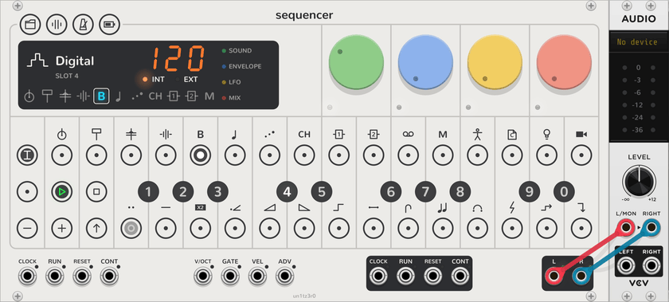
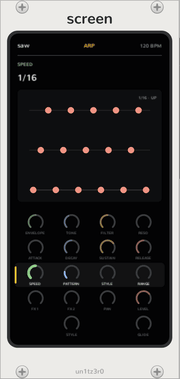

# Synth tracks and their engines

Tracks 5 to 8, bass, lead, arp and chord, are the OP-Z's synth tracks. Each plays one of eleven synth **engines**, its
[plug](sequencer.md#plugs), picked from its ten slots with **TRACK** and a black key; everything on this page but the
last section applies to all of them, and only their two sound dials differ. The [drum tracks](drum-tracks.md) share
all of it but the note styles and portamento. To play a synth track on other modules, use a
[Synth Breakout](breakout.md#synth-breakout).

<picture><source media="(prefers-color-scheme: dark)" srcset="assets/guide/slots-dark.png"></picture>

## Pages

Like the hardware, a track has four dials whose job changes with the page. They are the Sequencer's four while the
track is selected: click **SHIFT** or a page on the display to turn the page, and the dials' LEDs glow in the page's
colour. A [Screen](screen.md) shows every dial on every page and turns them by touch.

| Page | Dials |
| --- | --- |
| Sound (green) | The engine's two dials, **Filter** (low-pass to the left, high-pass to the right, open in the middle), **Reso** |
| Envelope (blue) | **Attack**, **Decay**, **Sustain**, **Release**, 1 ms to 10 s |
| LFO (yellow) | **Amount** (off in the middle), **Speed** (synced 1/64 to 2/1 to the left, free 8 s to 20 Hz to the right), **Target**, **Shape** |
| Arp (yellow, on the arp track in place of the LFO) | **Speed**, **Pattern**, **Style**, **Range**; see [Arp](#arp) |
| Mix (red) | **FX 1** and **FX 2** (sends to the [FX tracks](fx-tracks.md), or to a breakout's outputs of the same names), **Pan**, **Level** |
| Track (white) | **Style** (poly, mono, legato) on the second dial, **Glide** (mono and legato) on the fourth |

**Track mode:** the Sequencer's **TRACK**, or the track row on a Screen, puts the note style and portamento on the
dials, the slots on the black keys and the presets on the white keys. It stands in for holding the hardware's track
key.

## Presets

Each engine keeps 14 presets, shared by every patch: with **TRACK** latched, click a white key to load one, or
long-press it to store the track's dials there. A preset holds the sound, envelope, LFO and mix pages, the note style
and portamento. **REC** in track mode randomizes the sound, envelope and LFO pages instead. See
[the Sequencer](sequencer.md#presets).

## Playing

- **Notes:** the track plays its steps and the Sequencer's keys and note inputs while it's selected, in the
  Sequencer's tempo. A switch of engine takes the next note, while the last engine's notes ring out.
- **Parameter locks:** a Sequencer step can lock any of the track's dials while it plays. The track plays the
  locked value and the dial stays where it is; see [the Sequencer](sequencer.md#steps).
- **Note styles:** poly plays each gate channel on its own voice. Mono plays the newest held note and retriggers
  the envelope on every change, including falling back to an older note. Legato does the same without retriggering.
- **LFO targets:** the two sound dials, filter, resonance, attack, pitch (up to ±2 octaves), pan and level.
- **LFO shapes:** sine, triangle, square, saw, random and external are free-running and bipolar. Bell, triangle,
  square, saw, random and single saw are unipolar and restart with every note (but not legato slides), so they work
  as a second envelope. External follows a [breakout](breakout.md)'s **EXT** input, ±5V, in place of the OP-Z's
  motion sensor.
- **Clock:** the synced speeds follow the Sequencer's tempo, or a breakout's **CLOCK** input while it's patched.

## Arp

<picture><source media="(prefers-color-scheme: dark)" srcset="assets/guide/arp-screen-dark.png"></picture>

On the arp track, track 7, the LFO page is the arpeggiator's, and the track has no LFO. Hold notes or a chord, from
the steps, the keys or the inputs, and it plays them one at a time on the tempo's grid, in key: the master track
moves its notes as it moves any track's, while they're held.

- **Speed** (green): off fully left, which plays the notes as they are; then 1/4, 1/8, 1/8 triplets, 1/16, 1/16
  triplets, 1/32, 1/32 triplets and 1/64. Swing moves its notes as it moves the steps.
- **Pattern** (blue): as played, up, down, up and down, down and up, or random.
- **Style** (yellow): a rhythm of accents over the notes, H as played, M at three quarters, L at half, and - a
  rest: as set, LHLLHLLH, HLLHLLHL, LLHLLHLL, LMH, or LL- (two notes, then a rest).
- **Range** (red): 1 to 4 octaves of the notes, low to high.

Each note lasts half the time to the next. The first plays as soon as the notes are held; while stopped, the grid
starts with it. Mono with portamento slides from note to note, as the guide suggests. A step can lock the arp's
dials like any other. A patch saved before the arp opens with it off, so the arp track plays as it did.

## Out of the Sequencer

Every synth track mixes into the Sequencer's **L** and **R**. A [Synth Breakout](breakout.md#synth-breakout) on the
track takes it out: its **L** and **R** carry the engine on its own, and its **V/OCT**, **GATE** and the other CVs
hand its notes to other modules, whose sound comes back in through the track.

## The engines

| | Engine | Sound | First dial | Second dial |
| --- | --- | --- | --- | --- |
| <picture><source media="(prefers-color-scheme: dark)" srcset="assets/plugs/Digital-dark.png"></picture> | Digital | A sine on a binary counter, driven past full scale so it wraps around like an overflowing integer | **Octave**: how many times each peak wraps, 0 to 7 | **Feedback**: how hard the sine modulates its own phase, leaning it towards a saw |
| <picture><source media="(prefers-color-scheme: dark)" srcset="assets/plugs/Analog-dark.png"></picture> | Analog | A saw, a square an octave below and noise, through a low-pass the amp envelope opens | **Mix**: saw, then saw and sub, then sub and noise | **Envelope**: how far the filter closes between notes, for the envelope to sweep it up to eight octaves |
| <picture><source media="(prefers-color-scheme: dark)" srcset="assets/plugs/Cluster-dark.png"></picture> | Cluster | Seven detuned saws per note | **Tone**: a low-pass that follows the note, from a near sine to fully bright | **Gravity**: pulls the saws together, from almost two semitones each way to one saw |
| <picture><source media="(prefers-color-scheme: dark)" srcset="assets/plugs/Organ-dark.png"></picture> | Organ | Up to four sine carriers and one modulator, in eight algorithms | **Algorithm**: flute, jazz, full and gospel drawbars, reed, pipe, combo, bell | **Tweak**: FM depth, from pure drawbars to grit |
| <picture><source media="(prefers-color-scheme: dark)" srcset="assets/plugs/Bow-dark.png"></picture> | Bow | A bowed string as a waveguide; the bow's speed follows the amp envelope, so a note swells in and rings on | **Tension**: bow pressure and the string's brightness, from airy to biting | **Chorus**: a second string either side of the note, up to 9 cents each way |
| <picture><source media="(prefers-color-scheme: dark)" srcset="assets/plugs/Electric-dark.png"></picture> | Electric | Two sines modulating each other's phase, opened up by the amp envelope | **Cross mod**: how hard, from two pure tones to a snarl | **X mod**: the second sine's ratio to the note, 0.5 to 4 through the inharmonic ratios between |
| <picture><source media="(prefers-color-scheme: dark)" srcset="assets/plugs/Saw-dark.png"></picture> | Saw | Two saws a few cents apart through a resonant low-pass | **Envelope**: how far the amp envelope opens the filter, for plucks to swells | **Tone**: where the filter sits over the note, and how much it rings |
| <picture><source media="(prefers-color-scheme: dark)" srcset="assets/plugs/Shade-dark.png"></picture> | Shade | A soft FM piano, a sine modulated by another at its own pitch | **Detune**: a second piano against the first, from unison to a wide chorus | **Drive**: a soft clip, from clean to growling |
| <picture><source media="(prefers-color-scheme: dark)" srcset="assets/plugs/Uranus-dark.png"></picture> | Uranus | A clean bass: a sine operator that feeds back on itself, as a DX7's does | **Tone**: adds the second and third harmonics | **Feedback**: from a sine towards a saw |
| <picture><source media="(prefers-color-scheme: dark)" srcset="assets/plugs/Volt-dark.png"></picture> | Volt | A saw, a pulse above it and a triangle sub | **Variation**: the pulse's interval above the saw, unison to two octaves, bringing the sub in as it goes | **Modulation**: a slow sweep of the pulse's width, and ring modulation of saw and pulse |
| <picture><source media="(prefers-color-scheme: dark)" srcset="assets/plugs/EP-dark.png"></picture> | EP | An FM electric piano in eight algorithms, struck bright and mellowing as it fades | **Algorithm**: tine, bright tine, dyno, reed, soft, bell, glass, toy | **Tone**: how hard the hammer strikes |

A new Sequencer puts every engine in each synth track's slots, the OP-Z's own start first: Saw on the bass, Volt on
the lead, Saw on the arp and Shade on the chord. The OP-Z's twelfth engine, Sample (a PCM sample player), isn't here
yet.
