# Synth tracks

Digital, Analog, Cluster, Organ, Bow, Electric, Saw, Shade, Uranus, Volt, EP and [Synth Breakout](breakout.md) are all the
same OP-Z synth track around a different sound. Everything on this page but the last section applies to each of them; only their two sound dials differ. The
[drum tracks](drum-tracks.md) share all of it but the note styles and portamento.

<picture><source media="(prefers-color-scheme: dark)" srcset="assets/guide/digital-screen-dark.png">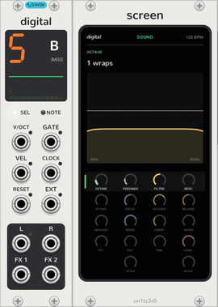</picture>

## The panel

A synth track is a slim strip with no dials, since the [Sequencer](sequencer.md)'s turn them. At the top, a status
screen:

- **Track:** the Sequencer track it plays, as a big digit beside that track's icon and name. The icon lights white
  while the Sequencer has the track selected. Off the bus the digit is a dash, and the track plays from its inputs.
- **Scope:** its output, the last 1024 samples at ±5V.
- **Voices:** a dot per voice, as bright as its envelope.
- **Level:** its output in twelve segments, green, then yellow, then red as it goes into the soft limit.

Under it, **SEL** lights while the Sequencer has its track selected, and **NOTE** glows while it plays. Its jacks fill
the rest.

## Pages

Like the hardware, a track has four dials whose job changes with the page. They are the Sequencer's four while its
track is selected there: click **SHIFT** or one of the Sequencer's page keys to turn the page, and its dial LEDs
glow in the page's colour. A [Screen](screen.md) beside the track shows every dial on every page and turns them by
touch, with or without a Sequencer.

| Page | Dials |
| --- | --- |
| Sound (green) | The engine's two dials, **Filter** (low-pass to the left, high-pass to the right, open in the middle), **Reso** |
| Envelope (blue) | **Attack**, **Decay**, **Sustain**, **Release**, 1 ms to 10 s |
| LFO (yellow) | **Amount** (off in the middle), **Speed** (synced 1/64 to 2/1 to the left, free 8 s to 20 Hz to the right), **Target**, **Shape** |
| Arp (yellow, on the arp track in place of the LFO) | **Speed**, **Pattern**, **Style**, **Range**; see [Arp](#arp) |
| Mix (red) | **FX 1** and **FX 2** (sends to the [FX modules](fx-tracks.md), or to the outputs of the same names), **Pan**, **Level** |
| Track (white) | **Style** (poly, mono, legato) on the second dial, **Glide** (mono and legato) on the fourth |

**Track mode:** the Sequencer's **TRACK**, or the track row on a Screen, puts the note style and portamento on the
dials. It stands in for holding the hardware's track key.

## Playing

- **Notes:** an engine has no keys of its own. Placed to the right of a [Sequencer](sequencer.md), it plays its
  track from there, follows its tempo, and its dials are the Sequencer's while its track is selected. A patched
  **GATE** plays the poly **V/OCT**, **GATE** and **VEL** inputs instead, and a patched **CLOCK** sets the LFO's
  tempo.
- **Parameter locks:** a Sequencer step can lock any of the track's dials while it plays. The engine plays the
  locked value and the dial stays where it is; see [the Sequencer](sequencer.md#steps).
- **Note styles:** poly plays each gate channel on its own voice. Mono plays the newest held note and retriggers
  the envelope on every change, including falling back to an older note. Legato does the same without retriggering.
- **LFO targets:** the two sound dials, filter, resonance, attack, pitch (up to ±2 octaves), pan and level.
- **LFO shapes:** sine, triangle, square, saw, random and external are free-running and bipolar. Bell, triangle,
  square, saw, random and single saw are unipolar and restart with every note (but not legato slides), so they work
  as a second envelope. External follows the **EXT** input, ±5V, in place of the OP-Z's motion sensor.
- **Clock:** the synced speeds follow the **CLOCK** input, at 4 pulses per beat unless you change it in the context
  menu; unpatched, the Sequencer's tempo, or 120 BPM without one. **RESET** restarts the LFO.

## Arp

<picture><source media="(prefers-color-scheme: dark)" srcset="assets/guide/arp-screen-dark.png"></picture>

On the arp track, track 7, the LFO page is the arpeggiator's, and the track has no LFO. Hold notes or a chord, from
the steps, the keys or the inputs, and it plays them one at a time on the tempo's grid, in key: the master track
moves its notes as it moves any track's, while they're held.

- **Speed** (green): off fully left, which plays the notes as they are; then 1/4, 1/8, 1/8 triplets, 1/16, 1/16
  triplets, 1/32, 1/32 triplets and 1/64. Swing moves its notes as it moves the steps.
- **Pattern** (blue): as played, up, down, up and down, down and up, or random.
- **Style** (yellow): a rhythm of accents over the notes, H as played, M at three quarters, L at half, and - a
  rest: as set, LHLLHLLH, HLLHLLHL, LLHLLHLL, LMH, or LL- (two notes, then a rest).
- **Range** (red): 1 to 4 octaves of the notes, low to high.

Each note lasts half the time to the next. The first plays as soon as the notes are held; while stopped, the grid
starts with it. Mono with portamento slides from note to note, as the guide suggests. A step can lock the arp's
dials like any other. A patch saved before the arp opens with it off, so the arp track plays as it did.

## Jacks

- **Outputs:** **L** carries a mono mix while **R** is unpatched. With both unpatched, the track also goes, in
  stereo, to the Sequencer's **L** and **R**. **FX 1** and **FX 2** carry the track after its level, before the pan,
  for patching to effects; patched, that send no longer goes to its [FX module](fx-tracks.md).
- **Jack LEDs:** green follows each jack's level. Red means clipping: above 10V on an input, or into the soft limiter
  that keeps the outputs within ±10V. An unpatched output shows nothing.

## The engines

<picture><source media="(prefers-color-scheme: dark)" srcset="assets/modules/Digital-small-dark.png">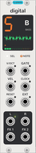</picture> <picture><source media="(prefers-color-scheme: dark)" srcset="assets/modules/Analog-small-dark.png">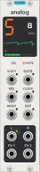</picture> <picture><source media="(prefers-color-scheme: dark)" srcset="assets/modules/Cluster-small-dark.png"></picture> <picture><source media="(prefers-color-scheme: dark)" srcset="assets/modules/Organ-small-dark.png"></picture> <picture><source media="(prefers-color-scheme: dark)" srcset="assets/modules/Bow-small-dark.png">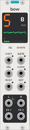</picture> <picture><source media="(prefers-color-scheme: dark)" srcset="assets/modules/Electric-small-dark.png"></picture> <picture><source media="(prefers-color-scheme: dark)" srcset="assets/modules/Saw-small-dark.png">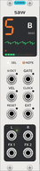</picture> <picture><source media="(prefers-color-scheme: dark)" srcset="assets/modules/Shade-small-dark.png">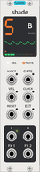</picture> <picture><source media="(prefers-color-scheme: dark)" srcset="assets/modules/Uranus-small-dark.png"></picture> <picture><source media="(prefers-color-scheme: dark)" srcset="assets/modules/Volt-small-dark.png">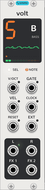</picture> <picture><source media="(prefers-color-scheme: dark)" srcset="assets/modules/EP-small-dark.png">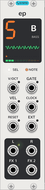</picture>

| | Engine | Sound | First dial | Second dial |
| --- | --- | --- | --- | --- |
| <picture><source media="(prefers-color-scheme: dark)" srcset="assets/modules/Digital-label-dark.png">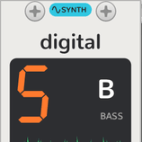</picture> | Digital | A sine on a binary counter, driven past full scale so it wraps around like an overflowing integer | **Octave**: how many times each peak wraps, 0 to 7 | **Feedback**: how hard the sine modulates its own phase, leaning it towards a saw |
| <picture><source media="(prefers-color-scheme: dark)" srcset="assets/modules/Analog-label-dark.png">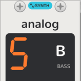</picture> | Analog | A saw, a square an octave below and noise, through a low-pass the amp envelope opens | **Mix**: saw, then saw and sub, then sub and noise | **Envelope**: how far the filter closes between notes, for the envelope to sweep it up to eight octaves |
| <picture><source media="(prefers-color-scheme: dark)" srcset="assets/modules/Cluster-label-dark.png"></picture> | Cluster | Seven detuned saws per note | **Tone**: a low-pass that follows the note, from a near sine to fully bright | **Gravity**: pulls the saws together, from almost two semitones each way to one saw |
| <picture><source media="(prefers-color-scheme: dark)" srcset="assets/modules/Organ-label-dark.png"></picture> | Organ | Up to four sine carriers and one modulator, in eight algorithms | **Algorithm**: flute, jazz, full and gospel drawbars, reed, pipe, combo, bell | **Tweak**: FM depth, from pure drawbars to grit |
| <picture><source media="(prefers-color-scheme: dark)" srcset="assets/modules/Bow-label-dark.png">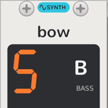</picture> | Bow | A bowed string as a waveguide; the bow's speed follows the amp envelope, so a note swells in and rings on | **Tension**: bow pressure and the string's brightness, from airy to biting | **Chorus**: a second string either side of the note, up to 9 cents each way |
| <picture><source media="(prefers-color-scheme: dark)" srcset="assets/modules/Electric-label-dark.png"></picture> | Electric | Two sines modulating each other's phase, opened up by the amp envelope | **Cross mod**: how hard, from two pure tones to a snarl | **X mod**: the second sine's ratio to the note, 0.5 to 4 through the inharmonic ratios between |
| <picture><source media="(prefers-color-scheme: dark)" srcset="assets/modules/Saw-label-dark.png">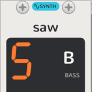</picture> | Saw | Two saws a few cents apart through a resonant low-pass | **Envelope**: how far the amp envelope opens the filter, for plucks to swells | **Tone**: where the filter sits over the note, and how much it rings |
| <picture><source media="(prefers-color-scheme: dark)" srcset="assets/modules/Shade-label-dark.png"></picture> | Shade | A soft FM piano, a sine modulated by another at its own pitch | **Detune**: a second piano against the first, from unison to a wide chorus | **Drive**: a soft clip, from clean to growling |
| <picture><source media="(prefers-color-scheme: dark)" srcset="assets/modules/Uranus-label-dark.png"></picture> | Uranus | A clean bass: a sine operator that feeds back on itself, as a DX7's does | **Tone**: adds the second and third harmonics | **Feedback**: from a sine towards a saw |
| <picture><source media="(prefers-color-scheme: dark)" srcset="assets/modules/Volt-label-dark.png">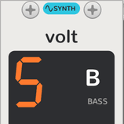</picture> | Volt | A saw, a pulse above it and a triangle sub | **Variation**: the pulse's interval above the saw, unison to two octaves, bringing the sub in as it goes | **Modulation**: a slow sweep of the pulse's width, and ring modulation of saw and pulse |
| <picture><source media="(prefers-color-scheme: dark)" srcset="assets/modules/EP-label-dark.png">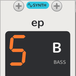</picture> | EP | An FM electric piano in eight algorithms, struck bright and mellowing as it fades | **Algorithm**: tine, bright tine, dyno, reed, soft, bell, glass, toy | **Tone**: how hard the hammer strikes |

A Sequencer has four synth tracks, so four of these play at once; a fifth synth engine along the row has no track
and shows a dash. The OP-Z's twelfth engine, Sample (a PCM sample player), isn't here yet.
