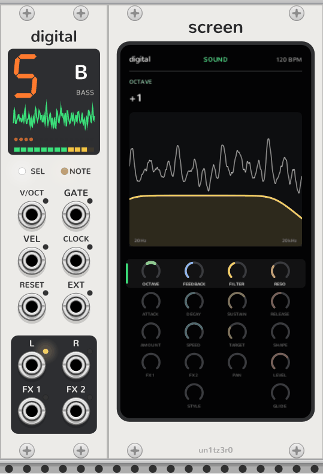
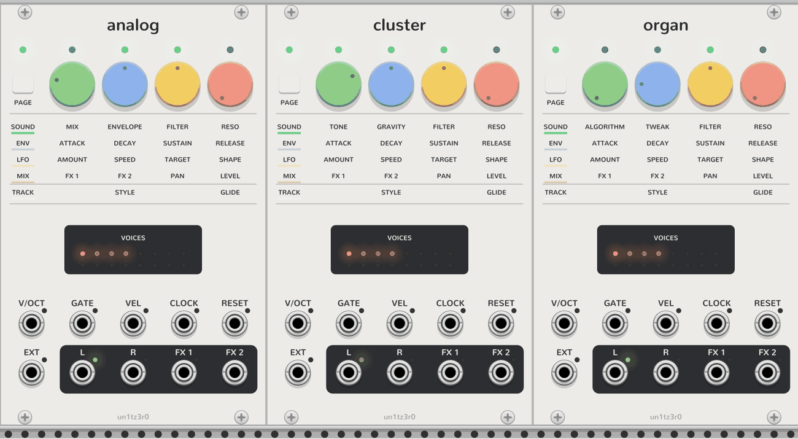

# Synth tracks

Digital, Analog, Cluster, Organ and [Breakout](breakout.md) are all the same OP-Z synth track around a different
sound. Everything on this page but the last section applies to each of them; only their two sound dials differ. The
[drum tracks](drum-tracks.md) share all of it but the note styles and portamento.

<picture>
  <source media="(prefers-color-scheme: dark)" srcset="assets/digital-screen-dark.png">
  
</picture>

## The panel

A synth track is a slim strip with no dials, since the [Sequencer](sequencer.md)'s turn them. At the top, a status
screen:

- **Track:** the Sequencer track it plays, as a big digit beside that track's icon and name. The icon lights white
  while the Sequencer has the track selected. Off the bus the digit is a dash, and the track plays from its inputs.
- **Scope:** its output, the last 1024 samples at ±5V.
- **Voices:** a dot per voice, as bright as its envelope.
- **Level:** its output in twelve segments, green, then yellow, then red as it goes into the soft limit.

Under it, **SEL** lights while the Sequencer has its track selected, and **NOTE** glows while it plays. Its jacks fill
the rest.

## Pages

Like the hardware, a track has four dials whose job changes with the page. They are the Sequencer's four while its
track is selected there: click **SHIFT** or one of the Sequencer's page keys to turn the page, and its dial LEDs
glow in the page's colour. A [Screen](screen.md) beside the track shows every dial on every page and turns them by
touch, with or without a Sequencer.

| Page | Dials |
| --- | --- |
| Sound (green) | The engine's two dials, **Filter** (low-pass to the left, high-pass to the right, open in the middle), **Reso** |
| Envelope (blue) | **Attack**, **Decay**, **Sustain**, **Release**, 1 ms to 10 s |
| LFO (yellow) | **Amount** (off in the middle), **Speed** (synced 1/64 to 2/1 to the left, free 8 s to 20 Hz to the right), **Target**, **Shape** |
| Mix (red) | **FX 1** and **FX 2** (sends to the outputs of the same names), **Pan**, **Level** |
| Track (white) | **Style** (poly, mono, legato) on the second dial, **Glide** (mono and legato) on the fourth |

**Track mode:** the Sequencer's **TRACK**, or the track row on a Screen, puts the note style and portamento on the
dials. It stands in for holding the hardware's track key.

## Playing

- **Notes:** an engine has no keys of its own. Placed to the right of a [Sequencer](sequencer.md), it plays its
  track from there, follows its tempo, and its dials are the Sequencer's while its track is selected. A patched
  **GATE** plays the poly **V/OCT**, **GATE** and **VEL** inputs instead, and a patched **CLOCK** sets the LFO's
  tempo.
- **Parameter locks:** a Sequencer step can lock any of the track's dials while it plays. The engine plays the
  locked value and the dial stays where it is; see [the Sequencer](sequencer.md#steps).
- **Note styles:** poly plays each gate channel on its own voice. Mono plays the newest held note and retriggers
  the envelope on every change, including falling back to an older note. Legato does the same without retriggering.
- **LFO targets:** the two sound dials, filter, resonance, attack, pitch (up to ±2 octaves), pan and level.
- **LFO shapes:** sine, triangle, square, saw, random and external are free-running and bipolar. Bell, triangle,
  square, saw, random and single saw are unipolar and restart with every note (but not legato slides), so they work
  as a second envelope. External follows the **EXT** input, ±5V, in place of the OP-Z's motion sensor.
- **Clock:** the synced speeds follow the **CLOCK** input, at 4 pulses per beat unless you change it in the context
  menu; unpatched, the Sequencer's tempo, or 120 BPM without one. **RESET** restarts the LFO.

## Jacks

- **Outputs:** **L** carries a mono mix while **R** is unpatched. With both unpatched, the track also goes, in
  stereo, to the Sequencer's **L** and **R**. **FX 1** and **FX 2** carry the track after its level, before the pan,
  for patching to effects.
- **Jack LEDs:** green follows each jack's level. Red means clipping: above 10V on an input, or into the soft limiter
  that keeps the outputs within ±10V. An unpatched output shows nothing.

## The engines

<picture>
  <source media="(prefers-color-scheme: dark)" srcset="assets/engines-dark.png">
  
</picture>

| Engine | Sound | First dial | Second dial |
| --- | --- | --- | --- |
| Digital | Two binary-counter oscillators reading a 32-step, 4-bit sine with no interpolation, one frequency-modulating the other | **Octave**: the modulator's pitch, in octaves from the note | **Feedback**: FM depth |
| Analog | A saw, a square an octave below and noise, through a low-pass the amp envelope opens | **Mix**: saw, then saw and sub, then sub and noise | **Envelope**: how far the filter closes between notes, for the envelope to sweep it up to eight octaves |
| Cluster | Seven detuned saws per note | **Tone**: a low-pass that follows the note, from a near sine to fully bright | **Gravity**: pulls the saws together, from almost two semitones each way to one saw |
| Organ | Up to four sine carriers and one modulator, in eight algorithms | **Algorithm**: flute, jazz, full and gospel drawbars, reed, pipe, combo, bell | **Tweak**: FM depth, from pure drawbars to grit |
