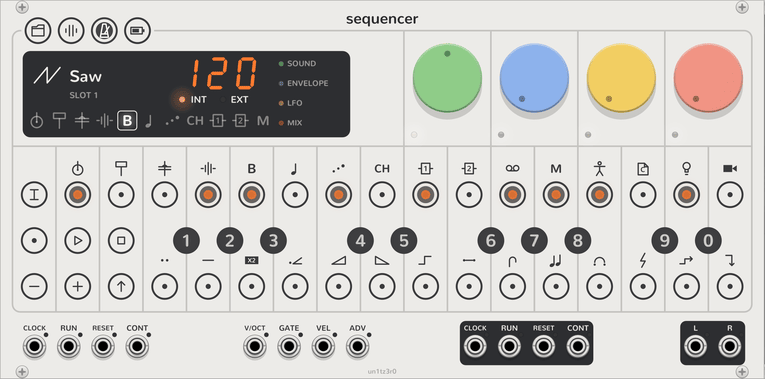

# Tempo

<picture><source media="(prefers-color-scheme: dark)" srcset="assets/keys/face-tempo-dark.png"></picture>

The Sequencer keeps the tempo for every track. The tempo readout on the display shows it. Click **TEMPO** to latch
tempo mode. Click it again to release it. The **TEMPO** key flashes on each beat while the Sequencer plays.

## Set the tempo

In tempo mode, do one of these:

- **Type it:** click three black keys, such as 1, 2 and 0 for 120.
- **Tap it:** click a white key on each beat.
- **Move it a little:** click **−** or **+** to move the tempo one beat a minute.
- **Turn it:** turn the green dial.

The tempo goes from 40 to 200 beats a minute. It starts at 120.

## The dials

| Dial | Setting |
| --- | --- |
| Green | **Tempo**, 40 to 200. |
| Blue | **Swing**: from 50%, which is straight, to 75%. It delays every second sixteenth. |
| Yellow | **Metronome sound**: click, wood, beep, cowbell, hat or blip. The first beat of each bar plays higher. |
| Red | **Metronome level**. Fully left is off. The metronome plays into **L** and **R** while the Sequencer plays. |

The project slot saves the tempo, the swing and the metronome with the song.

## An outside clock

Patch a clock to the **CLOCK** input, and it sets the tempo. **EXT** lights in place of **INT**.

- The clock gives 4 pulses for each beat. To change this, right-click the Sequencer and open **Clock pulses per
  beat**. The choices go from 1 to 96.
- The display shows dashes until it has timed two pulses.
- **PLAY** then waits for the next pulse. The Sequencer follows the pulses when they become faster, slower, or stop.

The **CLOCK** output gives pulses while the Sequencer plays, at the same rate. Use it to clock other modules.

## One step for each trigger

A track whose step length is **Per ADV trigger** (black key 0 in track mode with **SHIFT**) does not follow the
tempo. It moves one step for each trigger at the **ADV** input. See [Track](track.md#step-count-and-step-length).
