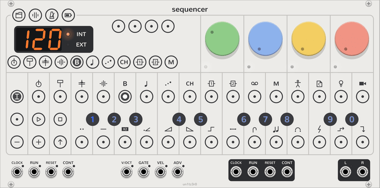

# Track

<picture><source media="(prefers-color-scheme: dark)" srcset="assets/keys/face-track-dark.png"></picture>

A track is one part of the song, with its own steps and its own sound. This page tells how to select a track, change
its sound with plugs, presets and dials, and set how it plays its steps. [How it works](how-it-works.md#tracks) lists
the tracks.

## Select a track

Click the track's key along the bottom of the display. The keys are tracks 1 to 8, then FX 1, FX 2 and **MASTER**.
Hover over a key to see the track's name.

The keys, the steps, the dials and recording then work on that track. You can also select a track in track mode: see
below.

## Pages

The four dials have four jobs each. A set of jobs is a **page**:

| Page | Colour | The dials |
| --- | --- | --- |
| Sound | Green | The plug's two sound dials, then the filter and the resonance. |
| Envelope | Blue | Attack, decay, sustain, release. |
| LFO | Yellow | Amount, speed, target, shape. On track 7 (arp), the arpeggiator in its place. |
| Mix | Red | FX 1 send, FX 2 send, pan, level. |

To change the page, click **SHIFT**, or click a page name on the display. The page name lights, and the small lights
under the dials take its colour. Hover over a dial to see its name and value.

Each kind of track has its own dials: see [synth tracks](synth-tracks.md#pages), [drum tracks](drum-tracks.md#pages)
and [FX tracks](fx-tracks.md#dials). A [Screen](screen.md) shows every dial of the track at once.

## Track mode

Click **TRACK** to latch track mode. Click it again to release it. In track mode:

- Steps 1 to 8 select tracks 1 to 8. Steps 9 and 10 select the FX tracks, and step 12 the master track.
- The black keys are the track's ten [plug slots](#plugs). The white keys are the plug's 14 [presets](#presets).
- **REC** gives the track a [random sound](#presets).
- **−** and **+** move the whole pattern one step earlier or later.
- The dials set how the track plays its notes:

| Dial | Setting | Range |
| --- | --- | --- |
| Green | **Note length**: the length of each note at the default length. | 1/64 to 1 bar, with the dotted values between, then **Drone**. It starts at 1/16. |
| Blue | **Note style**: how new notes take the voices. | Each kind of track has its own. See [synth tracks](synth-tracks.md#playing) and [drum tracks](drum-tracks.md#note-styles). |
| Yellow | **Quantize**: pulls each note's micro timing toward the step as it plays. | 0 to 100%. |
| Red | **Portamento**: how long a note glides to its pitch, in the mono and legato styles. | Synth tracks only. |

## Plugs

A track's sound is its **plug**: an engine on a synth track, a kit on a drum track, and an effect on an FX track.
Each track has ten plug slots. The plug readout on the display shows the plug that plays, with its icon, its plug
slot and its preset.

1. Latch **TRACK**. The black keys light white: brightest for the plug slot that plays, dim for the other full ones.
2. Click a black key. The track plays that plug from its next note. The notes of the last plug continue to their end.
3. Release **TRACK**.

Each plug slot keeps its plug's dials, so a plug returns with the sound that you left it with. A drum track is
different: all its kits use the track's one set of dials.

### Fill the plug slots

A new Sequencer fills every plug slot. To put another plug in a plug slot:

1. Right-click the Sequencer and open **Plug slots**.
2. Open the track, then the plug slot.
3. Click a plug. On a drum track, choose a kit, or load one from a file: see [Kits](kits.md).

**Empty** clears a plug slot. You cannot empty the plug slot that plays. Each change in this menu is one step of
Rack's undo.

A patch from before version 2.1.0 had a module for each track's engine. The Sequencer opens such a patch with each
track's plug, dials and kit file from those modules. Rack lists the old modules as missing. Save the patch again, and
it no longer needs them.

## Presets

Each plug has 14 presets, on the white keys in track mode. The same presets work in every patch.

- **Load:** latch **TRACK** and click a white key. The track takes the preset's dials.
- **Store:** latch **TRACK** and long-press a white key, or Ctrl+click it. The preset takes the track's dials.
- **Random sound:** latch **TRACK** and click **REC**. The Sequencer gives the sound, envelope and LFO pages random
  values. The mix page does not change.

The white key of the preset that you loaded lights brightly, and stored presets light dimly. Preset 1 starts as the
plug's default dials. A preset holds the sound, envelope, LFO and mix pages, the note style and the portamento. It
does not hold the arp's dials, which belong to the pattern.

The Sequencer writes presets at once to `vcvopxyz/presets/` in Rack's user folder. A load, a store, a random sound and
a plug change are each one step of Rack's undo.

## Step count and step length

The **step count** is how many of its 16 steps a track plays. The **step length** is how long each step lasts.

1. Latch **TRACK**, then latch **SHIFT**.
2. Click a step to set the step count. The track now plays from step 1 to that step.
3. Click a black key to set the step length. The black key lights blue.
4. Release **SHIFT** and **TRACK**.

| Black key | 1 to 8 | 9 | 0 |
| --- | --- | --- | --- |
| Step length | 1 to 8 sixteenths | 16 sixteenths | One step for each trigger at the **ADV** input |

Each track loops at its own step count and step length. Tracks of different lengths drift against each other until
a [chain](project.md#chains) brings them back together. On the master track, the black keys always set the step
length, because it has no plugs.

## Polyphony

A track's polyphony is how many voices it plays at once. To change it, select the track, right-click the Sequencer,
and open **polyphony**. The menu item has the track's name.

| Tracks | Voices at the start |
| --- | --- |
| 1 to 4 (drums) | 2 |
| 5 (bass), 7 (arp) | 1 |
| 6 (lead) | 3 |
| 8 (chord) | 4 |

A new note takes the voice that has been silent longest. If every voice plays, it takes the voice that has played
longest. On track 7, while the arp is on, the polyphony counts the notes that the arp holds.
